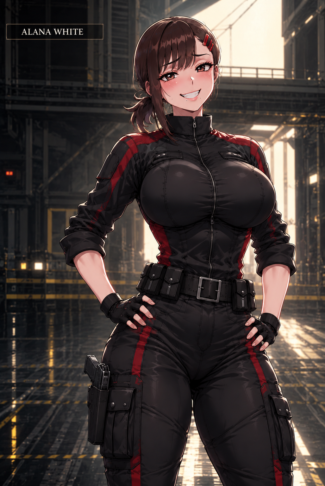

# FICHA DE PERSONAGEM: ALANA WHITE

*Auxiliar de logística da Leopard Mako, dos Tubarões. Civil de Skye, sequestrada aos dezenove anos, sobrevivente entre piratas.*

*"White!", para Haddix. "Boneca", para quem não a leva a sério. "Alana", para Azami, que quase nunca diz o nome.*

> Legenda das categorias: **[CÂNONE]** conferido no Sarna.net em 26/11/2026 (fontes no fim) · **[JOGADOR]** definido pelo jogador, no roteiro do Capítulo 2 ou no pedido desta ficha · **[CAP. 2]** estabelecido na narração do Capítulo 2 · **[imagem]** tirado da imagem de referência · **[INVENÇÃO]** criado nesta ficha, e por isso vetável · **[a definir]** fica para o jogador ou para a narrativa. O que não traz marca é invenção.
>
> O jogador deu liberdade para preencher as lacunas da história dela. As invenções estão todas marcadas. A ficha descreve Alana até a noite do pouso da Gibraltar em Waycross, ponto em que o Capítulo 2 está.

---

## 1. Identificação

| Campo | Dado |
|---|---|
| Nome | **Alana White** [JOGADOR]. Nome completo: Alana Moira White, com o nome da mãe no meio [INVENÇÃO]. |
| Como a chamam | "White!", Haddix, aos gritos [CAP. 2]. "White", Kroll e a tripulação [CAP. 2]. "Boneca", Haddix quando quer diminuí-la [CAP. 2]. "Alana", os poucos amigos e Azami [CAP. 2]. "A secretária do Kroll", o resto da Rocha [INVENÇÃO]. |
| Nascimento | **3003**, em Raina, no continente de New Scotland, planeta Skye, Comunidade de Lyran [CÂNONE quanto à cidade e ao planeta; INVENÇÃO quanto a ser a cidade dela]. Dia e mês [INVENÇÃO]: 14 de fevereiro, para que tenha 23 anos em Waycross. |
| Idade | 23 anos [JOGADOR] |
| Origem | Filha de um comerciante de Skye, dono de um armazém de importação [JOGADOR; CAP. 2] |
| Línguas | Inglês. Sabe números, pesos e frases de balcão em alemão, a outra língua do comércio lirano [INVENÇÃO]. Tem o sotaque de Skye, que puxa os erres e abre as vogais [INVENÇÃO]. |
| Formação | Diploma de técnica de logística de uma escola comercial de Skye, aos dezoito anos [CAP. 2] |
| Função | Auxiliar de logística da *Mako*, Leopard dos Tubarões, sob o mestre de logística Lorne Haddix [JOGADOR; CAP. 2] |
| Na *Mako* desde | Início de 3024. Pouco mais de dois anos [CAP. 2: "em dois anos"; INVENÇÃO quanto à data] |
| Situação real | Civil, nem livre nem presa. Circula pela nave e pela base, mas não tem documentos, dinheiro ou um lugar para onde ir. Kroll diz que ela lhe deve o preço que pagou por ela [INVENÇÃO]. |
| Situação legal | Vítima de sequestro na Comunidade de Lyran [JOGADOR]. Para a Federação dos Sóis, uma tripulante de nave pirata. |
| Armada | Uma pistola no coldre da coxa direita, dada pelo capitão [JOGADOR; imagem] |
| Patrimônio | O grampo vermelho do cabelo, um diploma que ficou em Skye e o que cabe nos bolsos do cinto |
| Onde está na noite do pouso | Na borda da rampa aberta da *Mako*, olhando a base, com a prancheta contra o peito, enquanto a nave é reabastecida para decolar às seis [CAP. 2] |

---

## 2. Aparência

### 2.1 Corpo e rosto
- **Estatura:** 1,65 m [JOGADOR]; 58 kg [INVENÇÃO].
- **Corpo:** cintura fina, quadris largos e seios fartos, um corpo que chama atenção em qualquer porto e que ela não escolheu mostrar [JOGADOR]. Ela sabe exatamente como os outros olham para ele [JOGADOR]. Por baixo, tem a constituição de quem passou a vida subindo rampas e carregando pranchetas e caixas pequenas: pernas firmes e braços mais fortes do que parecem [INVENÇÃO].
- **Rosto:** redondo e expressivo, de bochechas cheias que coram com facilidade, queixo pequeno e nariz curto e arrebitado [imagem]. É um rosto feito para sorrir, e ela sorri quase sempre, com os dentes à mostra e os olhos apertados [imagem; JOGADOR].
- **Olhos:** castanho-claros, de um tom de mel quando pega luz [JOGADOR; imagem]. Sorriem mesmo quando a boca não sorri [CAP. 2].
- **Pele:** clara, com rubor fácil nas bochechas e nas orelhas [JOGADOR; imagem].
- **Cabelo:** castanho, liso, na altura dos ombros quando solto [JOGADOR; INVENÇÃO quanto ao tamanho]. Usa um rabo de cavalo curto e baixo, na nuca, preso com um elástico de borracha de amarrar caixa [CAP. 2; imagem]. Franja repicada caindo de lado, sobre o olho esquerdo, e mechas soltas ao redor do rosto [imagem]. Do lado esquerdo da cabeça, um grampo de cabelo vermelho, de duas barrinhas [imagem]. Ver 2.3.
- **Mãos:** pequenas, ágeis, de dedos curtos. As unhas são roídas até o sabugo [CAP. 2]. Tem a ponta do dedo médio direito calejada de segurar lápis o dia inteiro [INVENÇÃO]. Uma cicatriz fina na palma esquerda, de um arame de lacre que cortou fundo no primeiro mês na *Mako* [INVENÇÃO].
- **Postura e movimento:** anda depressa, em passos curtos, com um saltitado que vira os rostos dos homens na *Mako*; Azami sabe que ela odeia ter de usar esse passo [CAP. 2]. Parada, põe as mãos na cintura ou abraça a prancheta contra o peito [imagem; CAP. 2]. Quando ouve o próprio nome num rádio, os ombros sobem um centímetro e o sorriso não sai do lugar [CAP. 2].
- **Expressão:** aberta, alegre e um pouco travessa [imagem]. Quando acha que ninguém está olhando, o rosto cai de uma vez, e fica cansado [CAP. 2: "Não conseguia sorrir, e não havia ninguém ali para quem precisasse sorrir."].

### 2.2 O macacão
- **O que é:** o macacão de tripulação da *Mako* [JOGADOR]. Preto, de tecido grosso de lona sintética, com faixas vermelhas nos ombros e descendo pela lateral dos braços e das pernas [imagem]. Gola alta, zíper central da gola até a cintura, dois bolsos de aba no peito, cotoveleiras e joelheiras de reforço [imagem].
- **O tamanho:** dois números abaixo do dela, mandado fazer assim de propósito pelo capitão Kroll [JOGADOR; CAP. 2]. Ela não escolheu. Usa todos os dias como se tivesse escolhido [CAP. 2].
- **O que ela fez com ele** [INVENÇÃO sobre a imagem]: dobrou as mangas até o meio do antebraço, porque se esticar os braços com a manga desdobrada as costuras dos ombros reclamam. Diz que é para não sujar o punho de graxa.
- **A piada:** "Se eu respirar fundo, rasga, e a gente perde um macacão novinho. Eu respiro de pouquinho em pouquinho, para economizar." [CAP. 2] Disse isso a Kroll na frente dos carregadores, e eles riram com ela, e não dela.
- **Cinto** [imagem; INVENÇÃO quanto ao conteúdo]: preto, largo, com fivela retangular de aço e quatro bolsas pequenas de aba. Nelas vão as ferramentas dela: tocos de lápis, um giz de cera para marcar caixa, um rolo de fita adesiva, um maço de etiquetas de lacre, uma régua de cálculo de bolso que foi do pai, três elásticos de amarrar caixa de reserva e o carregador sobressalente da pistola.
- **Luvas:** pretas, sem dedos, de couro sintético [imagem]. São de trabalho, para não cortar a mão nas cintas de carga. Tira para escrever.
- **Coldre e bolsos:** coldre preto de coxa, na direita, com a pistola; uma bolsa de coxa por baixo dele; um bolso cargo na coxa esquerda [imagem].
- **Botas:** de cano curto, de sola de borracha, boas para rampa [INVENÇÃO].

### 2.3 O grampo vermelho [INVENÇÃO]
É a única coisa que veio de Skye. Estava no cabelo dela na noite do armazém, quando os credores entraram (ver 4.4), e ninguém se deu ao trabalho de tirar. Foi o pai quem deu, quando ela fez dezesseis anos, comprado de um mascate do porto de Raina porque era "da cor do batom que a tua mãe usava". Ela o prende sempre do mesmo lado, acima da orelha esquerda. Quando está nervosa, tira o grampo, abre e fecha a mola e põe de volta.

### 2.4 A pistola
**PI-04 · Tharkad Waffenwerke P-12 "Adler"** [arsenal do projeto, `Armas_e_Equipamento_de_Infantaria.md`; escolha de modelo INVENÇÃO].
- Pistola de serviço da LCAF, de 2970, calibre 9×22 mm Padrão, carregador de 15, 0,9 kg, 110 C-bills. Aço usinado com acabamento cinza-azulado, tão escuro que parece preto, e uma águia pequena gravada na empunhadura.
- **Quem deu:** o capitão Kroll [JOGADOR]. Ver 4.8.
- **Por que essa** [INVENÇÃO]: saiu de uma caixa de excedente da LCAF que os Tubarões revendiam. Kroll achou graça: "Uma águia de Tharkad pra minha lirana."
- **Para quê:** para o caso de alguém tentar alguma coisa com ela [JOGADOR].
- **Como ela leva** [INVENÇÃO]: carregador cheio, câmara vazia e trava acionada, como o sargento ensinou. Precisa de dois movimentos para atirar, e sabe que isso é lento. Tem o carregador sobressalente numa das bolsas do cinto: trinta tiros ao todo.
- **O que ela sabe fazer:** destravar, recarregar, mirar e disparar. Conhece o coice da própria arma [JOGADOR]. Não é profissional [JOGADOR].
- **O que ela nunca fez:** atirar em alguém [INVENÇÃO].
- **A ironia** [INVENÇÃO]: Alana carrega uma pistola carregada pelo corredor do convés três, a dois metros da cela de Azami, que carrega a dela vazia.

---

## 3. Cronologia

| Data | Acontecimento |
|---|---|
| 14/02/3003 | Nasce em Raina, Skye [INVENÇÃO sobre a idade dada pelo jogador]. |
| 3010 (7 anos) | A mãe, Moira, morre de uma febre de inverno [INVENÇÃO]. Alana passa a crescer no armazém do pai. |
| 3015 (12 anos) | Aprende a conferir notas de embarque ao lado do pai, sentada num caixote, com cheiro de lona molhada e café torrado [CAP. 2]. |
| 3019 (16 anos) | Faz o inventário do armazém sozinha [CAP. 2]. Ganha o grampo vermelho [INVENÇÃO]. |
| 3021 (18 anos) | Diploma de técnica de logística numa escola comercial de Skye e carta de recomendação de uma companhia de transportes de Tharkad [CAP. 2]. Adia a ida a Tharkad para ajudar o pai [INVENÇÃO]. |
| 3021–3022 | O armazém afunda em dívidas. O pai pede dinheiro a gente que não aceita atraso [CAP. 2; INVENÇÃO quanto à causa]. |
| 3022 (19 anos) | Os credores levam o armazém, depois o pai, depois ela [CAP. 2]. Dois homens matam o pai enquanto ela se esconde debaixo do balcão [CAP. 2]. |
| 3022–3024 | Porões e naves, vendida e comprada [CAP. 2]. Uma noite, a nave em que está é atacada, e os donos mudam [CAP. 2]. |
| Início de 3024 | Um ano e meio depois do sequestro, chega a Waycross a bordo da *Mako*, comprada por Kroll [CAP. 2; INVENÇÃO quanto à compra]. |
| 3024 | Primeira semana: começa a fazer amigos na tripulação, "com piada, com café, com fofoca" [CAP. 2]. Primeiro mês: corta a mão num arame de lacre [INVENÇÃO]. |
| Início de 3025 | Azami chega à *Mako* como prisioneira [CAP. 2; ficha de Azami]. Pouco depois, Alana começa a levar comida escondida à cela dela [CAP. 2; INVENÇÃO quanto à data]. |
| Meados de 3025 | Um carregador bêbado a encurrala no porão. Kroll lhe dá a pistola [JOGADOR quanto à pistola; INVENÇÃO quanto ao episódio]. |
| Dia do pouso da Gibraltar (fim de março ou início de abril de 3026) | Leva comida a Azami de manhã; confere a carga da Gibraltar; descobre que falta peso no item 41, o Centurion; espera Azami descer do 'Mech [CAP. 2]. |
| Manhã seguinte, 06:00 | Decolagem prevista da *Mako*. A *Resolute*, das AFFS, ataca antes [CAP. 2]. |

---

## 4. História

### 4.1 Raina
Skye é o coração da antiga Federação de Skye, uma das três potências que fundaram a Comunidade de Lyran, e muita gente na região ainda se considera de Skye primeiro e lirana depois [CÂNONE quanto à região]. A Comunidade construiu sua grandeza no comércio; é um reino de mercadores, governado pelo Arconte, por casas nobres e por combinados comerciais [CÂNONE]. Em 3026, a Arconte é Katrina Steiner, e o líder do movimento separatista de Skye é o duque Aldo Lestrade [CÂNONE].

Raina é uma cidade do continente de New Scotland, em Skye, conhecida pela universidade [CÂNONE]. A Raina de Alana é a outra, a do bairro do porto de cargas, longe da universidade: ruas de armazéns, oficinas de conserto de empilhadeira, botecos de estivador e o barulho das naves descendo no espaçoporto [INVENÇÃO].

O pai, **Alistair White** [INVENÇÃO], era dono do **Armazém White, Importação e Cabotagem** [INVENÇÃO], um depósito de dois andares que comprava lotes de carga das DropShips mercantes e revendia no varejo da cidade: café, lona, ferragens, tecido, conserva. Era um homem grande, de barba ruiva, que falava alto, ria mais alto ainda e sabia o nome de todos os estivadores do porto [INVENÇÃO]. Fazia mal as contas e bem os amigos.

A mãe, **Moira White** [INVENÇÃO], cuidava dos livros do armazém. Morreu de uma febre de inverno quando Alana tinha sete anos. Depois disso, os livros ficaram com o pai, e o pai não sabia cuidar deles.

### 4.2 O armazém
Alana cresceu ali. Tinha um caixote só dela ao lado da mesa do pai [CAP. 2]. Aos doze anos, aprendeu com ele a conferir notas de embarque, com cheiro de lona molhada e café torrado, enquanto ele trabalhava de lápis atrás da orelha [CAP. 2]. Aos dezesseis, já fazia o inventário sozinha [CAP. 2]. Aos dezessete, já fazia sozinha também os livros que a mãe fazia, e escondia do pai o tamanho do buraco [INVENÇÃO].

Era a menina do armazém. Os estivadores a conheciam desde os sete anos e a tratavam como sobrinha; os capitães de DropShip que vendiam lotes ao pai lhe traziam doce de outros mundos [INVENÇÃO]. Foi ali que ela aprendeu que uma piada no lugar certo abre mais porta que uma reclamação, que todo homem fala mais quando está rindo e que um balcão cheio de gente é um lugar seguro [INVENÇÃO].

Foi ali também que o corpo dela mudou, aos catorze, quinze anos, e os olhares dos estivadores mudaram junto [INVENÇÃO]. O pai fingia não ver. Ela aprendeu sozinha a desviar: fazendo rir, puxando assunto, devolvendo o olhar para o rosto dela com uma pergunta. Ninguém lhe ensinou. Ela descobriu que funcionava.

### 4.3 A escola comercial e a carta de Tharkad
Aos dezoito anos, tirou o diploma de técnica de logística numa escola comercial de Skye [CAP. 2]. Era a primeira da turma em estiva e balanceamento de carga e a última em contabilidade de impostos, que achava a coisa mais chata do universo [INVENÇÃO].

No fim do curso, recebeu uma carta de recomendação de uma companhia de transportes de Tharkad [CAP. 2]. [INVENÇÃO] Era a **Transportes Hollenbeck**, uma casa de fretes de médio porte, cujo intendente-chefe a conheceu numa feira de cargas de Raina e lhe ofereceu um lugar de aprendiz de intendente na sede, na capital da Comunidade. Era a porta de saída de Raina, de um armazém afundando e de uma vida inteira atrás de um balcão.

Ela adiou. O pai estava mal, os livros estavam piores, e ela achou que um ano bastava para pôr ordem nas contas. Guardou a carta na gaveta da mesa do armazém [INVENÇÃO]. A carta deve estar lá até hoje, se o armazém ainda existir.

### 4.4 A noite do balcão
O pai devia dinheiro a gente que não aceitava atraso. Ela nunca soube quanto [CAP. 2].

[INVENÇÃO] Ela sabe de onde veio a dívida, porque estava nos livros: em 3020, o pai financiou um lote grande de café de Donegal, o maior negócio da vida dele, com dinheiro do banco. A DropShip que trazia o café foi apreendida pela alfândega por causa de outra carga, e o café apodreceu num pátio. O banco cobrou. O pai pegou dinheiro com quem empresta sem perguntar para pagar o banco, e depois com outros para pagar os primeiros. A Máfia tem presença forte na Comunidade de Lyran [CÂNONE], e esses empréstimos sempre acabam nela de algum jeito.

Numa noite de 3022, dois homens entraram no armazém. O pai mandou que ela se escondesse debaixo do balcão, e ela obedeceu. Ficou lá, com a mão na boca, ouvindo. Quando saiu, o pai estava no chão. Os dois homens a esperavam do lado de fora [CAP. 2].

Ela não sabe quem eram. Não sabe para onde foi o corpo do pai. O grampo vermelho estava no cabelo dela [INVENÇÃO].

### 4.5 Um ano e meio de porões
Depois disso, ela perdeu a conta dos lugares. Um porão, uma nave, outra nave. Gente que a vendia, gente que a comprava [CAP. 2].

[INVENÇÃO] Os dois homens a venderam como pagamento de uma parte da dívida, a um contrabandista que precisava de mão de obra a bordo. Nos porões, foi o que sempre tinha sido: alguém que conta, limpa, cozinha e confere. Descobriu que saber contar carga era o que a mantinha inteira. Um capitão não estraga uma moça que acha cinco toneladas a mais num manifesto. Descobriu também que fazer a tripulação rir a mantinha protegida. Nunca foi violentada. Sabe que foi sorte e sabe exatamente quanta sorte foi.

Numa noite, alguém atacou a nave em que ela estava. Houve tiros, gritos e fumaça e, quando a porta do porão abriu de novo, os homens eram outros, e olharam para ela como se olha uma caixa achada no meio de uma carga roubada. Ela nem sabia quem eram os primeiros. Nunca soube quem eram os segundos [CAP. 2].

### 4.6 Kroll e a *Mako*
Um ano e meio depois do armazém, estava em Waycross, numa Leopard com um tubarão pintado no flanco e um capitão que mandava fazer os macacões dela dois números abaixo [CAP. 2].

**Como chegou** [INVENÇÃO]: os segundos donos a ofereceram num porto da Periferia, junto com um lote de peças, como "serviçal de bordo, sabe contar". Kroll pagou **seis mil e quinhentos C-bills**. Ela sabe o número exato porque, seis meses depois, achou o recibo nos arquivos de Haddix. Kroll a fez tripulante, com nome no rol e um "salário" que ele desconta da dívida, e por isso a dívida nunca diminui. Servidão por dívida é tolerada nas bordas das Casas [INVENÇÃO do projeto, `Politica_Leis_e_Nobreza_3026.md`]. Alana é filha de uma dívida e agora é uma dívida.

**Por que ele a quis:** o único motivo de ela fazer parte da tripulação é que o capitão gosta das curvas dela [JOGADOR].

**O que ela é ali:** auxiliar de logística, com uma formação de verdade que ninguém a bordo leva a sério [JOGADOR]. Não tem nenhuma atribuição de responsabilidade, porque ninguém a considera competente o bastante; para os superiores, ela é no máximo uma secretária bonita [JOGADOR]. Confere caixas, faz inventário, serve café, leva relatórios e sobe escadas quando Kroll quer vê-la subir [CAP. 2].

**A Leopard:** a classe Leopard é das primeiras DropShips projetadas como transporte de 'Mechs desde o início. É simples e fácil de manter, leva uma lança e dois caças, tem as baias de caça muitas vezes convertidas em carga e é a favorita de muitos piratas da Periferia [CÂNONE]. A *Mako* tem quatro baias de 'Mech e duas de caça, com o tubarão de ossos cruzados no flanco [CAP. 2]. As portas de caça não se abriram desde que a *Resolute* chegou à órbita [CAP. 2]. Alana sabe de cor a capacidade de cada baia, a ordem de estiva e o lastro [INVENÇÃO sobre o CAP. 2].

### 4.7 Dois anos assim
Os homens da *Mako* gostam dela. É verdade. Ela cuidou disso desde a primeira semana, com piada, com café, com fofoca, com uma palavra boa para o carregador que tinha brigado com a mulher pelo rádio e um esparadrapo para o soldado que tinha cortado a mão. Ninguém toca nela porque todos gostam dela, todos sabem que os outros gostam, e ninguém quer ser o primeiro. É uma proteção feita de nada. Basta um homem bêbado num dia ruim [CAP. 2].

Ela sorri o tempo todo, para que ninguém veja isso no rosto dela [CAP. 2]. E sofre todo dia com comentários e assédio, como uma das poucas mulheres da tripulação [JOGADOR]. Há só três a bordo: ela, a cozinheira e, desde o início de 3025, a prisioneira do convés três [CAP. 2 quanto à cozinheira e a Azami; INVENÇÃO quanto à contagem].

Haddix transformou o nome dela num grito, e ela transformou o grito num número. Em dois anos, cada "White!" dele quer dizer uma de três coisas: faz isso; para de fazer isso; vem cá que eu quero olhar para você [CAP. 2].

Ela não sabe como sair dessa vida, apesar de querer muito [JOGADOR]. [INVENÇÃO] Os documentos dela ficaram com Kroll. Não tem dinheiro de verdade, só créditos na cantina da Rocha. Waycross é um deserto sem registro desde a Segunda Guerra de Sucessão [CÂNONE], e as únicas naves que saem dali são dos Tubarões. Quando a *Mako* faz uma entrega num porto, ela fica a bordo, por ordem de Kroll.

### 4.8 A pistola [JOGADOR; INVENÇÃO quanto ao episódio]
Em meados de 3025, numa noite de folga da tripulação, um carregador bêbado chamado **Dekker** [INVENÇÃO] a encurralou entre duas pilhas de caixas no porão. A proteção feita de nada não funcionou. Funcionou o grito dela, que chegou a Fitch, outro carregador, e a dois soldados.

No dia seguinte, Dekker apareceu com o rosto quebrado e foi desembarcado na Rocha. Kroll chamou Alana à cabine dele e pôs a pistola na mesa.

— Se algum desses porcos encostar em você, você atira. Na barriga, que é maior.

Ela entendeu o resto sem que ele dissesse: na tripulação, ninguém toca no que é do capitão. A pistola a protege de todos os homens da *Mako*, menos de um.

**O treino.** Kroll mandou o **sargento Abel Kessler** [INVENÇÃO], o sargento da guarda da *Mako* (o mesmo que guarda o carregador de Azami), ensiná-la. Foram quatro tardes no domo de treinamento da Rocha [CAP. 2 quanto ao domo]. Kessler ensinou o que um civil precisa saber: segurança da arma, trava, carregar, descarregar, a posição das duas mãos e a mira, e repetiu a mesma regra até ela decorar: "Arma não é para mostrar. Se sacou, é porque vai atirar." Desde então, ela atira quinze tiros por mês no domo, sob o olho dele, com a munição que Kroll libera.

**Como ela atira** [INVENÇÃO]: com as duas mãos, devagar e com atenção. Conhece o salto do cano da Adler e espera ele voltar antes do segundo tiro [JOGADOR quanto ao coice]. A dez metros, acerta o tronco de um alvo quase sempre; a vinte e cinco, metade das vezes. Nunca atirou com medo, no escuro ou contra quem atira de volta. Ninguém sabe como ela vai se sair na primeira vez, nem ela.

### 4.9 Azami
No início de 3025, a *Mako* ganhou uma prisioneira no convés três: uma MechWarrior do Combine que os Tubarões compraram de um presídio e que quase quebrou o braço do Júnior [ficha de Azami; CAP. 2].

[INVENÇÃO] Alana viu Azami pela primeira vez na escada do convés, entre dois fuzis, de costas retas e sem tocar no corrimão. Achou que era a mulher mais bonita e mais triste que já tinha visto. Na semana seguinte, levou à cela metade do pão da própria ração. Azami mandou que ela fosse embora. Ela voltou no dia seguinte.

É a única amiga de verdade que Alana tem a bordo, apesar de Azami não querer contato [JOGADOR]. Azami é fria e manda que ela pare de ir; Alana a chama de amiga e faz questão de perguntar o que ela quer comer na próxima visita [JOGADOR]. É a única pessoa na nave que não a trata como um rosto bonito [JOGADOR].

Alana não sabe dizer por que vai. Às vezes acha que é porque Azami é a única ali mais presa do que ela. Às vezes acha que é porque Azami nunca olhou para o corpo dela [INVENÇÃO].

### 4.10 O dia do Centurion
**Seis da manhã.** Chega à cela de Azami com o embrulho de pano de prato: duas bolas de arroz feitas à mão, com peixe salgado no meio, um pão doce achatado e uma tangerina pequena e murcha [CAP. 2]. Tentou fazer o bolinho triangular, como Azami contou uma vez, mas o arroz da Rocha solta tudo, e a cozinheira quase a pegou com a mão na panela; disse que procurava o brinco, embora não use brinco [CAP. 2]. Pergunta se ficou feio. Azami diz que ficou. Pergunta se está bom. Azami diz que está. O sorriso de Alana muda: não fica maior, fica verdadeiro, por um segundo [CAP. 2]. Conta que chega uma Mule com um Centurion "da Liga" e que é Azami quem vai levá-lo [CAP. 2]. Arranca de Azami, pela primeira vez, um desejo: missô. Anota na testa, com dois dedos: "Não sai mais." [CAP. 2] Pettigrew acorda, e ela sai com meio passo de dança e uma piada sobre a baba dele [CAP. 2].

**Às 9h40.** Está no pé da rampa da *Mako* quando a Mule pousa. Lê a nave em segundos: mais gorda do que pensava, vinte e poucos anos de casco, remendo de solda recente no flanco de bombordo; alguém levou tiro [CAP. 2]. Haddix grita. Ela sobe a rampa e passa por Kroll, que lhe elogia o macacão sem tirar os olhos do quadril dela; ela responde com a piada do "respiro de pouquinho em pouquinho" e passa antes que a mão dele se mexa [CAP. 2]. (Dois anos. Dois anos assim. Respira de pouquinho em pouquinho, Alana.)

**A conferência.** Confere o manifesto da Gibraltar contra o pedido do Júnior, caixa por caixa, linha por linha, na areia [CAP. 2]. No item 41, o Centurion CN9-A de 50 t, o peso bruto está abaixo do que deveria: umas quatro ou cinco toneladas [CAP. 2]. Ela conclui que ou o berço é mais leve, ou o 'Mech veio sem alguma coisa dentro, e avisa Haddix: pode ser arma [CAP. 2]. Haddix ri e a chama de "boneca": "Coisa da Liga é mais leve. Tecnologia." [CAP. 2] Ela conta as caixas, mas faz uma marca pequena de lápis ao lado do item 41, que só ela vai entender [CAP. 2]. Ela estava certa: o Centurion veio sem o canhão do braço direito e sem os mísseis do torso [CAP. 2].

**O rádio.** Kroll pede pelo rádio que mandem "a White" subir na baia um com a lista do 'Mech, porque quer ver aquele macacão subindo a escada. O canal ri [CAP. 2]. Ela pega o rádio de um carregador, que o estende com cara de pena, e responde que sobe com o maior prazer assim que o Centurion entrar na baia, porque aí terá o peso para conferir, e o capitão não vai querer um 'Mech de cinquenta toneladas desequilibrando a nave por causa de uma conta errada da White [CAP. 2]. O canal ri de novo, com ela. Kroll resmunga e desliga [CAP. 2]. Ela volta a falar do item 41. Haddix grita o nome dela. "Tá, tá. Contando." [CAP. 2]

**Às 11h38.** De pé no meio da rampa da *Mako*, com a prancheta contra o peito e a areia batendo nas pernas, é a única pessoa em toda a pista que olha para a cabine do Centurion, e não para o Centurion [CAP. 2].

**A tarde.** Termina a conferência, leva o relatório a Haddix, serve café a Kroll e ri de três piadas dele [CAP. 2]. Depois espera quase uma hora no pé da escada da baia um [CAP. 2].

**Às 17h10.** Azami desce. "Tá viva!" Conta a piada da múmia que fez com Haddix ("Melhor, uma a menos para dar comida." "Mas, chefe, múmia não pilota.") e para quando vê o rosto de Azami: "Azami. Você está bem?" [CAP. 2] Conta os boatos que correm pela nave: um soldado do domo vomitou na rampa; Pettigrew está com cara de quem viu fantasma; um homem da Mule matou o Brakk, o Mendes e o Ruivo no tanque de areia, com uma faca, e arrancou o coração do Ruivo com a mão; dizem que é o sobrinho do capitão [CAP. 2]. Pergunta, insiste: "Quem chegou, Azami? Quem chegou?" Azami não responde nem olha para ela, e vai embora entre os fuzis [CAP. 2].

**O fim do dia.** Fica parada no meio da baia, com a prancheta contra o peito. Depois vai até a borda da rampa aberta. O sol está baixo, a sombra da rocha vermelha avança pela pista, a Gibraltar pisca as luzes de posição na plataforma três, e a cúpula branca fica rosada a oeste. A *Mako* vibra debaixo dos pés dela com o hidrogênio passando pela mangueira. Um técnico ri embaixo da asa [CAP. 2]. (Quem chegou?) Ela não consegue sorrir, e não há ninguém ali para quem precise sorrir. Fica ali muito tempo [CAP. 2].

---

## 5. Estudos e formação

### 5.1 O armazém, de 3010 a 3022
O primeiro e melhor estudo dela. Conferência de notas de embarque desde os doze anos e inventário sozinha desde os dezesseis [CAP. 2]. Com o pai, aprendeu a comprar lote fechado de DropShip, a sentir pelo peso de uma caixa se o conteúdo bate com o rótulo e a negociar com capitão de carga. Com os livros da mãe, aprendeu escrituração [INVENÇÃO].

### 5.2 A escola comercial de Skye, 3019–3021
O diploma é de técnica de logística [CAP. 2]. A grade abaixo é INVENÇÃO.

| Disciplina | O que aprendeu | Como se saiu |
|---|---|---|
| Estiva e balanceamento de carga | Distribuição de peso, centro de gravidade, amarração, carga em baia de DropShip | Primeira da turma |
| Inventário e controle de estoque | Contagem cíclica, conciliação de manifesto, controle de perdas | Excelente |
| Documentação de frete e alfândega | Manifestos, conhecimentos de embarque, lacres, declarações aduaneiras liranas | Boa |
| Cargas perigosas | Combustível, munição, produtos químicos, regras de separação | Boa |
| Logística interestelar | Tempos de salto e de recarga, janelas de JumpShip, custo de frete | Boa |
| Contabilidade comercial | Escrituração, custo, margem | Boa |
| Contabilidade de impostos | Tarifas e impostos da Comunidade | A pior nota da vida dela |
| Correspondência comercial | Cartas, contratos simples, cotação | Muito boa |
| Alemão comercial | Números, pesos, frases de negócio | Regular |

### 5.3 Os porões, 3022–3024 [INVENÇÃO]
O curso que ninguém escolhe. Aprendeu a cozinhar para trinta com o que houvesse, a ler a tripulação de uma nave em um dia (quem manda, quem bebe, quem bate, quem protege), a não chorar onde alguém pudesse ver e que ser útil e ser querida são as duas únicas armas de quem não tem arma.

### 5.4 A *Mako*, desde 3024 [INVENÇÃO]
Aprendeu o sistema dos Tubarões: os códigos de item nos manifestos, os pesos de cada modelo de arma (conhece um M-47H pelo peso da caixa, não pelo uso), a rotação dos depósitos enterrados a oeste da rocha, o consumo de hidrogênio da Leopard e o calendário das entregas. Aprendeu também onde Haddix guarda os arquivos e o que ele não lê.

### 5.5 O tiro, desde meados de 3025 [JOGADOR; INVENÇÃO quanto ao instrutor]
Quatro tardes com o sargento Kessler no domo de treinamento da Rocha e quinze tiros por mês desde então. Ver 4.8.

---

## 6. Capacitação

### 6.1 Perfil
Alana é uma **intendente de verdade presa num cargo de secretária**. Faz de cabeça a conta de lastro que Haddix faz no papel e erra. Lê uma DropShip pelo casco, uma carga pelo peso e uma tripulação pela maneira como os homens riem. E é, antes de tudo, uma pessoa de quem os outros gostam, coisa que nenhuma escola ensina e que a manteve viva.

Não é MechWarrior, soldado nem pirata. É uma civil [JOGADOR].

### 6.2 Avaliação por área
Escala do projeto: Verde, Regular, Veterana e Elite (`Economia_3026.md`). Serve de guia de narração, não de dado. [INVENÇÃO]

| Área | Nível | Observação |
|---|---|---|
| Conferência de carga e inventário | **Elite** | Achou as quatro ou cinco toneladas que faltavam no Centurion num manifesto em que ninguém mais reparou [CAP. 2] |
| Peso, lastro e estiva | **Elite** | |
| Leitura de naves e cargas | Veterana | Leu a idade e o remendo da Mule num relance [CAP. 2] |
| Documentação, alfândega e manifesto | Veterana | |
| Contabilidade | Regular | Boa na escrituração, péssima em impostos |
| Carisma e trato com pessoas | **Elite** | Faz um canal de rádio de piratas rir com ela, e não dela [CAP. 2] |
| Leitura de pessoas | Veterana | Transformou os gritos de Haddix em três significados [CAP. 2] |
| Esconder o que sente | Veterana | O sorriso segura quase tudo; os ombros não [CAP. 2] |
| Mentira | Regular | Pequenas e rápidas ("procurava o meu brinco") [CAP. 2]; não sustenta uma grande |
| Pistola | Verde, treinada | Destrava, recarrega, mira, dispara e conhece o coice [JOGADOR]; nunca atirou numa pessoa |
| Combate desarmado | Nenhum | Sabe gritar, e isso já a salvou uma vez [INVENÇÃO] |
| Primeiros socorros | Regular | Curativo, esparadrapo, tala simples; é a quem a tripulação recorre antes do médico [CAP. 2 quanto ao esparadrapo] |
| Cozinha | Regular | Para trinta, com o que houver; o bolinho de arroz ainda sai feio [CAP. 2] |
| 'Mechs | Nenhum | "Tem dois braços, duas pernas e uma cabeça, eu acho." Para ela, um 'Mech é cinquenta toneladas numa linha do manifesto e um problema de lastro na baia [CAP. 2] |
| Navegação e naves | Verde | Sabe tempos de salto e janelas de JumpShip pelo trabalho; não sabe pilotar nada |
| Línguas | Inglês nativo; alemão de balcão | |

### 6.3 O que ela sabe e vale alguma coisa [INVENÇÃO sobre o CAP. 2]
- A planta da *Mako* de cor: as quatro baias de 'Mech, as duas de caça convertidas em carga, os corredores, as escotilhas, onde fica cada coisa e quanto pesa.
- O manifesto completo da carga da Gibraltar, linha por linha, e a marca de lápis no item 41.
- Os códigos de item dos Tubarões e o sistema de arquivamento de Haddix.
- Os depósitos da Rocha: o que entra, o que sai, para onde.
- O calendário de entregas e de abastecimento.
- A rotina da tripulação: quem dorme quando, quem bebe, quem joga, quem vigia.
- **O livro do Júnior.** A *Resolute* soube por um navegador capturado que o Júnior mantém um registro de cada compra, de cada venda e de cada cliente [CAP. 2]. Alana nunca viu esse livro. Mas os manifestos de Haddix o alimentam, e ela copia os manifestos. Sem perceber, sabe metade do que está nele [INVENÇÃO].

### 6.4 Limites
- Não luta.
- Nunca atirou sob pressão nem contra alguém.
- Não sabe nada de 'Mechs além do peso.
- Não tem documentos, dinheiro nem contatos fora dos Tubarões.
- Não sabe mentir por muito tempo.
- O carisma não funciona com quem não ri: um homem bêbado num dia ruim, ou um homem como André.

---

## 7. Histórico de trabalho

| Período | Onde | Função | Como terminou |
|---|---|---|---|
| 3010–3022 | Armazém White, Raina, Skye [INVENÇÃO quanto ao nome] | Filha do dono; inventário, notas, livros | Os credores levaram o armazém, o pai e ela [CAP. 2] |
| 3019–3021 | Escola comercial de Skye [CAP. 2] | Estudante de logística | Diploma e carta de Tharkad [CAP. 2] |
| 3021 | Transportes Hollenbeck, Tharkad [INVENÇÃO] | Vaga de aprendiz de intendente, nunca ocupada | Adiada; depois, impossível |
| 3022–3024 | Naves e porões de contrabandistas [CAP. 2] | Mão de obra: cozinha, limpeza, conferência | Vendida e trocada de dono até a *Mako* |
| 3024–hoje | Leopard *Mako*, Tubarões, Waycross [CAP. 2] | Auxiliar de logística | Em curso |

---

## 8. Histórico médico

### 8.1 Corpo
- **Infância:** saudável. Não pegou a febre que matou a mãe [INVENÇÃO].
- **Cicatriz:** a palma esquerda, do arame de lacre, no primeiro mês na *Mako*. Levou seis pontos dados pelo médico de bordo [INVENÇÃO].
- **Gravidade zero:** vomitou no primeiro salto da vida e em mais nenhum [INVENÇÃO].
- **Os porões:** perdeu peso no primeiro ano e recuperou na *Mako*, onde come a ração da tripulação [INVENÇÃO]. Às vezes dá metade da própria comida a Azami [INVENÇÃO].
- **Dentes:** bons; o sorriso é dela mesmo [imagem].
- **Bebida:** bebe pouco e nunca com a tripulação. Precisa estar inteira o tempo todo [INVENÇÃO].
- **Estado na noite do pouso:** sem ferimento, cansada, com a voz rouca de falar o dia inteiro na areia [INVENÇÃO].
- **Dados** [INVENÇÃO]: tipo sanguíneo O positivo; nenhuma alergia conhecida; nenhuma medicação.

### 8.2 O que não aparece em exame
Descrição de comportamento, para a narração. Não é diagnóstico.
- **As unhas.** Roídas até o sabugo [CAP. 2]. É o único lugar do corpo dela onde o medo aparece todos os dias.
- **O balcão.** Não fica debaixo de nada: mesa, bancada, escada. Se precisa pegar alguma coisa caída debaixo de um balcão, pede a alguém [INVENÇÃO].
- **Duas vozes de homem, de noite, do lado de fora.** Ela acorda [INVENÇÃO].
- **O sono.** Dorme mal. Sonha que está debaixo do balcão e que, dessa vez, não obedece ao pai [INVENÇÃO].
- **O mantra.** "Respira de pouquinho em pouquinho." Nasceu como piada sobre o macacão e virou o jeito dela de atravessar o dia [CAP. 2].
- **O sorriso como trabalho.** Sorrir o dia inteiro cansa. No fim do dia, quando não há ninguém para quem sorrir, o rosto dela desaba [CAP. 2].
- **O grampo.** Abrir e fechar a mola do grampo vermelho é o que ela faz quando não pode fazer mais nada [INVENÇÃO].
- **O cubículo** [INVENÇÃO]. Dorme num depósito convertido ao lado da baia de caça dois, com uma cama dobrável, um armário e uma porta que tranca por fora e não por dentro. A chave fica com Kroll.

---

## 9. Mente e personalidade

### 9.1 O núcleo
**Ela é o que é** [JOGADOR]. Alegre, simpática e carismática, e nada disso é máscara. Alana não força a personalidade. Gosta de gente, acha graça nas coisas, puxa conversa com quem está sozinho e se lembra do aniversário dos carregadores. Seria assim num armazém em Raina, num escritório em Tharkad ou num porão de piratas. A diferença é que, num porão de piratas, isso também a mantém viva.

### 9.2 O carisma como direção do olhar
Alana conhece o corpo que tem e sabe como os outros olham para ele [JOGADOR]. Não o esconde, porque não pode: o macacão foi feito para mostrar. O que ela faz é **mudar a direção do olhar**: da cintura para o rosto, do quadril para a piada, do corpo para a alegria [JOGADOR]. Quando Kroll elogia o macacão olhando para o quadril dela, ela faz o canal inteiro rir de uma conta de economia de tecido, e Kroll ri junto porque é isso ou admitir que não entendeu [CAP. 2]. Quando ele pede para vê-la subir a escada, ela fala de lastro, de cinquenta toneladas e de uma conta errada [CAP. 2]. Não é sedução: é o contrário. Ela transforma o olhar que pesa em riso, e um homem que está rindo com ela tem mais dificuldade de olhar para ela daquele outro jeito.

### 9.3 A inocência
Alana é inocente [JOGADOR], e isso não quer dizer boba.
- Acredita que as pessoas podem ser boas, mesmo depois de tudo. Acredita em Fitch, em Pettigrew e em Azami.
- Não usa o corpo como moeda. Nunca. É a linha que ela traçou nos porões e que nunca cruzou [INVENÇÃO].
- Não tem experiência amorosa. Um beijo aos dezessete, atrás do armazém, com o filho de um estivador que depois foi para a milícia de Skye, e mais nada [INVENÇÃO].
- Não é ingênua sobre os homens. Sabe o que eles querem, sabe ler o momento em que um olhar vira mão e sabe que a proteção dela é feita de nada [CAP. 2].

### 9.4 A inteligência que ninguém vê
Ninguém na *Mako* sabe que ela é boa no trabalho, porque ninguém perguntou [CAP. 2]. Ela pensa em números de carga: pesos, lastros, contagens. Lê a Mule pelo casco e o Centurion pelo manifesto [CAP. 2]. Quando é desprezada ("Você sabe contar, não sabe?"), responde com uma piada ("Até vinte, chefe. Depois tiro a bota.") e faz o trabalho direito assim mesmo [CAP. 2]. A marca de lápis no item 41 diz tudo sobre ela: obedece, mas não esquece [CAP. 2].

### 9.5 O medo por baixo
Sorri o tempo todo para que ninguém veja o medo no rosto dela [JOGADOR; CAP. 2]. O medo aparece nas unhas, nos ombros que sobem um centímetro e no rosto que cai quando não há ninguém olhando [CAP. 2]. Sabe que basta um homem bêbado num dia ruim [CAP. 2]. Já aconteceu uma vez [INVENÇÃO].

### 9.6 Lealdade e cuidado
Cuida dos outros como quem respira: esparadrapo para o soldado, palavra boa para o carregador, café para quem está de vigia, comida escondida para a prisioneira [CAP. 2]. Fez amizades na tripulação por sobrevivência [JOGADOR], mas não são amizades falsas. Ela gosta deles de verdade, mesmo sabendo o que eles são. Com Azami, a lealdade é outra: Alana arrisca a pele por ela todo dia, e não espera nada em troca.

### 9.7 Humor
- **Autodepreciativo:** "Até vinte, chefe. Depois tiro a bota." [CAP. 2]
- **De apelido:** "flor do deserto", "Bela Adormecida", "bebezão de cento e dez quilos" [CAP. 2].
- **De Skye:** "Lá em Skye a gente nasce surda pra conselho, é coisa do clima." [CAP. 2]
- **De trabalho:** transforma o assédio em conta de logística [CAP. 2].
- **De consolo:** faz piada para o outro, não para ela, quando o outro está mal ("múmia não pilota") [CAP. 2].
- **O que ela não faz:** piada cruel. Ri de si e da situação, nunca de quem está por baixo.

### 9.8 O que ela quer
- **Agora:** missô para Azami. Anotou na testa e "não sai mais" [CAP. 2].
- **Pequeno:** um quarto com porta que tranque por dentro. Uma roupa que ela mesma escolha [INVENÇÃO].
- **Médio:** ser levada a sério uma vez. Que alguém diga "você tinha razão sobre o item 41".
- **Grande:** sair dessa vida, e não sabe como [JOGADOR].
- **O sonho guardado:** Tharkad. A vaga na Transportes Hollenbeck, a mesa de intendente, a vida que estava na gaveta [INVENÇÃO].
- **O que ela não admite que quer:** saber quem matou o pai.

### 9.9 O que ela não faz [INVENÇÃO]
- Não usa o corpo para conseguir nada.
- Não dedura ninguém, nem quem merece.
- Não deixa de ir à cela de Azami.
- Não chora onde alguém possa ver. Chora no cubículo, uma vez por mês, e conta os minutos.
- Não aponta a pistola para mostrar. Se sacar, vai atirar (regra de Kessler).
- Não ri da desgraça alheia.

### 9.10 Como reage

| Diante de | Ela |
|---|---|
| Assédio verbal | Piada, de preferência com plateia. Vira o riso a favor dela e sai antes que a mão se mexa [CAP. 2]. |
| Uma mão que se mexe | Grita, recua e, desde meados de 3025, leva a mão ao coldre [INVENÇÃO]. |
| Desprezo pelo trabalho | Piada, e depois faz direito [CAP. 2]. |
| Ser ignorada quando está certa | Obedece e faz a marca de lápis [CAP. 2]. |
| Gentileza verdadeira | Fica sem graça, cora, faz uma piada para disfarçar e não esquece nunca. |
| Alguém sozinho ou triste | Vai até lá. |
| Violência | Congela por um segundo, depois age. Viu o pai morrer pelo som [CAP. 2]. |
| Silêncio de Azami | Insiste mais [CAP. 2]. |
| Um homem que mata três com uma faca | Medo, e curiosidade; quer saber quem é [CAP. 2]. |
| Uma chance real de sair | Não sabe. É a pergunta que ela nunca precisou responder. |

### 9.11 Contradições
- Alegre de verdade e com medo o tempo todo.
- Sabe que o corpo atrai olhares e é inexperiente.
- Competente e tratada como enfeite.
- Gosta da tripulação que a mantém presa.
- Carrega uma arma para se defender, dada pelo homem de quem mais precisa se defender.
- A melhor amiga dela é a pessoa que mais manda ela embora.

---

## 10. Voz e fala

### 10.1 Como ela fala
- **Ritmo:** depressa, muitas palavras, frases que emendam, perguntas que ela mesma responde.
- **Registro:** informal e carinhoso: "pra", "tá", "pra caramba", "chefe", "capitão" [CAP. 2]. Quando fala de carga, vira técnica de repente, com números exatos: "lacre um-sete-quatro-dois, peso declarado de duzentos e doze quilos" [CAP. 2].
- **Sotaque:** de Skye [INVENÇÃO].
- **Apelidos:** dá apelido a todo mundo [CAP. 2].
- **Piada como pontuação:** quase toda fala tem uma.
- **Quando está com medo:** fala mais, não menos [CAP. 2: a avalanche de boatos para Azami].
- **Quando está séria:** frases curtas, e o nome da pessoa no começo: "Azami. Você está bem?" [CAP. 2]
- **Com Azami:** insiste, negocia e faz listas: "você vai responder outra coisa que não seja 'nada', 'vai embora' ou 'você vai morrer por minha causa'" [CAP. 2].

### 10.2 Falas do Capítulo 2
— Bom dia, flor do deserto! Serviço de quarto. Cinco estrelas. Gorjeta opcional, mas recomendada.

— E eu já falei que eu não escuto. É defeito de fábrica. Lá em Skye a gente nasce surda pra conselho, é coisa do clima.

— O Haddix não sabe nem quantos pés tem. Eu conto os pés dele toda manhã no inventário e ainda erro.

— Eu sou da logística, Azami. Pra mim um 'Mech é cinquenta toneladas numa linha do manifesto e um problema de lastro na baia.

— Mi-sso. Pasta de soja. Fermentada. Tofu. Eu sei o que é tofu. Mais ou menos. É aquele queijo que não é queijo?

— Já anotei. — Bateu dois dedos na testa. — Aqui. Não sai mais.

— Bom dia, Pettigrew! Você baba quando dorme, sabia? Muito charmoso.

— Não está, não, capitão. Está me servindo apertado. Se eu respirar fundo, rasga, e a gente perde um macacão novinho. Eu respiro de pouquinho em pouquinho, para economizar.

— Até vinte, chefe. Depois tiro a bota.

— O peso do item quarenta e um não bate com um CN9-A completo. Está faltando coisa. Pelo número, umas quatro ou cinco toneladas. Pode ser arma.

— Tá viva!

— Quem chegou, Azami? Quem chegou?

### 10.3 Exemplos de voz em situações novas [INVENÇÃO]
Para um carregador que passou a mão perto demais:

— Ô, Fitch, segura esse aí que ele tá confundindo eu com a caixa de lacre. Eu sou a que fala!

Para alguém que a chama de "boneca":

— Boneca que confere quinhentas caixas por dia, chefe. Quer que eu confira o senhor também?

Para alguém que está mal:

— Senta aqui. Não, senta. Eu tenho café e não tenho pressa, que é a coisa mais rara desta nave.

Quando está com medo de verdade e não pode mostrar:

— Tudo certo, tudo certo. — O sorriso no lugar. — Respira de pouquinho em pouquinho.

Se alguém lhe oferecer uma saída:

— Pra onde? — Parou de sorrir. — Não, sério. Pra onde? Eu sei o peso de tudo nesta nave. Até o meu: seis mil e quinhentos.

Diante de André, se um dia ele lhe disser que ela estava certa sobre o item 41:

— Eu sabia. — Corou até as orelhas. — Eu sabia! Faltavam umas quatro toneladas e ninguém… Desculpa. Ninguém nunca me disse isso.

### 10.4 Pensamentos
Entre parênteses, na primeira pessoa dela, rápidos e práticos [regra do roleplay; CAP. 2]:

(Grande. Mais gorda do que eu pensava. Vinte e poucos anos de casco, pelo menos. Remendo de solda no flanco de bombordo, recente. Alguém levou tiro.)

(Ou o berço é mais leve do que um berço normal, ou esse 'Mech veio sem alguma coisa dentro.)

(Dois anos. Dois anos assim. Respira de pouquinho em pouquinho, Alana.)

(Quem chegou?)

---

## 11. Relações

### 11.1 Azami Matsuda
**Quem é** [ficha `Azami_Matsuda.md`]: MechWarrior de 26 anos, formada em Sun Zhang, desertora do Combine, vendida aos Tubarões no início de 3025. Mora na cela do convés três da *Mako* sempre que não está numa cabine. Pilota o Griffin da lança do hangar.

**O que Alana faz:** leva comida escondida à cela, tirada da cozinha ou da própria ração [CAP. 2; INVENÇÃO quanto à ração]. Chama Azami de amiga [JOGADOR]. Pergunta todos os dias o que ela quer comer na próxima vez e não aceita "nada" como resposta [CAP. 2]. Tentou o bolinho de arroz triangular porque Azami contou uma vez como era [CAP. 2]. Esperou quase uma hora no pé da escada do Centurion [CAP. 2]. É a única pessoa na pista que olhou para a cabine, e não para o 'Mech [CAP. 2].

**O que Azami faz:** manda que ela não venha, diz que ela vai morrer por causa dela e come tudo até o último grão [CAP. 2]. Naquela manhã, disse "missô" [CAP. 2]. Naquela tarde, não respondeu "Quem chegou?" e não olhou para ela [CAP. 2]. Azami sabe que Alana odeia o passo saltitado que precisa usar [CAP. 2]. É a única pessoa na nave que não trata Alana como um rosto bonito [JOGADOR].

**O que Alana entende e o que não entende** [INVENÇÃO]: entende que a frieza é proteção, porque é a mesma coisa que ela faz com o sorriso. Não entende por que Azami não respondeu naquela tarde, e isso dói mais do que todos os "vai embora" juntos. Não sabe nada do passado de Azami além de "desertora do Combine" e "missô". Nunca perguntou. Acha que um dia Azami vai contar.

**O que elas são uma para a outra:** a relação é complexa [JOGADOR]. Alana dá, Azami recusa e aceita. Alana fala por duas, Azami responde com uma palavra que vale mais. O sorriso verdadeiro de Alana durou um segundo, quando Azami disse "Está bom" [CAP. 2]. As duas serão personagens importantes [JOGADOR]. Nenhuma cena deve resolver essa amizade de uma vez.

### 11.2 Capitão Kroll
**Quem é** [CAP. 2]: o capitão da *Mako*. Masca raiz de alcaçuz, encosta-se na antepara do topo da rampa e olha para ela subir "do jeito que olhava sempre". Primeiro nome [INVENÇÃO]: Harlan. Uns cinquenta anos, magro, de cabelo grisalho cortado rente e dentes manchados de alcaçuz [INVENÇÃO].

**Com ela:** comprou-a por seis mil e quinhentos C-bills [INVENÇÃO]. Ela só faz parte da tripulação porque ele gosta das curvas dela [JOGADOR]. Manda fazer os macacões dela dois números abaixo [CAP. 2]. Elogia o macacão olhando para o quadril [CAP. 2]. Pede pelo rádio para vê-la subir a escada [CAP. 2]. Deu-lhe a pistola [JOGADOR].

**O que ele quer** [INVENÇÃO]: ele nunca a tocou. Quer que ela seja dele sem precisar tocar, e o toque fica como ameaça adiada. A pistola é o selo de propriedade: ninguém toca no que é do capitão.

**O que ela sente:** medo e uma raiva que nunca deixou subir ao rosto. Serve café e ri das piadas dele, três por dia [CAP. 2]. Sabe que, se Kroll mudar de ideia, nem a pistola nem o carisma vão bastar.

### 11.3 Lorne Haddix
Mestre de logística das operações do Júnior e chefe direto dela [JOGADOR; CAP. 2]. Cinquenta e poucos anos, barriga de quem nunca carregou nada, bigode tingido, só fala gritando [CAP. 2]. Chama-a de "boneca" e a olha como quem olha um cachorro que aprendeu a dar a pata [CAP. 2]. Mandou-a contar as caixas quando ela achou o erro do Centurion [CAP. 2]. Sobre Azami: "Melhor, uma a menos para dar comida." [CAP. 2]

Ela conhece o trabalho dele melhor que ele [INVENÇÃO]. Corrige os erros dele em silêncio nas cópias dos manifestos, porque, se faltar uma caixa, "o Júnior arranca o meu couro e eu arranco o seu" [CAP. 2]. Ela tem pena dele às vezes, o que a irrita.

### 11.4 Pettigrew
Guarda da *Mako*, uns 110 kg, barba, dorme sentado no corredor do convés três com o fuzil no colo e baba [CAP. 2]. Ela o provoca com carinho ("bebezão de cento e dez quilos"), e ele resmunga "Vai trabalhar, White" sem nunca denunciá-la [CAP. 2]. [INVENÇÃO] Pettigrew sabe da comida. Finge que dorme mais do que dorme. É o primeiro da lista de pessoas em quem ela confiaria, e a lista é curta.

### 11.5 Sargento Abel Kessler [INVENÇÃO]
O sargento da guarda da *Mako*, o mesmo que guarda o carregador da pistola de Azami [CAP. 2 quanto ao cargo]. Uns cinquenta e cinco anos, ex-soldado de alguma milícia lirana, de cabelo branco à escovinha, correto à moda dele. Ensinou Alana a atirar e a acompanha uma vez por mês no domo. Nunca fez uma piada sobre o macacão dela. Para Alana, é o mais próximo de um pai a bordo, e ela não diria isso em voz alta.

### 11.6 A cozinheira
A cozinheira da *Mako* quase pegou Alana com a mão na panela [CAP. 2]. [INVENÇÃO] Chama-se **Magda Strand**, tem uns sessenta anos, é de algum mundo da Periferia, fuma cachimbo na despensa e conta o arroz grão a grão. É a outra mulher livre a bordo. Gosta de Alana, desconfia da comida que some e ainda não decidiu se vai fingir que não vê.

### 11.7 Os amigos da tripulação [CAP. 2; INVENÇÃO quanto aos nomes]
- **Fitch**, carregador, o que brigou com a mulher pelo rádio e ganhou dela uma palavra boa. Foi quem chegou primeiro quando ela gritou.
- **Marlowe**, soldado, o que cortou a mão e ganhou dela um esparadrapo.
- **O carregador do rádio**, que estendeu o aparelho para ela "com cara de pena" quando Kroll a chamou pelo canal [CAP. 2]. Nome [a definir].
- **Os técnicos de abastecimento**, que conversam embaixo da asa [CAP. 2]. Ela sabe o nome de todos.

São amizades feitas por sobrevivência [JOGADOR], mas Alana gosta deles de verdade. Na hora errada, ela não sabe de que lado eles ficariam.

### 11.8 Dekker [INVENÇÃO]
O carregador bêbado que a encurralou em meados de 3025. Foi desembarcado na Rocha com o rosto quebrado. Ainda trabalha nos depósitos da base, e ela o vê de longe às vezes.

### 11.9 O Júnior
Ela o viu poucas vezes, sempre de longe, de terno prateado e aparelho de diamantes [CAP. 2]. Ele a chama de "a secretária do Kroll" e nunca falou diretamente com ela [INVENÇÃO]. Ela sabe o que ele tentou com Azami [INVENÇÃO quanto a ela saber]. Tem medo dele de um jeito diferente do medo de Kroll: Kroll é previsível.

### 11.10 Dusty, Vane e os outros
- **Dusty**, o piloto do Enforcer, é um rapaz entediado que ela acha inofensivo e que aponta um canhão para as costas da amiga dela toda vez que Azami sobe numa cabine [CAP. 2].
- **Desmond Vane**, o homem de terno cinza das operações do Júnior, a cumprimenta com educação e não a enxerga [INVENÇÃO].

### 11.11 André ("Harry", o sobrinho do capitão)
**O que ela sabe dele:** nada que tenha visto. Sabe os boatos: um homem da Mule matou três soldados no tanque de areia com uma faca e arrancou o coração de um deles; dizem que é o sobrinho do capitão da Gibraltar; ninguém sabe o nome [CAP. 2]. Ela quer saber quem é [CAP. 2].

**O que ele sabe dela** [CAP. 2]: viu-a pela lente de aproximação na rampa da *Mako*: a moça de rabo de cavalo castanho e prancheta no peito que, ao ouvir o próprio nome no rádio, manteve o sorriso e subiu os ombros um centímetro. Ouviu, no canal aberto dos Tubarões, a resposta dela a Kroll e a insistência sobre o item 41. Pensou: "A tripulante que todos tocam com os olhos e ninguém toca com as mãos. A proteção dela é gostarem dela. Funciona até não funcionar." E, depois do item 41: "(Ela viu o peso.)" **E anotou.**

**O que pode haver:** André é a primeira pessoa daquela base que reparou na competência dela. Ela ainda não sabe disso. Todo o resto está em aberto.

### 11.12 A Gibraltar
- Conferiu o manifesto inteiro da Gibraltar, que Tom Penhallow, o mestre de carga, fez [CAP. 2]. Achou-o limpo e bem feito, com exceção do item 41 [INVENÇÃO quanto à opinião].
- **Nell**, a navegadora de 18 anos, é a pessoa mais perto da idade dela que chegou à Rocha em dois anos [INVENÇÃO quanto à observação].
- **Moss**, o técnico, ensinou Azami a ligar o Centurion. Alana viu de longe [CAP. 2].

### 11.13 A Resolute
A DropShip classe Union das AFFS, em órbita, prepara o ataque à Rocha [CAP. 2]. A inteligência da força sabe que a *Mako* decola às seis e que é dos Tubarões [CAP. 2]. Sobre a Leopard, a ordem do major Farrow é: "Então cai junto com o resto." [CAP. 2] Alana não sabe de nada disso.

**O que está em jogo para ela** [INVENÇÃO]: Alana é lirana, e a Comunidade de Lyran é aliada da Federação desde 3022 [CÂNONE, `Estado_do_Universo_Marco_3026.md`]. Uma lirana sequestrada, a bordo de uma nave pirata, é vítima, se tiver tempo de dizer isso. Uma tripulante pirata com uma pistola na coxa, no meio de um ataque, é um alvo.

### 11.14 Os mortos e os ausentes
- **Alistair White**, o pai: morto pelos credores em 3022, com ela debaixo do balcão [CAP. 2; INVENÇÃO quanto ao nome]. Destino do corpo, desconhecido.
- **Moira White**, a mãe: morta de febre em 3010 [INVENÇÃO].
- **Os credores:** dois homens que ela ouviu e não viu, e quem estava por trás deles [CAP. 2]. Nomes [a definir].
- **A Transportes Hollenbeck**, de Tharkad: a vaga que ela nunca ocupou e a carta que ficou na gaveta [INVENÇÃO].

---

## 12. Recursos e posses

**No corpo** [imagem; INVENÇÃO quanto ao conteúdo]:
- o macacão da *Mako*, dois números abaixo;
- o cinto com as quatro bolsas: lápis, giz de cera, fita, etiquetas de lacre, a régua de cálculo de bolso do pai, elásticos de reserva e o carregador sobressalente;
- a pistola Adler, com quinze tiros, e mais quinze no cinto;
- as luvas sem dedos;
- o grampo vermelho;
- a prancheta.

**No cubículo** [INVENÇÃO]: uma cama dobrável; dois macacões de troca, também apertados; uma camiseta grande e velha que ela usa para dormir e que ninguém escolheu por ela; um caderno de capa mole onde anota receitas que Azami poderia querer; e uma lata com os créditos da cantina da Rocha.

**Dinheiro e documentos:** nenhum dinheiro de verdade. Os documentos dela estão com Kroll [INVENÇÃO].

**O que ela sabe e vale alguma coisa:** ver 6.3.

**O que ficou em Skye** [INVENÇÃO]: o diploma, a carta de Tharkad na gaveta e o armazém, se ainda existir.

---

## 13. Estado na noite do pouso

- **Onde:** na borda da rampa aberta da *Mako*, ao pôr do sol, com a prancheta contra o peito, olhando a base, enquanto a Leopard é reabastecida de hidrogênio [CAP. 2].
- **Corpo:** cansada, rouca, sem ferimento [INVENÇÃO].
- **Cabeça:** sem conseguir sorrir, sem ninguém para quem sorrir [CAP. 2]. Azami não lhe respondeu nem olhou para ela. Na cabeça, uma pergunta: (Quem chegou?) [CAP. 2].
- **O que ela sabe:** que o Centurion veio sem quatro ou cinco toneladas, e que ninguém acreditou nela [CAP. 2]; que alguém da Mule matou três soldados com uma faca [CAP. 2]; que a *Mako* decola às seis, com o Centurion e as caixas [CAP. 2, pela conversa no canal de carga]; que Azami passou cinco horas na cabine e saiu de lá diferente [CAP. 2].
- **O que ela não sabe:** quem é o homem da Mule; que ele reparou nela; que a *Resolute* está em órbita; que o ataque vem antes das seis.
- **O que está planejando** [INVENÇÃO]: perguntar à cozinheira se existe pasta de soja em algum depósito da Rocha.

---

## 14. Segredos e quem sabe o quê

| Fato | Quem sabe |
|---|---|
| É boa em logística, muito melhor que Haddix | Ela. André desconfia [CAP. 2] |
| A marca de lápis no item 41 | Ela [CAP. 2] |
| Leva comida a Azami | Azami; Pettigrew, que finge dormir [INVENÇÃO]; a cozinheira, que desconfia [INVENÇÃO] |
| O pai foi morto pelos credores, com ela debaixo do balcão | Só ela [CAP. 2] |
| O próprio preço: 6.500 C-bills | Ela, Kroll e Haddix [INVENÇÃO] |
| A carta de Tharkad | Só ela [INVENÇÃO] |
| A noite com Dekker | Ela, Fitch, dois soldados, Kroll [INVENÇÃO] |
| Copia os manifestos e sabe parte do que está no livro do Júnior | Ninguém, nem ela inteiramente [INVENÇÃO] |
| O grampo vermelho veio de Skye | Só ela [INVENÇÃO] |
| Chora uma vez por mês no cubículo | Ninguém [INVENÇÃO] |
| Nunca foi violentada | Ela [INVENÇÃO coerente com o JOGADOR] |
| Quer ir para Tharkad | Ninguém [INVENÇÃO] |

---

## 15. Vulnerabilidades

1. **A proteção é feita de nada.** Gostarem dela funciona até não funcionar. Basta um homem bêbado num dia ruim [CAP. 2].
2. **Kroll.** A pistola a protege de todos, menos dele [INVENÇÃO].
3. **A pistola.** Nas mãos de uma civil, numa batalha, ela transforma uma vítima em alvo. Para as AFFS, uma pirata armada [INVENÇÃO].
4. **Azami.** A pessoa que ela mais quer proteger é a que mais a manda embora. Se Azami estiver em perigo, Alana vai na direção errada [INVENÇÃO].
5. **O sorriso.** Sorrir o dia inteiro cansa, e um dia o sorriso falha na frente de alguém.
6. **Gentileza.** Quem a levar a sério uma vez ganha uma lealdade que ela não sabe medir. Pode ser explorada.
7. **Sem papel e sem dinheiro.** Fora dos Tubarões, não tem nome nem crédito.
8. **O balcão.** Ficar escondida enquanto alguém morre do outro lado é o pesadelo dela. Numa situação parecida, ela pode sair do esconderijo na hora errada [INVENÇÃO].
9. **Ela não luta.** Treinou tiro, mas nunca atirou com medo.

---

## 16. Orientação ao narrador

- **A alegria é real.** Alana não interpreta uma personagem alegre. Ela é alegre [JOGADOR]. A narração nunca deve tratar a alegria dela como fachada. O medo existe ao lado da alegria, e não por baixo dela, como se a alegria fosse mentira.
- **O carisma tem direção.** A arma dela é mudar o rumo do olhar: do corpo para a alegria [JOGADOR]. Nas cenas de assédio, mostrar a manobra: a piada, a plateia, a conta de logística, o passo para fora do alcance. Ela nunca seduz para escapar.
- **O corpo.** Ela é bonita e o macacão foi feito para mostrar isso, porque outros escolheram. A narração pode registrar como os homens a olham, mas o ponto de vista que conta é o dela: ela sabe, mede e desvia. Não reduzir a personagem ao corpo, que é exatamente o que a tripulação faz.
- **A inocência.** Ela não é ingênua sobre os homens, é inexperiente e boa. Não tem cinismo. Acredita nas pessoas apesar de tudo, e isso não deve ser tratado como burrice.
- **A competência.** Toda vez que houver carga, peso, manifesto, nave ou depósito na cena, Alana sabe mais do que parece. Mostrar isso em números exatos, e mostrar que quase ninguém escuta.
- **Fala.** Muitas palavras, depressa, com piada e apelido. Quando ela fica séria, as frases encurtam e o nome da pessoa vem primeiro. Quando ela fica com medo, fala mais.
- **Pensamentos.** Entre parênteses, rápidos, práticos e às vezes técnicos. "Respira de pouquinho em pouquinho" é o mantra dela, e não pode virar bordão em toda cena.
- **Com Azami.** O coração das duas personagens. Alana insiste, Azami recusa, e as duas ganham um pouco a cada cena. Nenhuma das duas diz "amiga" no mesmo sentido.
- **Com André.** Ele reparou nela pelo trabalho, não pelo corpo. Se houver laço, ele nasce daí. Ela vai ter medo dele primeiro, pelos boatos, e curiosidade junto. Não deve se apaixonar nem o admirar de saída.
- **A pistola.** Ela sabe usar o básico e nunca usou de verdade. A primeira vez, se houver, deve pesar: o coice que ela conhece no domo não é o mesmo com medo.
- **Consequências.** Ela é uma civil num mundo de piratas e soldados. Não tem armadura de roteiro.
- **O que fica com o jogador.** Os credores, o destino do armazém, a carta de Tharkad e o que acontece com ela quando a *Resolute* atacar.

---

## 17. Ganchos

1. **A decolagem das seis.** A *Resolute* ataca antes. Alana está na *Mako*, armada, com a amiga presa numa cela e um Centurion na baia um.
2. **O item 41.** Ela tinha razão sobre o peso. A primeira pessoa que lhe disser isso ganha a lealdade dela.
3. **O livro do Júnior.** Alana sabe metade do que está nele sem saber que sabe. Para as AFFS, para André ou para um rival do Júnior, ela vale muito mais do que seis mil e quinhentos.
4. **Missô.** Ela vai procurar pasta de soja na Rocha, em Waycross ou no fim da Esfera Interna.
5. **A pistola.** A primeira vez que ela sacar será a primeira vez que vai atirar.
6. **Tharkad.** Uma carta na gaveta de um armazém em Raina e uma vaga de intendente que talvez ainda exista.
7. **Os credores.** Os homens que mataram o pai dela ainda existem, e quem estava por trás deles também.
8. **Kroll.** O dia em que ele cobrar a "dívida" de outro jeito.
9. **A lirana nas mãos dos Sóis.** Se ela sobreviver ao ataque, a aliança FedCom pode fazer dela uma vítima repatriada, e não uma pirata presa, se alguém acreditar na história dela.
10. **O balcão.** Uma cena em que alguém que ela ama corre perigo do outro lado de uma porta, e ela pode ficar escondida ou sair.
11. **Dekker.** Ainda trabalha nos depósitos e ainda se lembra dela.
12. **O homem da Mule.** Ela quer saber quem chegou. Vai descobrir.

---

## 18. Registro

### CÂNONE verificado (Sarna.net, 26/11/2026)

| Fato | Fonte |
|---|---|
| Raina University on Skye: instituição acadêmica no planeta Skye, na cidade de Raina, continente de New Scotland | cfw.sarna.net/wiki/Raina_University_on_Skye |
| Aldo Lestrade IV, nascido em 2981: duque de Summer e líder da Federação de Skye; queria separá-la da Comunidade de Lyran | sarna.net/wiki/Aldo_Lestrade_IV |
| Duque de Skye: Margaret Aten, de 3022 a 3056 | sarna.net/wiki/Grand_Duke_of_Skye |
| Mundos da região que se consideram de Skye primeiro e da Comunidade depois (exemplo de Carsphairn) | sarna.net/wiki/Carsphaim |
| A Comunidade de Lyran construiu a grandeza no comércio; reino mercante, governado pelo Arconte, por casas nobres e por combinados comerciais | battletech.com/factions/lyran-commonwealth |
| Leopard: produção desde 2537; fabricantes Bowie Industries, Federated-Boeing Interstellar e Majesty Metals; um dos primeiros projetos de transporte de 'Mech; simples e fácil de manter; transporte padrão de lança; armamento forte para o tamanho; baias de caça muitas vezes convertidas em carga; favorita de muitos piratas da Periferia; tripulação regular de 9, mais pilotos e técnicos | cfw.sarna.net/wiki/Leopard |
| Leopard leva 4 'Mechs e 2 caças | `Viagem_e_Logistica_Espacial_3026.md` |
| Katrina Steiner, Arconte desde 3007; aliança Davion-Steiner de 3022 | `Estado_do_Universo_Marco_3026.md` |
| A Máfia tem presença concentrada na Liga, na Comunidade de Lyran e na Federação | `Economia_3026.md` |
| Waycross, mundo sem registro desde a Segunda Guerra de Sucessão | registro do Capítulo 1 |
| PI-04 Adler | `Armas_e_Equipamento_de_Infantaria.md` (arsenal do projeto, INVENÇÃO coerente com o cânone) |

**NÃO VERIFICADO:** o clima de Skye (a piada de Alana sobre "coisa do clima" não depende dele) e as línguas faladas em Skye. A ficha não afirma nenhum dos dois como cânone.

### Estabelecido no Capítulo 2
Skye; a comida escondida e o bolinho de arroz triangular; a cozinheira e o brinco; "Bom dia, flor do deserto"; "surda pra conselho"; os pés de Haddix; "Mas está bom?"; o sorriso que fica verdadeiro por um segundo; o elástico de amarrar caixa; os olhos castanho-claros; o macacão dois números abaixo, escolhido por outros; as unhas roídas; o missô anotado na testa; o passo saltitado que ela odeia; Pettigrew e o "bebezão"; a leitura da Mule; os três sentidos de "White!"; Kroll, o alcaçuz e o quadril; "respiro de pouquinho em pouquinho"; o pensamento "Dois anos assim"; "Até vinte, chefe"; o armazém do pai aos doze e aos dezesseis; o diploma e a carta de Tharkad aos dezoito; os credores aos dezenove; o balcão; os porões e o ataque; um ano e meio até Waycross; os amigos feitos com piada, café e esparadrapo; "uma proteção feita de nada"; o item 41 e a marca de lápis; "boneca"; o rádio de Kroll e a resposta sobre o lastro; os ombros que sobem um centímetro; a pergunta "Quem chegou?"; a rampa ao pôr do sol.

### Definido pelo jogador
Nome, 23 anos, Skye, auxiliar de logística da Leopard, beleza e corpo, gentileza, carisma e extroversão, a razão de estar na tripulação (o capitão), o assédio diário, uma das poucas mulheres a bordo, a formação decente em logística, o pai comerciante falido morto por agiotas, o sequestro e a passagem de tripulação em tripulação, Haddix como chefe, nenhuma responsabilidade alta, vista como "secretária", o ataque aos sequestradores e o espólio, as piadas, ser o alívio do grupo, as amizades por sobrevivência, ninguém a tocar porque todos gostam dela, o inferno da convivência, a vontade de sair sem saber como, Azami como única amiga de verdade, a comida escondida, a relação complexa entre as duas, 1,65 m, cintura fina, cabelo castanho, olhos castanho-claros, rabo de cavalo curto, sorriso para esconder o medo, pele clara, o macacão apertado que não escolheu, a imagem de referência e, no pedido desta ficha: civil; carisma para sobreviver; sabe o corpo que tem e como a olham; é inocente; usa o carisma para desviar o olhar do corpo para a alegria; não força a personalidade; anda com uma pistola dada pelo capitão, para o caso de alguém tentar algo; sabe destravar, recarregar, mirar e disparar, e conhece o coice da própria arma; não é profissional.

### INVENÇÃO desta ficha (tudo vetável)
O nome do meio; a data de nascimento; Raina como cidade natal; o pai Alistair, a mãe Moira e a morte dela; o Armazém White; a causa da dívida (o lote de café apreendido); a Transportes Hollenbeck e a vaga adiada; o grampo vermelho e a origem dele; o que ela fez nos porões e a linha que nunca cruzou; a compra por Kroll e o preço; a "dívida" e os documentos com Kroll; o primeiro nome e a aparência de Kroll; o episódio com Dekker; o modelo da pistola; o sargento Kessler e o treino; a cozinheira Magda Strand; Fitch e Marlowe; o cubículo que não tranca por dentro; o conteúdo do cinto; a cicatriz da palma; a escala de capacidades; os exemplos de fala; o livro do Júnior que ela conhece pela metade; os ganchos.

### Divergências e leituras adotadas
- **"Não força a personalidade" e "sorria o tempo todo para que ninguém visse".** O jogador diz que a alegria dela é verdadeira; o Capítulo 2 diz que ela sorri para esconder o medo e que odeia o passo saltitado. Leitura adotada: a alegria é dela; o que ela usa como ferramenta é a direção do olhar, e não uma alegria falsa. O passo que ela odeia é o jeito natural dela de andar, exagerado quando os homens estão olhando, porque é isso que esperam dela.
- **O cabelo.** O Capítulo 2 fala do elástico de amarrar caixa; a imagem mostra também um grampo vermelho. As duas coisas ficam: o elástico prende o rabo de cavalo, o grampo prende a franja.
- **A pistola.** Não aparece no Capítulo 2. Fica estabelecida a partir desta ficha [JOGADOR]. O acabamento cinza-azulado da Adler explica a arma quase preta da imagem.
- **O sargento da guarda.** A ficha de Azami deixou o nome dele em aberto. Esta ficha o chama de Abel Kessler, e a ficha de Azami foi atualizada com o mesmo nome.

### Pendências
- Quem eram os credores e para quem trabalhavam.
- O que aconteceu com o armazém e com o corpo do pai.
- Quem a vendeu nos porões e quem atacou a nave.
- Se a vaga em Tharkad ainda existe.
- O nome do carregador do rádio.
- O que acontece com ela no ataque da *Resolute*.
