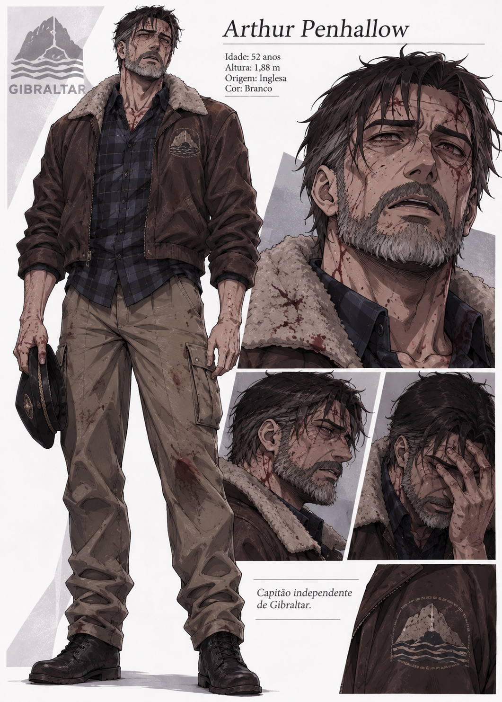

# FICHA DE PERSONAGEM: ARTHUR PENHALLOW

*Comandante e proprietário da ISS Gibraltar. Cinco anos de contrabando de armas, dez de trigo. Pai de Nell.*

*"Capitão", para a tripulação. "Arthur", para Ros, Odell e o Júnior. "Art", só para o irmão, que morreu. "Pai", para a filha que não olha para ele.*

> Legenda das categorias: **[CÂNONE]** conferido no Sarna.net ou nos documentos do projeto (fontes no fim) · **[JOGADOR]** definido pelo jogador · **[CAP. 1]** e **[CAP. 2]** estabelecido na narração dos capítulos · **[imagem]** tirado da imagem de referência · **[INVENÇÃO]** criado nesta ficha, e por isso vetável · **[a definir]** fica para o jogador ou para a narrativa.
>
> A imagem mostra Arthur ferido e ensanguentado, como ele está no roleplay. A aparência abaixo descreve o homem como ele é no dia a dia; os ferimentos atuais estão listados à parte. A ficha vai até a noite do pouso em Waycross, onde o Capítulo 2 está.

---

## 1. Identificação

| Campo | Dado |
|---|---|
| Nome | **Arthur Penhallow** [CAP. 1]. Nome completo: Arthur James Penhallow [INVENÇÃO]. |
| Como o chamam | "Capitão", a tripulação. "Arthur", Ros, Odell, Vane e o Júnior [CAP. 1–2]. "Art", só Edward [CAP. 2]. "Pai", Nell. "Tio", Tom e Harry [CAP. 1–2]. |
| Nascimento | 2973 ou 2974, no porto de Elbar [CAP. 2]. Dia e mês [INVENÇÃO]: 9 de novembro de 2973. |
| Idade | 52 anos [CAP. 1; imagem] |
| Origem | Neto de estivador do porto de Elbar [CAP. 1–2]. Ascendência inglesa [JOGADOR; imagem]. Elbar fica a cerca de dezesseis anos-luz de Schedar, na região da Marca Draconis, e é da Federação dos Sóis em 3030 [CÂNONE; dono em 3025 não verificado, provavelmente a Federação]. |
| Altura e corpo | 1,88 m [imagem]; grande, de mãos grandes [CAP. 1]; uns 98 kg [INVENÇÃO] |
| Ofício | Comandante e proprietário da ISS Gibraltar, DropShip classe Mule, desde 3016 [CAP. 1] |
| Rota legal | Grão e água de Elbar para Schedar, concentrado de minério de volta, há dez anos [CAP. 1] |
| Rota ilegal | Trinta e uma entregas de armas em cinco anos para os Tubarões, por intermédio de Desmond Vane [CAP. 2] |
| Família | A mulher, Catherine, morta em 3017 [CAP. 1]. A filha, Eleanor "Nell", 18 anos [CAP. 1]. O irmão mais novo, Edward, morto em 3019 [CAP. 1]. A irmã, Ruth, que criou Nell em Elbar [CAP. 1]. Os sobrinhos Thomas "Tom", 25 anos, e Harold "Harry", morto em 27/03/3026 [CAP. 1]. |
| Dinheiro | Deve ao banco. A entrega em Waycross paga 1.500.000 C-bills em letras da ComStar, o que faltava para quitar a nave [CAP. 1]. |
| Situação legal | Contrabandista de armas. A inspeção da Milícia que o pegou foi apagada com a Halberd [CAP. 1]. Se as AFFS o prenderem, ele mesmo calcula quinze anos de cela, ou mais [CAP. 1]. |
| Armado | Uma pistola de serviço da segurança da Gibraltar e um carregador extra, entregues por André antes do encontro com o Júnior [CAP. 2] |
| Onde está na noite do pouso | Na Rocha, hóspede e refém do Júnior, depois do passeio pela base com André. O Júnior quer "discutir à noite" a contratação de André [CAP. 2]. |

---

## 2. Aparência

### 2.1 Corpo e rosto
- **Porte:** alto, largo de ombros, ossudo, de mãos grandes e calejadas de quem carregou carga a vida inteira [CAP. 1; imagem]. Ocupa um corredor de DropShip inteiro. Quando fica de pé, a mesa se cala [CAP. 1].
- **Rosto:** comprido, de maçãs marcadas, nariz largo e reto e testa riscada por rugas fundas [imagem]. Rugas de riso nos cantos dos olhos, porque ri muito, e duas linhas verticais entre as sobrancelhas, porque se preocupa mais [INVENÇÃO sobre a imagem].
- **Olhos:** castanhos, de pálpebras pesadas, que leem um rosto como ele lê um manifesto [imagem; CAP. 1].
- **Cabelo:** castanho-escuro, grisalho nas têmporas e na nuca, comprido para um capitão, despenteado, caindo sobre a testa [CAP. 1: "cabelo grisalho"; imagem].
- **Barba:** curta e grisalha, quase branca no queixo. Barbeia as bochechas e o pescoço toda manhã e apara o resto; por isso o rosto dele cheira a espuma de barbear [CAP. 1–2; imagem; INVENÇÃO quanto à conciliação].
- **Voz:** de cascalho, grave e arranhada pelo tabaco. Com ela faz as mulheres dos portos rirem e cala os estivadores sem levantar o tom [CAP. 1].
- **Cheiro:** tabaco, espuma de barbear e óleo de nave [CAP. 1].
- **Postura:** de pé, ocupa espaço sem esforço. Sentado na cadeira de comando, apoia a xícara no braço da cadeira, ao lado do cinzeiro de latão [CAP. 1–2]. Depois da noite da ponte, passou a andar como um velho [CAP. 1].

### 2.2 Roupa
- **No dia a dia a bordo** [imagem]: jaqueta de couro marrom, gasta, com gola de pele de carneiro e o emblema da Gibraltar bordado no peito (uma rocha sobre ondas); camisa de flanela xadrez azul-escura; calça cargo cáqui; botas marrons de cano curto.
- **Para jantar e receber visitas:** paletó escuro e camisa de colarinho branco. Ajeita o colarinho no espelho antes de descer [CAP. 1]. Foi de paletó que recebeu a Milícia, e o paletó rasgou no ombro na luta [CAP. 1].
- **De noite:** robe de lã por cima do pijama, chinelos e um cigarro apagado na boca [CAP. 1].
- **O quepe** [imagem]: preto, de capitão mercante, com cordão dourado e o emblema da nave. Carrega mais na mão do que na cabeça. Põe para receber inspetores [INVENÇÃO].
- **Sempre com ele:** um cigarro atrás da orelha [CAP. 1]; o maço no bolso do peito; o isqueiro de latão do pai [INVENÇÃO].

### 2.3 Ferimentos atuais (não fazem parte da aparência normal)
- Corte acima da orelha esquerda, da coronhada do sargento Brannock em 27/03/3026 [CAP. 1]. A imagem mostra o sangue descendo pela testa e pelo pescoço.
- Hematomas da noite da ponte.
- Nada tratado por médico: ninguém a bordo é médico [INVENÇÃO].

### 2.4 O emblema [INVENÇÃO sobre a imagem]
A rocha sobre as ondas é o emblema que Edward desenhou em 3016, no dia da compra. Dizia que a nave ia ser uma rocha no meio do mar, como a de Gibraltar, em Terra, que nenhum dos dois tinha visto. O emblema dos macacões da tripulação, uma agulha com asas, veio depois, em 3020, desenhado por Nell aos doze anos num papel de pão e copiado pelo bordador do porto. Arthur nunca trocou a jaqueta.

---

## 3. Cronologia

| Data | Acontecimento |
|---|---|
| 2973 | Nasce no porto de Elbar, neto de estivador [CAP. 1–2]. |
| ~2989 | Começa a trabalhar no cais, aos dezesseis anos [INVENÇÃO]. |
| ~2991 | Recolhe um gato cinza, gordo, de orelha comida, no cais: o Almirante, que vive dezessete anos [CAP. 2]. |
| ~2993–3016 | Vinte anos carregando e pilotando a carga dos outros, nas naves dos outros [CAP. 1]. |
| ~3004 | Casa com Catherine [INVENÇÃO quanto à data]. |
| 3007 | Nasce Eleanor, em maio [INVENÇÃO quanto ao mês; deduzido do CAP. 1: nove anos quando a mãe morreu, em 3017, e dezoito em março de 3026]. |
| 3016 | Compra a Gibraltar, uma Mule velha de uma companhia falida, com as terras de Catherine, um empréstimo de doze anos e as economias de Edward. Abre a rota Elbar–Schedar [CAP. 1–2]. Ros e Bridget embarcam desde o primeiro dia [CAP. 1–2]. |
| Começo de 3017 | Catherine tosse na véspera da partida e diz para ele ir. Ele vai. Ela morre na febre que leva meia cidade. A carta chega onze dias depois do enterro [CAP. 1–2]. Ruth passa a criar Nell. |
| 3019 | Arthur manda acelerar antes de o contêiner estar travado; Edward pede "espera, Art, só um minuto"; o contêiner esmaga Edward contra a antepara. Arthur traz Tom e Harry para bordo [CAP. 1–2]. |
| 3021 | Uma pane no resfriamento estraga uma carga inteira de grão; o seguro não paga. No bar do porto de Elbar, Desmond Vane paga duas doses e fala de "uma caixa só" [CAP. 1–2]. |
| Março de 3022 | Primeiro lote: Rangers da AFFS para rebeldes de uma lua mineira do lado capelano da fronteira, que mataram o governador, a família e os cães [CAP. 2]. |
| 3022–3026 | Trinta e uma entregas em cinco anos, nunca mais de dois dias de atraso, nenhuma caixa perdida. Paga 800 C-bills por mês a Fenwick, controlador da torre de Schedar [CAP. 2]. |
| Outubro de 3023 | TO-21 para um grupo de fronteira que arrasou uma vila de colonos de quarenta e sete casas. Arthur vê a foto do fuzil apreendido no jornal da Marca e não quer saber se é o dele [CAP. 2]. |
| Março de 3025 | Morteiros para "um senhorzinho da Periferia que queria ser rei" [CAP. 2]. |
| Início de 3026 | Tenta adiar a primeira viagem de Nell e não consegue [CAP. 1]. |
| 25/03/3026 | Decolagem de Jacksonville, em Schedar, com Nell a bordo e o Centurion no reservatório quatro [CAP. 1]. |
| 27/03/3026 | A Halberd, da Milícia, aparece no ponto pirata. Arthur ataca o Leftenant Duval e leva a coronhada. Harry é morto. À noite, André mata os soldados e obriga Arthur a enganar Odell [CAP. 1]. |
| 28/03/3026 | Atraca a Gibraltar na Bellwether com o cano de uma pistola na nuca, a atracação mais suave que André já viu. Salto para Waycross [CAP. 1]. |
| 28–29/03/3026 | Bridget envenena o chá de André; André põe a pistola na cabeça de Nell. A Gibraltar passa a ser de André [CAP. 2]. |
| 30/03/3026 | Turno de Arthur: a confissão ao "rapaz", a promessa do uísque e o apelido "filho da puta júnior" [CAP. 2]. |
| Dia do pouso (fim de março ou início de abril de 3026) | Pouso em Waycross. Vane revela o nome. O Júnior mostra o dossiê, oferece um contrato de cinco anos e ouve "não". André entorta o fuzil. O Júnior solta Arthur do esquema, mas os mantém na Rocha à noite [CAP. 2]. |

---

## 4. História

### 4.1 Elbar e o cais
Arthur nasceu no porto de Elbar, neto de estivador [CAP. 1–2]. Elbar fica a cerca de dezesseis anos-luz de Schedar, na região da Marca Draconis; já foi condomínio da Federação e da Hegemonia Terrana, e em 2788 a AFFS sofreu ali uma derrota pesada [CÂNONE, `Mapa_Regiao_Schedar.md`]. A Marca Draconis é a fronteira com o Combine, e a hostilidade a ele faz parte da cultura da região [CÂNONE].

[INVENÇÃO] O pai era guindasteiro, a mãe vendia peixe frito na boca do cais, e a casa tinha três cômodos e vista para as rampas das DropShips. Arthur começou a trabalhar aos dezesseis, carregando saco. Aos dezoito, recolheu do cais um gato cinza e gordo, de orelha comida, que comia peixe podre e que ninguém queria: o Almirante [CAP. 2]. O gato viveu dezessete anos e ouviu, sentado na mesa da cozinha, todas as confissões de um rapaz que chegava tarde do cais com cerveja demais na cabeça e uma coisa errada no peito [CAP. 2]. "Era o melhor padre que eu já tive."

### 4.2 Vinte anos na carga dos outros
Passou vinte anos carregando e pilotando a carga dos outros, nas naves dos outros, até juntar coragem e dinheiro para ter a sua [CAP. 1]. [INVENÇÃO] Foi estivador, depois carregador de bordo, depois mestre de carga de uma Mule de cooperativa, depois copiloto com licença de DropShip, tirada aos trinta, depois de reprovar duas vezes no exame teórico. Aprendeu a pilotar de ouvido, como aprendeu tudo. Aprendeu sobretudo a lidar com gente: estivadores, banqueiros, inspetores de porto, fiscais de alfândega, mulheres de porto, capitães mais ricos que ele.

É ali que nasce o homem que André estuda nas câmeras [CAP. 1]:
- lembra o nome de todos e, de cada um, um detalhe que a própria pessoa esqueceu que contou (o joelho da mãe de Pike, o dente da filha de Okafor, o barco do irmão de Bridget);
- ri primeiro das próprias piadas, alto, e quem está perto ri junto antes de decidir se a piada é boa;
- quando dá uma ordem, põe a mão no ombro da pessoa;
- quando dá bronca, chama pelo sobrenome; quando perdoa, pelo apelido;
- tem uns trinta sorrisos, cada um para uma pessoa e uma ocasião, e não parece precisar pensar em nenhum.

"Anotei tudo como se anota uma técnica de combate. Era uma." [CAP. 1, André]

### 4.3 Catherine
[INVENÇÃO quanto ao começo] Conheceu Catherine na feira de outono de Elbar, uma moça de família de pomares nas terras altas, de olhos azuis e riso fácil, que cantava sem letra quando estava distraída. Casaram em 3004. Nell nasceu em 3007, com os olhos da mãe, que Arthur nunca conseguiu encarar por muito tempo sem sentir alguma coisa ceder por dentro [CAP. 1].

Catherine acreditava nele mais do que ele mesmo. Foi ela quem quis vender as terras da família para comprar a nave [CAP. 1].

### 4.4 A Gibraltar (3016)
O dinheiro saiu de três lugares: as terras de Catherine, um empréstimo de banco que ele jurou pagar em doze anos e as economias de Edward, o irmão mais novo, que entrou como sócio sem saber fazer conta e sem precisar saber, porque confiava no irmão [CAP. 1]. Em 3016, a Gibraltar virou deles: uma Mule velha, de casco remendado, comprada de uma companhia falida, com motor bom e porão enorme. A rota apareceu no mesmo ano: grão e água de Elbar para Schedar, que comia mais do que plantava e bebia mais do que tinha, e minério de volta. Dez anos na mesma linha, como um bonde [CAP. 1].

Mandou abrir uma vigia de quartzo no casco da cabine do capitão, porque se recusava a atravessar o espaço sem enxergar nada [CAP. 1]. Na parede do refeitório, pendurou a foto da nave no dia da compra, com Edward rindo na frente da rampa [CAP. 1]. Na primeira viagem, o motor apagou a seis horas do ponto de salto, e Edward consertou um injetor com um grampo de cabelo de Bridget. O grampo continua preso por arame numa placa da sala de máquinas, como troféu, e a história fica melhor a cada vez que Arthur a conta [CAP. 1].

### 4.5 A tosse (3017)
Quando a febre chegou à cidade, ele estava em casa, a dois dias de partir. Catherine teve a primeira tosse na véspera da partida e disse para ele ir: o contrato era bom, a nave era nova, a dívida era grande, era só uma tosse. Ele foi. Sabia, quando subiu a rampa, que não era só uma tosse [CAP. 2]. A carta chegou onze dias depois do enterro. Ele estava a três saltos dali, com o porão cheio de trigo, e leu a carta sentado no chão do porão, ao lado do trigo, e não chorou, porque tinha uma manobra de atracação dali a seis horas e precisava das mãos firmes [CAP. 1–2].

Nell tinha nove anos. Foi criada pela tia Ruth, irmã de Arthur, numa casa de pedra com cheiro de lã molhada e de pão. Ele mandava dinheiro e cartas, e voltava duas vezes por ano com presentes demais e tempo de menos [CAP. 1]. Nunca falou da morte de Catherine com a filha [CAP. 2].

### 4.6 Edward (3019)
Em 3019, um contêiner mal travado escorregou no porão inferior durante uma manobra e esmagou Edward contra a antepara [CAP. 1]. É o que todos sabem.

O que ninguém sabe [CAP. 2]: naquela manobra, Arthur mandou acelerar antes de o contêiner estar travado, porque estavam atrasados para a janela de atracação. Edward disse: "Espera, Art, só um minuto." Ele não esperou. Nunca contou isso a ninguém, nem aos meninos. Criou os dois com o dinheiro de um seguro que não devia ter recebido.

Trouxe Tom e Harry para bordo, porque não havia outro lugar para levá-los e porque não conseguia olhar para aquele porão sem ver um Penhallow lá dentro [CAP. 1].

### 4.7 O grão e o homem de terno cinza (3021)
Em 3021, uma pane no resfriamento estragou uma carga inteira de grão. O seguro recusou o pagamento por uma cláusula que ninguém tinha lido, o banco começou a mandar cartas de tom cada vez mais educado, e o capitão aprendeu que a educação de um banco é a última coisa que se ouve antes de perder tudo [CAP. 1].

Foi nesse ano que um homem de terno cinza se sentou ao lado dele no bar do porto de Elbar, pagou duas doses e falou de uma caixa só, sem perguntas, por um valor que fazia a dívida encolher [CAP. 1–2]. Arthur nunca perguntou o nome dele. Cinco anos depois, em Waycross, descobriu que se chamava Desmond Vane [CAP. 2].

### 4.8 Cinco anos, trinta e uma viagens (3022–3026)
O primeiro lote foi em março de 3022: Rangers da AFFS, doze caixas, para rebeldes de uma lua mineira do lado capelano da fronteira [CAP. 2]. Depois vieram outros. Arthur nunca entregou duas vezes no mesmo lugar: eles mandavam o vetor, ele pousava, eles descarregavam, ele recebia e ia embora, e ninguém via ninguém [CAP. 2]. Em trinta e uma viagens, nunca atrasou mais de dois dias nem perdeu uma caixa [CAP. 2].

Para que a torre de Schedar não registrasse os desvios de rota, pagava todo mês 800 C-bills a um controlador chamado Fenwick, que tem três filhos e uma amante [CAP. 2]. Sabia o nome do controlador. Nunca soube o do homem que o contratou [CAP. 1].

Quem sabia: Tom, Harry, Moss e Crane [CAP. 1]. Moss sabia "como"; Arthur, "onde" [CAP. 1]. Moss ajudou a montar o reservatório quatro, o tanque falso com isolamento térmico de inspeção, feito para enganar sensores de calor [CAP. 2]. Ros sabia sem saber: via os números da rota, os meninos descendo ao porão de madrugada e o envelope que ia para Schedar todo mês, e preferiu não perguntar [CAP. 2]. Harry começou a andar armado em 3025, porque viu o tio sair armado para uma entrega e quis ser como ele [CAP. 2].

Em outubro de 3023, Arthur viu no jornal da Marca a foto de um fuzil apreendido depois do massacre de uma vila de colonos, com o número de série raspado do mesmo jeito que estavam raspados os da caixa que ele tinha levado seis meses antes [CAP. 2]. Não quis saber se era o mesmo. Em Waycross, o Júnior lhe disse que era [CAP. 2].

Todo ano, prometia a si mesmo e a Ros que aquela viagem era a última [CAP. 1–2].

### 4.9 A última viagem
Esta era para ser mesmo a última. No reservatório quatro havia um Centurion com tecnologia da Liga Estelar, que viajava escondido havia oito meses, por quatro naves, e a Gibraltar era a última delas [CAP. 1]. O frete, 1.500.000 C-bills, quitava a nave [CAP. 1].

Nell tinha acabado de se formar em navegação e queria estrear no lugar de navegadora que o pai lhe prometera por mensagem de HPG. Arthur tentou adiar a viagem dela com uma desculpa sobre a época ruim. Ela respondeu que tinha esperado sete meses para vê-lo e dezoito anos para voar com ele, e ele não encontrou nenhum argumento que não precisasse de uma explicação [CAP. 1]. Não teve coragem de dizer a única coisa que a faria ficar: "Querida, seu pai é contrabandista de armas" [CAP. 2]. Fez Tom jurar que ela nunca saberia [CAP. 1].

No jantar da primeira noite, fez o brinde de sempre: "Senhoras e senhores da Gibraltar…" Brindou à navegadora "formada em primeiro lugar", e ela corrigiu: "Em quinto, pai." "Em primeiro do meu coração." Viu Liam beijar Nell e disse: "Na minha mesa, a única coisa que encosta na boca da minha filha é o garfo da senhora Doyle." A mesa explodiu numa gargalhada [CAP. 1]. Durante a inversão, segurou a filha pelo tornozelo, sem peso, rindo, com o cabelo loiro espalhado como uma coroa, e ficou sério: "Você parece a sua mãe." [CAP. 1]

### 4.10 A Halberd (27/03/3026)
Às quinze horas do dia 27, Arthur viu a Bellwether pela vigia e sentiu o peito relaxar pela primeira vez em três dias. Às 15h22, apareceu a Halberd, uma Leopard da Milícia da Marca Draconis [CAP. 1]. Nell nunca tinha visto o rosto do pai mudar daquele jeito [CAP. 1]. Ele chamou Tom e Moss, deu ordens baixas e rápidas, mandou as armas para o armário e então sorriu: o sorriso que dava aos banqueiros e aos inspetores, o sorriso de capitão, que Nell nunca o tinha visto dar a alguém que importava [CAP. 1].

Recebeu o Leftenant Marcus Duval sozinho, na câmara, de paletó, de mão estendida, e o levou pela nave como quem mostra a casa a um parente rico [CAP. 1]. Quase deu certo. O sargento Brannock achou a escotilha do reservatório quatro.

Arthur viu tudo de uma vez: a nave confiscada, a dívida cobrada, quinze anos de cela, Nell sozinha numa casa de pedra com o sobrenome nos jornais da Marca [CAP. 1]. Não pensou. Lançou-se sobre o Leftenant, girou com ele e chegou a puxar a pistola do coldre até a metade, pensando em fazer dele refém. A coronha de Brannock o atingiu acima da orelha esquerda [CAP. 1]. No chão, viu Harry puxar a arma que não tinha tirado da cintura e morrer com dois tiros [CAP. 1].

Na ponte, Nell perguntou: "Pai, fala para ele que é mentira." Arthur não conseguiu sustentar o olhar dela por mais de um segundo, e foi o silêncio que contou a verdade a ela [CAP. 1]. Quando o cabo Voss pôs a mão em Nell e Liam o derrubou, Arthur rugiu como um bicho, "eu te mato, eu te mato", até Crane dizer alguma coisa no ouvido dele [CAP. 1].

### 4.11 A noite da ponte
Na fumaça, enquanto André matava os soldados, Arthur se arrastou de joelhos, algemado, para ficar entre a filha e a voz no escuro [CAP. 1]. Depois, André o levantou pela gola e o obrigou a dizer a Odell, da Bellwether, que a inspeção tinha sido limpa. A voz de cascalho voltou inteira, como se ele a tivesse tirado de uma gaveta: "A chaleira ferveu, meu velho. Pode pôr o chá." O código de perigo era "a chaleira queimou", e ele não o usou [CAP. 1].

Depois, de joelhos a meio metro da filha, tentou falar com ela: "Eu fiz por vocês. Eu fiz pela nave, pela dívida, pela sua academia." Ela não olhou para ele [CAP. 1]. Ros também falou: "Dez anos, Arthur… Armas de guerra? Um 'Mech? Com a sua filha a bordo?" [CAP. 1] Naquela noite, ele envelheceu dez anos [CAP. 1].

Às 7h12 do dia 28, encostou a Gibraltar no colar dois da Bellwether com o cano de uma pistola na nuca. Foi a atracação mais suave que André já viu na vida [CAP. 1]. No salto, ficou com a mão no botão do rádio, sem apertar, olhando a estrela cor de cobre de Schedar, que via subir e descer naquela rota havia dez anos. Nell olhou para ele por um segundo [CAP. 1].

### 4.12 A travessia
Quando André pôs a pistola na cabeça de Nell para descobrir quem tinha envenenado o chá, Arthur rugiu "Não, por Deus, não"; depois, puxou a filha para o peito com as mãos algemadas, e dessa vez ela deixou [CAP. 2].

Passou duas noites trancado na cabine, fumando os dois cigarros por dia que o rapaz deixava na bandeja, pensando em tudo o que podia tentar: convencer, negociar, comprar, humanizar. Viu Nell voltar do turno dela com o macacão fechado até o pescoço; viu Ros voltar rindo e chorando, coisa que nunca tinha visto em dez anos. E concluiu o que um homem que passou trinta anos negociando conclui sobre alguém que não quer nada: não adiantava tentar nada [CAP. 2].

No turno dele, às seis da manhã do dia 30, de cara lavada e barba feita, pediu para fumar na ponte, e o rapaz deixou: o primeiro em dezoito anos [CAP. 2]. Contou do Almirante. O rapaz disse que também tinha tido um gato e que o abriu para ver o que tinha dentro. Arthur ficou três segundos parado e riu: "Bom. O Almirante teve mais sorte." [CAP. 2] Então confessou tudo: Catherine, Edward, a caixa, a foto do fuzil, Harry, Nell. "Eu fiz tudo errado pelas razões certas, e as razões certas não valem merda nenhuma quando o seu sobrinho está numa câmara fria, no meio da carne do jantar." Chorou com as mãos no rosto [CAP. 2].

O rapaz disse que ele era um pai melhor do que o dele, e contou da infância: os remédios, as cirurgias acordado, os instrutores que sumiam, o detonador na nuca. Arthur viu nele, pela primeira vez, um soldado que alguém pegou no berço [CAP. 2]. "Esse homem é um filho da puta… Eu nunca, nem no pior dia da minha vida, pus uma bomba na cabeça de uma criança e dei boa noite para ela." Prometeu dividir com ele um uísque escocês de verdade, de Terra, se os dois estivessem vivos no fim, e o chamou de "seu filho da puta júnior". O rapaz disse que precisava de muito uísque para ficar bêbado. Arthur riu até tossir: "Sobra mais para mim." [CAP. 2]

### 4.13 Waycross
**Antes do pouso**, desceu ao porão para falar do enterro de Harry com Tom. Tom negou que o irmão estivesse morto: "Você viu ele? Viu o rosto?" "Ele não vai aparecer, filho." "Não me chama de filho. O senhor não é o meu pai." [CAP. 2] Arthur subiu a escada do porão parando no meio.

**No rádio**, deu a frase ("trigo para o inverno") com as mãos firmes [CAP. 2]. Ao meio-dia e quarenta, Vane o chamou: o pagamento estava com o Júnior, que queria conhecê-lo, com a tripulação inteira, com "uma proposta do tipo que não se recusa" [CAP. 2]. Arthur disse que não, que o combinado sempre foi nenhum contato; Vane disse para ele não começar a errar no quinto ano. Arthur ficou com a mão estendida para o microfone e disse duas vezes: "Eu não sei o que fazer." O rapaz respondeu: "O senhor não precisa saber o que fazer. Eu sei." [CAP. 2]

**No refeitório**, quando o rapaz decidiu ir junto como Harry, Tom pediu ao tio que dissesse que aquele não era o Harry. Arthur não disse nada e fechou os olhos [CAP. 2].

**No pé da rampa**, reconheceu o homem de terno cinza: "Era você. No bar do porto de Elbar. Em 3021." Desmond Vane [CAP. 2]. Apresentou a tripulação e o rapaz como "Harry, meu sobrinho, meu guarda-costas" [CAP. 2].

**Diante do Júnior** [CAP. 2]:
- ouviu a própria vida lida como uma ficha, de Elbar ao Fenwick;
- abriu a pasta de couro e viu para onde tinham ido os lotes dele: a lua mineira, a vila de quarenta e sete casas, o "rei" da Periferia;
- recusou o contrato exclusivo de cinco anos, com o dobro do frete e a dívida quitada no dia seguinte, com as mãos tremendo e a voz firme: "Eu prometi para a minha filha que esta era a última."
- encolheu-se diante dos gritos ("Quem entra no negócio sai de duas formas: rico ou embrulhado numa lona") e ficou mudo com o cano de um fuzil na testa;
- viu o rapaz entortar o cano do fuzil com a mão;
- ouviu o Júnior soltá-lo do esquema "por causa desse sobrinho foda pra caralho", com a porta sempre aberta;
- apertou a mão do Júnior quando o olhar dele não deixou escolha;
- quando o Júnior disse que estava louco para conhecer a "loirinha" e que Arthur talvez virasse sogro dele, deu meio passo à frente com os punhos fechados, "como um cachorro velho defendendo o osso".

**No domo**, quando o Júnior perguntou de onde tinha saído aquele sobrinho, inventou que o rapaz sempre foi viciado em jogo de guerra, simulador e tabuleiro, e que "o Tom puxou para a mãe". O rapaz estreitou os olhos para ele. O Júnior acreditou [CAP. 2].

---

## 5. Formação e capacitação

### 5.1 O que ele sabe fazer
- **Comandar uma nave e uma tripulação.** Dez anos de Gibraltar. Basta ficar de pé para a mesa se calar [CAP. 1].
- **Pilotar.** Não é o piloto da nave, que é Ros, mas atraca como poucos: a atracação de 28/03, com uma pistola na nuca, foi "a coisa mais bonita que ela tinha visto um piloto fazer" [CAP. 2].
- **Gente.** É o maior talento dele: ler rostos, lembrar nomes e detalhes, fazer rir, acalmar, convencer [CAP. 1].
- **Negociar.** Trinta anos com estivadores, banqueiros, inspetores e contrabandistas [CAP. 2].
- **Comércio de carga.** Fretes, seguros, lotes, rotas, portos, combustível, janelas de JumpShip.
- **Contrabando.** Cinco anos sem erro: desvio de rota, ponto pirata, propina na torre, frase de reconhecimento, manifesto limpo [CAP. 1–2].
- **Mentir.** Bem, a vida inteira, para a filha [CAP. 2]. Mal, quando improvisa sob pressão: o "jogo de guerra" [CAP. 2].
- **Briga.** Força de estivador. Nenhuma técnica [INVENÇÃO].

### 5.2 Avaliação por área
Escala do projeto: Verde, Regular, Veterano e Elite (`Economia_3026.md`). Guia de narração, não dado. [INVENÇÃO]

| Área | Nível | Observação |
|---|---|---|
| Trato com pessoas | **Elite** | Uns trinta sorrisos, um para cada pessoa [CAP. 1] |
| Leitura de rostos | **Elite** | Leu em Brannock que a vistoria não ia ser rotina [CAP. 1] |
| Negociação | Veterano | Mas não sabe lidar com quem não quer nada [CAP. 2] |
| Comando de nave civil | Veterano | |
| Pilotagem de DropShip | Veterano | Atracação de elite; o resto, Ros faz melhor |
| Comércio e logística de carga | Veterano | |
| Contrabando | Veterano | Trinta e uma entregas sem erro [CAP. 2] |
| Mentira planejada | Veterano | |
| Mentira improvisada | Regular | "Jogo de guerra" |
| Pistola | Regular | Sabe usar, não gosta [INVENÇÃO] |
| Luta | Regular | Peso e força, nenhuma técnica |
| Navegação | Regular | Confia em Nell e em Odell |
| Mecânica | Verde | Confia em Moss |

### 5.3 Limites
- Não sabe dizer "não" à filha [CAP. 2].
- Não sabe enfrentar quem não ri [CAP. 2].
- Age sem pensar quando a família está em perigo [CAP. 1].
- Está velho e cansado, e a tosse piora [CAP. 1].

---

## 6. Histórico de trabalho

| Período | Onde | Função |
|---|---|---|
| ~2989–~2995 | Cais do porto de Elbar | Estivador [CAP. 1; INVENÇÃO quanto às datas] |
| ~2995–3016 | Naves dos outros | Carregador de bordo, mestre de carga, copiloto [CAP. 1; INVENÇÃO quanto aos cargos] |
| 3016–hoje | ISS Gibraltar | Comandante e proprietário [CAP. 1] |
| 3022–3026 | Rede de Desmond Vane e do Júnior | Transportador de armas: trinta e uma viagens [CAP. 2] |

---

## 7. Histórico médico

- **A tosse.** Pior do que na última visita de Nell [CAP. 1]. Fuma desde os dezesseis anos [INVENÇÃO]. Se é só o cigarro ou alguma coisa mais: **[a definir]**. É o tipo de tosse que ele mesmo diz que "é só uma tosse", como Catherine disse [INVENÇÃO quanto ao paralelo].
- **Cigarro.** Era o único autorizado a fumar a bordo, e só na cabine [CAP. 1]. Prometeu a Nell não fumar na ponte com ela lá e perde o cigarro para ela todo dia [CAP. 1]. Desde que André tomou a nave, fuma dois por dia, contados [CAP. 2].
- **Sono.** "Meu pai não dorme nunca." [CAP. 1, Nell] Fuma acordado de madrugada.
- **Bebida.** Bebeu demais na juventude, no cais [CAP. 2]. Hoje, chá forte com um torrão de açúcar a mais, que Nell traz sem que ele peça [CAP. 1]. Gosta de uísque [CAP. 2].
- **Ferimento atual.** O corte acima da orelha esquerda, da coronhada de Brannock em 27/03 [CAP. 1]. Desmaiou na hora, com gosto de sangue na boca e um zumbido nos ouvidos. Provável concussão leve [INVENÇÃO]. O corte fechou sem pontos e vai deixar cicatriz [INVENÇÃO].
- **Desgaste.** Envelheceu dez anos numa noite [CAP. 1]. Desde então anda como um velho, chora com facilidade e treme as mãos sob pressão; mas, quando é preciso, as mãos ficam firmes [CAP. 1–2].
- **Dados** [INVENÇÃO]: tipo sanguíneo B positivo; nenhuma alergia; nenhuma medicação.

---

## 8. Mente e personalidade

### 8.1 O núcleo
**"Eu só queria proteger a minha família."** [CAP. 2]

Tudo o que Arthur fez de certo e de errado sai dessa frase. Comprou a nave pela família. Deixou Catherine com tosse pela dívida da família. Mandou acelerar o contêiner para não perder a janela que pagava a família. Aceitou a primeira caixa para não perder a nave da família. Mentiu para a filha para protegê-la. "Eu fiz tudo errado pelas razões certas." [CAP. 2]

### 8.2 O homem dos trinta sorrisos
É encantador de verdade, não só por técnica. As pessoas gostam dele à primeira vista, e ele sabe tirar proveito disso [CAP. 1]. Mas o carinho é real: ele se lembra do joelho da mãe de Pike porque se importa, e também porque sabe que funciona. As duas coisas são verdadeiras ao mesmo tempo.

### 8.3 A culpa
Carrega quatro mortes: Catherine, porque foi embora; Edward, porque não esperou; Harry, porque não insistiu; e as pessoas que os fuzis dele mataram, que agora têm números (quarenta e sete casas) [CAP. 2]. A culpa não o paralisa no trabalho. Paralisa nas noites, e fala nas confissões, ao gato e ao rapaz.

### 8.4 Coragem e covardia
É covarde diante do banco e corajoso diante da Milícia. Encolheu-se na poltrona diante do Júnior e, um minuto depois, deu meio passo à frente para defender a filha [CAP. 1–2]. Disse "não" ao Júnior com as mãos tremendo [CAP. 2]. A coragem dele só aparece quando alguém dele está em risco.

### 8.5 A filha
Nell é o centro de tudo. O pior momento da vida dele não foi a coronhada nem a morte de Harry: foi a filha sentada a meio metro sem olhar para ele [CAP. 1–2]. "Preferia mil vezes a coronhada, a algema, até a morte." [CAP. 2]

### 8.6 O rapaz
Arthur é o único a bordo que conseguiu olhar para André como para uma pessoa, e talvez o único que André escuta como se escuta um pai. Deu a ele o apelido que o Júnior repetiria por coincidência ("filho da puta júnior") e prometeu um uísque [CAP. 2]. Tem medo dele, e pena, e alguma coisa que se parece com afeto. Mentiu para protegê-lo diante do Júnior, mal [CAP. 2].

### 8.7 O que ele quer
- Que Nell volte a olhar para ele.
- Enterrar Harry no cemitério da colina, ao lado de Edward [CAP. 2].
- Pagar a nave e voltar ao trigo. Nunca mais transportar nada que não seja trigo [CAP. 2].
- Dividir um uísque de Terra com o rapaz [CAP. 2].
- Que a filha tenha uma nave quando ele morrer [CAP. 2].

### 8.8 O que ele não faz
- Não puxa gatilho em ninguém. Até agora [CAP. 2: "O seu pai não puxou nenhum gatilho. Mas todos os gatilhos começaram nele."].
- Não diz o código de perigo quando a filha está sob uma arma [CAP. 1].
- Não entrega a tripulação [INVENÇÃO].

### 8.9 Como reage

| Diante de | Ele |
|---|---|
| Um inspetor ou banqueiro | O sorriso de capitão e uma xícara de café de verdade [CAP. 1] |
| Uma ameaça à filha | Ataca, ruge, sem pensar [CAP. 1–2] |
| Uma ameaça a ele | Encolhe-se, treme, cede [CAP. 2] |
| Alguém que não quer nada | Desiste de negociar e passa a conversar [CAP. 2] |
| Culpa | Confessa a quem não julga |
| Humor | Ri primeiro e mais alto [CAP. 1] |
| Um beijo na filha à mesa | Uma piada que é uma ordem [CAP. 1] |

---

## 9. Voz e fala

### 9.1 Como ele fala
- Voz de cascalho, grave, que enche uma sala sem esforço [CAP. 1].
- Frases largas, de contador de histórias, com pausa para o riso.
- "Querida" para a filha; "meu velho" para Odell; "filho" para Tom e para o rapaz [CAP. 1–2].
- Sobrenome para dar bronca ("Ashby."), apelido para perdoar [CAP. 1].
- Quando está quebrado, a voz racha e fica baixa [CAP. 1–2].

### 9.2 Falas dos capítulos
— Senhoras e senhores da Gibraltar. Faz dez anos que esta velha senhora carrega trigo, água e a nossa paciência entre as estrelas.

— Na minha mesa, não. Na minha mesa, a única coisa que encosta na boca da minha filha é o garfo da senhora Doyle.

— Eu sou um homem moderno, querida. Pode beijar quem quiser. Longe de mim. E depois de casar. E de preferência nunca.

— Bom rapaz. Mãos onde eu possa ver.

— Nada, querida. Você parece a sua mãe.

— A rotina é a coisa mais bonita que existe, Leftenant. É ela que deixa a gente envelhecer.

— A chaleira ferveu, meu velho. Pode pôr o chá.

— Bom. O Almirante teve mais sorte.

— Eu fiz tudo errado pelas razões certas, e as razões certas não valem merda nenhuma quando o seu sobrinho está numa câmara fria, no meio da carne do jantar.

— Seu filho da puta júnior.

— Melhor ainda. Sobra mais para mim.

— Eu agradeço. De verdade. Mas não. Eu prometi para a minha filha que esta era a última.

### 9.3 Exemplos de voz em situações novas [INVENÇÃO]
Para Nell, quando ela finalmente olhar para ele:

— Não precisa dizer nada, querida. Eu sei o que eu sou. Só não vai embora da ponte.

Para um oficial das AFFS:

— Capitão Arthur Penhallow, da Gibraltar. Trigo, senhor. Dez anos de trigo. — O sorriso de capitão. — E uma coisa que eu preciso contar e que o senhor não vai gostar de ouvir.

Para o rapaz, numa noite de cigarro:

— Sabe o que é engraçado? Eu passei a vida dizendo que era a última. Agora que é, eu não sei o que fazer com as mãos.

### 9.4 Pensamentos
Entre parênteses, na primeira pessoa dele [regra do roleplay; INVENÇÃO quanto ao conteúdo]:

(Fala do trigo. Sorri. Eles gostam de quem sorri.)

(Ela olhou. Um segundo. Mas olhou.)

(Espera, Art, só um minuto.)

---

## 10. Relações

### 10.1 Nell
A filha, 18 anos, navegadora formada em quinto lugar da turma, com os olhos azuis de Catherine [CAP. 1]. Ficha própria: `Nell_Penhallow.md`. Ela o trata como se ele fosse feito de vidro e de ferro ao mesmo tempo: tira o cigarro, traz o chá na hora certa com um torrão a mais, corrige o colarinho, discute a trajetória e depois confere escondido se ele tinha razão [CAP. 1]. Desde a noite da ponte, não olha para ele, a não ser por um segundo no salto [CAP. 1]. Deixou-o abraçá-la depois que André lhe pôs uma pistola na cabeça [CAP. 2]. Ele a ama mais do que a tudo e mentiu para ela a vida inteira.

### 10.2 Tom e Harry
- **Thomas "Tom" Penhallow**, 25 anos, mestre de carga, filho de Edward, alto e sério, parecido com o pai até no jeito de esfregar a nuca [CAP. 1]. Sabia do contrabando e jurou não contar a Nell [CAP. 1]. Desde que Bridget disse "câmara fria", nega a morte do irmão [CAP. 2]. Disse ao tio: "O senhor não é o meu pai." [CAP. 2] Ofereceu-se no lugar de Nell diante da pistola [CAP. 2].
- **Harold "Harry" Penhallow**, 22 anos, estivador de bordo, que "não era parecido com ninguém e fazia questão disso" [CAP. 1]. Na lista da tripulação, a anotação de Arthur: "pare de chamá-lo de Harold" [CAP. 1]. Morto com dois tiros da Milícia em 27/03, depois de puxar a pistola que o tio mandou tirar da cintura [CAP. 1–2]. O corpo está na câmara fria da cozinha [CAP. 1]. André usa a blusa e o nome dele [CAP. 2].

### 10.3 Os mortos
- **Catherine**, a mulher: morta na febre de 3017 [CAP. 1].
- **Edward**, o irmão: morto em 3019; a foto dele rindo está no refeitório [CAP. 1].
- **O Almirante**, o gato: dezessete anos de confissões [CAP. 2].

### 10.4 Ruth
A irmã de Arthur, que criou Nell numa casa de pedra em Elbar [CAP. 1]. Vai querer Harry no cemitério da colina, ao lado de Edward [CAP. 2]. [INVENÇÃO] Viúva, sem filhos, severa e justa; é a única pessoa que nunca riu das piadas de Arthur, e a única de quem ele tem medo.

### 10.5 A tripulação
- **Ros Hale**, a piloto, há dez anos com ele. Sabia e não perguntou; agora o acusa [CAP. 1–2]. Ficha própria.
- **Gareth Moss**, o chefe de máquinas: sabe "como" e é leal. Disse a Nell que o pai era um bom homem, para ela lembrar [CAP. 1]. Ficha própria.
- **Liam Ashby**, o namorado da filha, que ele vigia com piada [CAP. 1]. Ficha própria.
- **Victor Crane**, chefe da segurança, 46 anos, vinte de mercenário, que sabia do reservatório e o acalmou na ponte com uma frase no ouvido [CAP. 1].
- **Bridget Doyle**, a cozinheira, que cozinha para ele desde antes da Gibraltar e ameaçou se demitir doze vezes [CAP. 1]. Envenenou André [CAP. 2].
- **Okafor, Bell, Pike, Sam, Jory e Pip Larkin**: Arthur sabe o nome da filha, da mãe e do joelho de cada um [CAP. 1].

### 10.6 Fora da nave
- **Odell**, capitão da JumpShip Bellwether, pão-duro, que cobra o dobro para não perguntar [CAP. 1].
- **Fenwick**, controlador da torre de Schedar, 800 C-bills por mês [CAP. 2].
- **Desmond Vane**, o homem de terno cinza, cinco anos sem nome [CAP. 2].
- **O Júnior**, que o chama de "o melhor que eu já tive" e quer conhecer a filha dele [CAP. 2].

### 10.7 André ("o rapaz")
Matou na ponte dele, ameaçou a filha dele, usa o nome do sobrinho morto e o ouviu confessar o que ninguém sabe [CAP. 1–2]. Arthur o chama de "rapaz" e, uma vez, de "filho". Deve a vida a ele e sabe disso. Tem medo dele e prometeu-lhe um uísque [CAP. 2]. Nos bares de porto, ouviu a vida inteira histórias de unidades secretas que faziam soldados de crianças e nunca acreditou; agora acredita [CAP. 2].

---

## 11. Recursos e posses

- **A ISS Gibraltar**, DropShip classe Mule, civil, esferoide, com porão inferior de cerca de 3.000 t, cerca de 8.500 t de carga, quatro rampas e quatro elevadores de carga [registro do Cap. 1]. Está sob o controle de André desde 28/03 [CAP. 2]. Danos: console de navegação destruído, marcas de bala na ponte, tampas de inspeção furadas [registro do Cap. 1].
- **A dívida:** o empréstimo de doze anos de 3016, mais o que o grão estragado acrescentou [CAP. 1]. Valor restante **[a definir]**. O frete de Waycross o quitaria [CAP. 1].
- **O pagamento:** 1.500.000 C-bills em letras da ComStar, que estão com o Júnior [CAP. 2].
- **A pistola** de serviço e um carregador extra [CAP. 2].
- **Na cabine:** a vigia de quartzo, o cinzeiro, o maço, o robe de lã, a foto de Catherine que ele não pendura [INVENÇÃO].

---

## 12. Estado na noite do pouso

- **Onde:** na Rocha, com a tripulação, como hóspede e refém do Júnior [CAP. 2].
- **Corpo:** o corte da orelha, cansaço de dias, a tosse.
- **Cabeça:** viu para onde foram os fuzis dele. Disse "não" ao homem mais perigoso que conheceu. Ouviu uma ameaça à filha embrulhada em piada. Mentiu pelo rapaz. Está livre do esquema, mas não está livre.
- **O que ele sabe:** que vão passar a noite ali; que o Júnior quer o rapaz como guarda-costas e vai "discutir à noite"; que o pagamento ainda não foi entregue; que o rapaz matou três soldados no tanque de areia [CAP. 2].
- **O que ele não sabe:** que a *Resolute*, das AFFS, está em órbita e ataca antes das seis [CAP. 2].

---

## 13. Segredos e quem sabe o quê

| Fato | Quem sabe |
|---|---|
| O contrabando | A tripulação inteira, desde a noite da ponte [CAP. 1] |
| Que mandou acelerar o contêiner que matou Edward | O rapaz [CAP. 2] |
| Que recebeu um seguro que não devia | O rapaz [CAP. 2] |
| Que sabia que a tosse de Catherine não era só tosse | O rapaz [CAP. 2] |
| Que viu a pistola de Harry e não insistiu | O rapaz [CAP. 2] |
| Fenwick e os 800 C-bills | O Júnior, o rapaz, Ros [CAP. 2] |
| A origem do rapaz (o detonador, o homem que o criou) | Arthur, pelo que o rapaz contou [CAP. 2] |
| Que o "Harry" da Rocha é outra pessoa | A tripulação [CAP. 2] |

---

## 14. Vulnerabilidades

1. **Nell.** Qualquer ameaça a ela o faz agir sem pensar.
2. **A culpa.** Quem souber de Edward o tem na mão.
3. **A dívida.** O banco, o Júnior, a "porta aberta".
4. **O medo.** Diante de quem grita e aponta uma arma, ele se encolhe.
5. **A mentira improvisada.** O "jogo de guerra" pode desmoronar.
6. **A tosse e a idade.**
7. **A lei.** As AFFS o querem por contrabando.

---

## 15. Orientação ao narrador

- **Arthur é encantador de verdade.** Mesmo quebrado, a voz de cascalho volta quando é preciso. Mostrar os trinta sorrisos.
- **Arthur é culpado de verdade.** Não absolvê-lo, não condená-lo. Ele mesmo não se absolve.
- **A relação com Nell avança por segundos**: um olhar, um abraço permitido, uma xícara de chá. Nada de reconciliação rápida.
- **Com André**, é a relação mais parecida com a de pai e filho que André já teve, e nenhum dos dois sabe disso. A promessa do uísque é um fio a manter.
- **Diante do perigo**, ele treme. Diante do perigo à filha, ele avança.
- **Fala muito**, conta histórias, e a história melhora a cada vez.
- **O que fica com o jogador:** o destino dele, a tosse, o enterro de Harry e o que ele vai dizer quando as AFFS chegarem.

---

## 16. Ganchos

1. **O ataque da madrugada.** As AFFS vêm por contrabandistas, e ele é um.
2. **A porta aberta do Júnior.** "Se o banco bater na porta, você sabe onde eu moro."
3. **O uísque de Terra.**
4. **O enterro de Harry** no cemitério da colina, e Tom, que não acredita.
5. **Edward.** Se Tom souber a verdade sobre o contêiner.
6. **A tosse.**
7. **Fenwick**, na torre de Schedar, sabe o que ele fez.
8. **A lua mineira e a vila de quarenta e sete casas.** As vítimas existem e têm parentes.
9. **Ruth**, em Elbar, que vai querer saber de tudo.

---

## 17. Registro

### CÂNONE verificado
| Fato | Fonte |
|---|---|
| Elbar: a cerca de 15,9 anos-luz de Schedar; da Federação em 3030 (3025 não verificado, provavelmente Federação); antigo condomínio da Federação e da Hegemonia; derrota da AFFS na Operação SOLAR SHIELD em 2788 | `Mapa_Regiao_Schedar.md` |
| Elbar é vizinho de Mara (17,5 anos-luz) | sarna.net/wiki/Montoya (página de Mara) |
| Marca Draconis: região da Federação na fronteira com o Combine; a hostilidade ao Combine é parte grande da cultura local | cfw.sarna.net/wiki/Draconis_March |
| Waycross: mundo sem registro desde a Segunda Guerra de Sucessão | registro do Capítulo 1 |
| Mule: nave civil esferoide; cerca de 8.500 t de carga, quatro rampas, quatro elevadores | registro do Capítulo 1 |

### Divergências e leituras adotadas
- **"Barba feita" e a barba da imagem.** O Capítulo 2 diz que ele entrou na ponte "de cara lavada e barba feita", e Nell sente nele cheiro de espuma de barbear; a imagem mostra uma barba curta e grisalha. Leitura adotada: barba curta aparada, com bochechas e pescoço barbeados todo dia.
- **Paletó e jaqueta.** O texto fala de paletó; a imagem, de jaqueta de couro com gola de pele. Leitura adotada: jaqueta no dia a dia, paletó para jantar e para visitas.
- **Cabelo.** O texto diz grisalho; a imagem, castanho-escuro com fios grisalhos. Leitura adotada: castanho-escuro grisalhando.
- **Data do primeiro lote.** Arthur diz "há cinco anos" e Vane o encontrou em 3021; o Júnior data o primeiro lote em março de 3022. Leitura adotada: o encontro foi em 3021 e a primeira caixa saiu em março de 3022.

### INVENÇÃO desta ficha (vetável)
O nome do meio e a data de nascimento; os pais e a infância no cais; os cargos antes da Gibraltar e a licença de piloto; o começo com Catherine e a data do casamento; a origem dos emblemas; o quepe; o isqueiro do pai; os hábitos de fumo; o tipo sanguíneo; Ruth como viúva severa; a foto de Catherine na gaveta; os exemplos de fala; os pensamentos; os ganchos.

### Pendências
- O que é a tosse.
- O valor restante da dívida.
- O que acontece com ele no ataque da *Resolute*.
