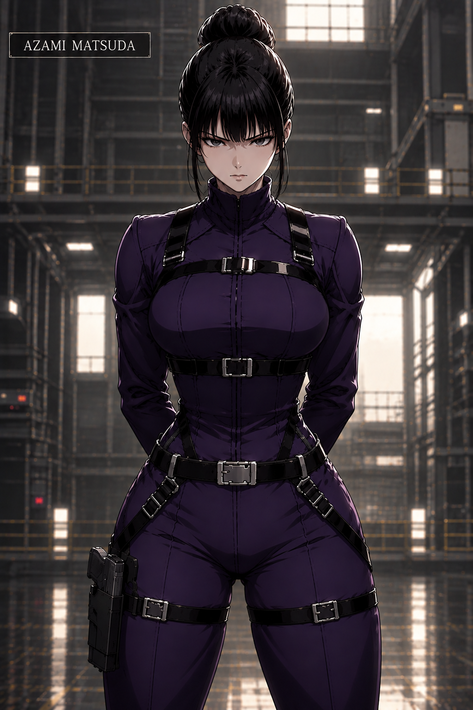

# FICHA DE PERSONAGEM: AZAMI MATSUDA

*MechWarrior. Formada em Sun Zhang, desertora do Combine, ex-mercenária da Companhia Halloway, prisioneira dos Tubarões.*

*"A japonesinha", para o Júnior. "Flor do deserto", para Alana. "Matsuda", para todo o resto.*

> Legenda das categorias: **[CÂNONE]** conferido no MUL e no Sarna.net em 26/11/2026 (fontes no fim) · **[JOGADOR]** definido pelo jogador no roteiro do Capítulo 2 · **[CAP. 2]** estabelecido na narração do Capítulo 2 · **[INVENÇÃO]** criado nesta ficha, e por isso vetável · **[a definir]** fica para o jogador ou para a narrativa. O que não traz marca é invenção.
>
> Esta ficha descreve Azami até a noite do pouso da Gibraltar em Waycross, ponto em que o Capítulo 2 está. Nada do que vem depois foi decidido.

---

## 1. Identificação

| Campo | Dado |
|---|---|
| Nome | **Azami Matsuda** [JOGADOR]. À maneira do Combine, sobrenome primeiro: Matsuda Azami. |
| Escrita | 松田 薊 [INVENÇÃO]. *Matsuda* quer dizer "campo de pinheiros". *Azami* é o cardo, a flor roxa que se defende com espinhos. Ela nunca comenta o próprio nome. |
| Como a chamam | "Matsuda", os soldados e os oficiais dos Tubarões [CAP. 2]. "A japonesinha", o Júnior [CAP. 2]. "Flor do deserto", Alana, quando chega com comida [CAP. 2]. Na academia, "Matsuda" na frente e "a de Ashio" pelas costas [INVENÇÃO]. |
| Nascimento | **2999**, em Ashio, sede da Prefeitura de Ashio, Distrito Militar de Dieron, Combine Draconis [CÂNONE quanto ao planeta e à prefeitura; CAP. 2 quanto à origem]. O ano sai da cronologia do Capítulo 2: tinha 17 anos quando a ISF levou os pais e entrou em Sun Zhang nove anos antes de 3026. Dia e mês **[a definir]**; precisam cair depois de março, para que tenha 26 anos em Waycross. |
| Idade | 26 anos [JOGADOR] |
| Ascendência | Japonesa pelo lado do pai [INVENÇÃO, sobre o nome e os costumes do CAP. 2]. O lado da mãe é misto, como boa parte de Dieron, o distrito do Combine com menos gente de ascendência japonesa [CÂNONE quanto ao distrito]. Os olhos cinzentos vêm da mãe [INVENÇÃO]. |
| Línguas | Japonês, a língua oficial do Combine; inglês, também corrente no Combine [CÂNONE]. Fala com o sotaque do Combine, que corta as consoantes no lugar certo [CAP. 2]. Entende o jargão técnico das AFFS dos manuais que leu na Companhia Halloway [INVENÇÃO]. |
| Formação | Academia de MechWarriors Sun Zhang, New Samarkand. Turma de 3021, **segunda colocada** [CAP. 2]. Recebeu o *daishō* na formatura [CAP. 2; o costume é CÂNONE]. |
| Serviço na DCMS | Cadete dos Cadres de Sun Zhang, de 3021 a 3022 [CÂNONE quanto aos Cadres]. Unidade **[a definir]**. Desertou oito meses depois da formatura [CAP. 2]. |
| Depois da deserção | MechWarrior da **Companhia Halloway**, mercenária, de 3022 até a emboscada, entre o fim de 3024 e o início de 3025 [CAP. 2]. Prisioneira e MechWarrior dos **Tubarões** desde o início de 3025 [JOGADOR]. |
| Situação legal | Desertora da DCMS. "O Dragão a queria morta" [CAP. 2]. Se o Combine sabe que está viva: **[a definir]**. Para a Federação dos Sóis, é uma pirata a serviço dos Tubarões. Não tem documento nenhum. |
| Função atual | MechWarrior dos Tubarões. O Griffin da lança do hangar é dela [CAP. 2]. |
| Patrimônio | Nenhum. Uma pistola sem carregador, um uniforme que não escolheu e a tira de couro do cabelo. |
| Onde está na noite do pouso | Na cela do convés três da Leopard *Mako*, que decola às seis da manhã seguinte com o Centurion da Gibraltar a bordo [CAP. 2]. |

---

## 2. Aparência

### 2.1 Corpo e rosto
- **Estatura e peso:** estatura média [CAP. 2]; 1,63 m e 55 kg [INVENÇÃO]. Perdeu uns cinco quilos no último ano, quase todos de músculo, e recupera o que pode com o kata na cela [INVENÇÃO].
- **Constituição:** corpo de piloto treinado desde os dezoito anos, atlético e curvilíneo, que o uniforme justo não disfarça: ombros firmes, braços definidos, cintura fina, quadris largos e pernas fortes, de quem passou anos empurrando pedais de 'Mech [imagem; INVENÇÃO quanto à causa].
- **Rosto:** oval, de maçãs discretas e queixo pequeno e firme. Nariz reto e fino. Boca pequena, de lábios finos, quase sempre fechada numa linha reta. As sobrancelhas pretas e retas ficam baixas em repouso, e por isso o rosto dela parece estar sempre reprovando alguma coisa [imagem].
- **Olhos:** cinza-escuros, frios, sob pálpebras um pouco pesadas que dão ao olhar um ar de quem mede [imagem]. Olha de frente e pisca pouco. Não desvia quando a encaram; desvia quando alguma coisa a toca. Desviou quando disse "missô" [CAP. 2].
- **Pele:** clara e pálida, de quem quase não vê o sol há um ano [imagem; INVENÇÃO quanto à causa].
- **Cabelo:** preto, liso e comprido; solto, passa do meio das costas [CAP. 2 quanto a "comprido"; INVENÇÃO quanto ao tamanho]. Franja reta na altura das sobrancelhas, que ela mesma apara com a lâmina de barbear que o sargento da guarda lhe empresta uma vez por mês e confere na volta [imagem; INVENÇÃO quanto à lâmina]. Duas mechas finas e compridas escapam dos lados do rosto. O coque é alto, no topo da cabeça, enrolado e apertado "do jeito da academia", preso com dois grampos e uma tira de couro até ela sentir a pele das têmporas esticar [CAP. 2]. Depois de horas na cabine, solta mechas que grudam no pescoço [CAP. 2].
- **Mãos:** firmes, de dedos longos, com calos na base dos dedos e no meio da palma, onde os manches apoiam [INVENÇÃO]. Unhas curtas, cortadas rente e limpas. Quando não estão fazendo alguma coisa, ficam fechadas [CAP. 2]. Depois de cinco horas na cabine do Centurion, tremeram um pouco, e ela as fechou [CAP. 2].
- **Cicatrizes** [INVENÇÃO]:
  - uma queimadura antiga, do tamanho de uma palma, na face interna do antebraço esquerdo, onde a manga pegou fogo na cabine do Panther. A manga do uniforme a cobre;
  - um degrau nas costelas do lado esquerdo, onde as duas costelas quebradas na ejeção [CAP. 2] calcificaram fora do lugar. Não se vê; sente-se ao toque;
  - duas marcas pálidas e finas na clavícula, das correias do assento ejetor.
- **Postura e movimento:** costas retas, ombros baixos e queixo um pouco erguido; anda como quem aprendeu a andar num pátio onde a postura era corrigida com uma vara [CAP. 2]. Parada e de pé, cruza as mãos atrás das costas, com os pés afastados na largura dos ombros, na posição de descanso da academia [imagem; INVENÇÃO quanto à origem]. Não toca em corrimão [CAP. 2]. Não se encosta em parede e senta na beira do beliche, nunca recostada [INVENÇÃO].
- **Expressão:** fechada. Não sorri para ninguém. O máximo que se vê é o ar saindo pelo nariz, que nela faz as vezes de suspiro, de impaciência e, uma vez ou outra, de riso [CAP. 2 quanto ao suspiro; INVENÇÃO quanto ao resto].

### 2.2 O uniforme
É o uniforme de MechWarrior [JOGADOR], e ela o veste todos os dias, mesmo quando não vai sair da cela [CAP. 2].

- **Tecido e cor:** roxo-escuro, quase berinjela, de tecido grosso e fosco, cortado em painéis costurados que acompanham o corpo [JOGADOR quanto ao roxo; imagem quanto ao resto].
- **Peças:** calça e jaqueta curta [CAP. 2]. A jaqueta tem gola alta, fechada até debaixo do queixo, mangas compridas e justas, ombros com costura acolchoada e um zíper central que desce até a cintura. Fechada sobre a calça de cintura alta, parece um macacão inteiriço [imagem; INVENÇÃO quanto à conciliação entre a imagem e o capítulo].
- **Arreio:** cintos de couro preto envernizado com fivelas de aço prateado [JOGADOR; imagem]. Duas alças passam pelos ombros e descem até a faixa do peito, que fecha com uma fivela no centro. Uma segunda faixa passa por baixo do busto. Na cintura, um cinto largo com fivela retangular. Das laterais do cinto descem tiras que prendem uma faixa em volta de cada coxa, também com fivela. Há fivelas ainda nos ombros e nos pulsos [CAP. 2].
- **Coldre:** preto, rígido, de coxa, na direita, bem ajustado, com a pistola dentro [JOGADOR; CAP. 2].
- **Botas:** pretas, de cano curto, com sola grossa de borracha [INVENÇÃO].
- **Origem** [INVENÇÃO]: os Tubarões lhe deram o uniforme na primeira semana. Quem escolheu o roxo foi o Júnior, que escolhe a cor de tudo o que considera dele. Azami sabe disso e o veste mesmo assim, com o cuidado com que vestia a farda da academia. A roupa foi imposta, mas a maneira de vesti-la é dela.
- **O ritual** [CAP. 2]: veste peça por peça, na mesma ordem: a calça, a jaqueta curta, os cintos cruzados no peito, as fivelas dos ombros, dos pulsos e da cintura e, por último, o coldre na coxa direita com a pistola vazia dentro. Depois prende o cabelo. Depois fica de pé no meio da cela, esperando.
- **Cuidado** [INVENÇÃO]: lava o uniforme na pia da cela a cada três dias e o põe para secar no gancho. Engraxa o couro com a gordura que sobra da comida. Já recosturou duas fivelas com linha tirada da barra da camiseta.
- **Na cabine:** leva o neurocapacete dos Tubarões debaixo do braço e o deixa no suporte do pórtico quando desce [CAP. 2]. Pilota de luvas [CAP. 2]. O colete de refrigeração é o equipamento padrão dos MechWarriors da Esfera Interna [CÂNONE]; no Griffin, ela o veste por cima da camiseta, com a jaqueta aberta e amarrada pelas mangas na cintura [INVENÇÃO]. No Centurion, cuja cabine da Liga Estelar segurava a temperatura, ficou cinco horas de uniforme fechado, e o suor colou o tecido nas costas e nas coxas [CAP. 2].

### 2.3 A pistola
**PI-07 · Arsenal Imperial de Luthien Tipo 06 "Kogatana"** [ficha do arsenal do projeto, `Armas_e_Equipamento_de_Infantaria.md`].
- Pistola de serviço da DCMS, de 3006: calibre 8×22 mm Kurita, carregador de 12, 0,9 kg, linhas retas, acabamento preto e empunhadura de madeira escura. Na cultura do Combine, a pistola vale menos que a espada.
- A dela tem a madeira da empunhadura escurecida quase a preto por anos de mão suada, e o número de patrimônio da DCMS ainda gravado na armação [INVENÇÃO]. É uma prova de origem, e por isso um rastro.
- Ela a trouxe do Combine [CAP. 2]. Os Tubarões a deixam carregar a pistola, mas sem carregador. O carregador fica com o sargento da guarda e só volta às mãos dela quando ela está dentro de um 'Mech, onde não serve para nada [CAP. 2].
- Usa a pistola todos os dias, com o coldre bem ajustado. Os piratas acham engraçado. Ela não explica. **É o único peso que ainda é dela** [CAP. 2].
- Antes de sair da cela, vira de costas para que o guarda confira o coldre vazio [CAP. 2].
- Como a pistola sobreviveu à emboscada, à fuga e à prisão: **[a definir]**. Sugestão [INVENÇÃO]: estava no coldre durante a ejeção e os onze dias de fuga; o diretor do presídio a pôs no lote da venda junto com ela, como prova de que a mercadoria era mesmo uma MechWarrior do Combine.

---

## 3. Cronologia

| Data | Acontecimento |
|---|---|
| 2999 | Nasce em Ashio, Prefeitura de Ashio, Distrito Militar de Dieron [CAP. 2 quanto a Ashio; ano deduzido]. |
| 3005–3016 | Escola pública de Ashio. Cresce na oficina de rádios do pai [CAP. 2 quanto à oficina; INVENÇÃO quanto ao resto]. |
| 3016 (17 anos) | Numa terça-feira, às duas da tarde, a ISF leva o pai e a mãe da oficina [CAP. 2]. |
| 3016–3017 | Seis meses depois, uma carta diz que os dois foram "reeducados com sucesso" e transferidos para um projeto agrícola num mundo de fronteira. Não traz endereço, e não chega outra [CAP. 2]. |
| 3017 (17–18 anos) | O Estado a manda para Sun Zhang, em New Samarkand, porque os testes de aptidão dela eram os mais altos do distrito [CAP. 2]. |
| 3017–3021 | Quatro anos de sala de aula e campo em Sun Zhang [CÂNONE quanto à duração]. |
| 3021 | Forma-se em segundo lugar, atrás do sobrinho de um Tai-sa que nunca a venceu num simulador. Recebe o *daishō* [CAP. 2]. Entra nos Cadres [CÂNONE quanto ao percurso; unidade a definir]. |
| 3022 | Oito meses depois da formatura, deserta no primeiro porto onde a unidade faz escala. Vende a espada longa para pagar a passagem e guarda a curta [CAP. 2]. Entra na Companhia Halloway [CAP. 2]. |
| 3022–3024 | Dois anos na Companhia Halloway, em contratos de guarnição para o Combine e trabalhos discretos para os Sóis [CAP. 2]. Pilota um Panther velho [CAP. 2]. |
| Fim de 3024 ou início de 3025 | Emboscada do Combine num mundo agrícola, na terceira semana de um contrato de guarnição. Ejeção, duas costelas quebradas, onze dias de fuga pelos arrozais e captura quando tentava sair do planeta [CAP. 2; JOGADOR]. |
| Início de 3025 | O diretor do presídio provincial a vende aos Tubarões por quarenta mil C-bills e um caminhão de cigarros [CAP. 2]. |
| 3025 | Primeiros meses nos Tubarões. O Júnior tenta "ser simpático", e ela quase lhe quebra o braço. A partir daí, passa a morar numa cela sempre que não está trabalhando [CAP. 2; JOGADOR]. Data exata **[a definir]**. |
| 3025–3026 | Cela no convés três da *Mako*. O Griffin, o Enforcer de Dusty sempre atrás, o carregador com o sargento, Alana e a comida escondida [CAP. 2]. |
| Dia do pouso da Gibraltar (fim de março ou início de abril de 3026) | Leva o Centurion da Liga da Mule até a baia um da *Mako* e fica mais de cinco horas na cabine, respondendo ao relatório de sistemas [CAP. 2]. |
| Manhã seguinte, 06:00 | Decolagem prevista da *Mako*, com o Centurion e as caixas da Gibraltar a bordo. A DropShip *Resolute*, das AFFS, está em órbita, preparando o ataque [CAP. 2]. |

---

## 4. História

### 4.1 Ashio
Ashio é a sede de uma das cinco prefeituras do Distrito Militar de Dieron, a fronteira do Combine com a Federação dos Sóis e com a Comunidade de Lira [CÂNONE]. Em 3025, dois regimentos de 'Mechs estão aquartelados no planeta, o 12º e o 27º Dieron Regulars, e o comandante da prefeitura é o Tai-sho Jasid Porterfield [CÂNONE]. É um mundo de guarnição, de gente acostumada a ver 'Mechs na avenida e a baixar a voz quando passa um terno cinza [INVENÇÃO sobre o CÂNONE].

O pai, **Matsuda [nome a definir]**, consertava rádios numa oficina de bairro [CAP. 2]. Era um homem paciente, de dedos finos, que trabalhava com uma lupa presa na testa e assobiava sempre a mesma canção desafinada [INVENÇÃO]. A mãe, **[nome e ofício a definir]**, levava o almoço dele na oficina todos os dias, ao meio-dia e meia [CAP. 2 quanto ao almoço; INVENÇÃO quanto ao horário]. Azami era filha única [INVENÇÃO].

Cresceu entre as prateleiras da oficina. Aos oito anos já sabia soldar um contato; aos doze, achava defeito num receptor de ouvido, girando o dial devagar até o chiado mudar de cor [INVENÇÃO]. O pai a chamava de "ouvido de gato" [INVENÇÃO]. Daí vem a facilidade que ela tem hoje com comunicações, sensores e com qualquer coisa que zumbe errado numa cabine.

Na escola pública de Ashio era a primeira em matemática e física e a última em caligrafia, que nunca teve paciência de aprender direito [INVENÇÃO]. Não tinha muitos amigos. Tinha a oficina.

### 4.2 A terça-feira
Tinha dezessete anos quando a ISF levou os pais dela [CAP. 2].

Não foi à noite, como nas histórias. Foi às duas da tarde de uma terça-feira, no meio do expediente. Quatro homens de terno cinza-escuro, com uma pasta de couro e uma lista. O pai tinha escutado uma transmissão proibida, ou tinha consertado o rádio de alguém que escutara; nunca ficou claro. A mãe estava na oficina levando o almoço dele. Levaram os dois. Azami estava na escola. Quando voltou, a oficina estava fechada com uma fita amarela e uma placa com o selo do Dragão [CAP. 2].

Não houve julgamento nem aviso. Seis meses depois chegou uma carta dizendo que os dois tinham sido reeducados com sucesso e transferidos para um projeto agrícola num mundo de fronteira. A carta não trazia endereço, e não chegou outra [CAP. 2].

Ela guardou a carta por oito anos, até perdê-la no Panther [INVENÇÃO]. Sabe o texto de cor.

### 4.3 O ano entre a carta e a academia
[INVENÇÃO] Com dezessete anos e sem parentes que quisessem o risco de recebê-la, ficou sob a tutela da prefeitura. Morou num alojamento estatal para filhos de "famílias em reeducação", com outras dezenove meninas, e continuou na escola. Aprendeu ali a não dizer nada que pudesse ser repetido. Aprendeu também que a fila da comida andava mais depressa para quem não reclamava.

No fim do ano letivo, fez os testes de aptidão do distrito, como todos os jovens da idade dela. Tirou as notas mais altas de Dieron [CAP. 2]. Um mês depois, um oficial de recrutamento foi buscá-la no alojamento.

O mesmo Estado que tinha levado os pais dela agora a queria. Deram-lhe um uniforme, uma cama, comida, disciplina e um propósito [CAP. 2]. Ela aceitou. Ninguém recusa o Dragão. E, se fosse honesta consigo mesma, o que nunca era nesse assunto, parte dela queria ir.

### 4.4 Sun Zhang (3017–3021)
A Academia de MechWarriors Sun Zhang fica em New Samarkand, a primeira capital do Combine. É a academia mais prestigiosa do Combine e forma mais MechWarriors por ano que qualquer outra escola da Esfera Interna, mais de quatrocentos [CÂNONE]. Ficar em segundo lugar numa turma desse tamanho não é sorte.

**O despertar.** Às cinco em ponto, um sargento instrutor batia na porta do alojamento com o cabo de uma espada de madeira. Quem não estivesse de pé na terceira batida corria vinte quilômetros com a mochila cheia de areia [CAP. 2]. Azami correu uma vez, na primeira semana, e nunca mais [INVENÇÃO]. Nove anos depois, o corpo dela ainda acorda às cinco [CAP. 2]. O sargento morreu **[a definir como e quando]** [CAP. 2].

**Os anos** [INVENÇÃO]:
- **Primeiro ano.** Corpo, obediência e fundamentos: marcha, combate desarmado, kata, tiro de pistola e de fuzil, mecânica básica, eletrônica, história do Combine e as virtudes do bushido. Foi na eletrônica que se destacou primeiro. Nos simuladores de procedimento, terminava a sequência de partida antes de o instrutor acabar de ler.
- **Segundo ano.** Primeiros simuladores de pilotagem, de 'Mechs leves e médios. Luxou o cotovelo esquerdo numa luta de treino, por deixá-lo aberto numa defesa. O instrutor a fez repetir a mesma defesa trezentas vezes no dia em que tirou a tala. Daí vem a frase que ela ainda diz para si mesma: "Mantém o cotovelo. Sempre o cotovelo." [CAP. 2 quanto à frase]
- **Terceiro ano.** Pilotagem em campo, em 'Mechs de treino, e artilharia. Foi aí que aprendeu a gerir a curva de calor de um PPC; os oficiais do Combine usam o Panther para ensinar isso aos recrutas, porque o PPC está entre as armas que mais esquentam [CÂNONE quanto ao uso do Panther no treino]. Saltos com retrorreatores. Os primeiros duelos de simulador contra a turma.
- **Quarto ano.** Tática de lança e de companhia, exercícios de campo de semanas, navegação, sobrevivência e o primeiro contato com os Cadres. Duelos de simulador contra a turma inteira. O sobrinho do Tai-sa nunca a venceu [CAP. 2].

**Os colegas** [INVENÇÃO]. Era respeitada e não era querida. Ganhava demais e falava de menos. Os meninos de família militar não sabiam o que fazer com uma órfã de Ashio, filha de "reeducados", que os derrubava no simulador e não comemorava. Havia preconceito: mulheres pilotam 'Mechs na DCMS desses anos, mas o Combine as olha com desconfiança [INVENÇÃO sobre o CÂNONE; ver o Registro]. Azami respondia a isso do único jeito que sabia: com nota.

**A classificação** [CAP. 2]. Ficou em segundo lugar, atrás do sobrinho de um Tai-sa. Ela sabia por quê, e todos sabiam. Ninguém disse nada.

**O daishō.** Todo formando de Sun Zhang recebe o *daishō*, o par de espadas do samurai [CÂNONE]. Azami recebeu o dela na cerimônia e ficou olhando para as duas espadas no alojamento, naquela noite, pensando que o Dragão tinha comido os pais dela e agora lhe dava um par de facas como sobremesa [CAP. 2].

### 4.5 Os Cadres e a deserção (3021–3022)
Depois dos quatro anos, os formandos de Sun Zhang servem como guerreiros na ativa nos **Cadres** da academia, regimentos de treinamento que entram em combate real. Ali são tratados com brutalidade pelos superiores e esperados à altura da tradição: patrulhar território inimigo, atravessar campos minados, fazer o que faria hesitar um veterano [CÂNONE]. Em 3025, o comandante dos Cadres é o General Isoroku Kurita [CÂNONE].

Azami serviu oito meses num deles. Qual: **[a definir]**.

Desertou no primeiro porto onde a unidade fez escala [CAP. 2]. Saiu do quartel com a roupa do corpo e o *daishō* num saco de lona. Vendeu a espada longa no mercado do porto para pagar a passagem. A curta, guardou [CAP. 2].

**Por quê.** O motivo de fundo está dado: o Estado que ela servia era o Estado que tinha levado os pais dela. O que transformou isso numa decisão naquele mês, e não noutro, **[a definir]**. Sugestões [INVENÇÃO]: uma ordem que ela se recusou a cumprir numa patrulha; uma lista de nomes de um "projeto agrícola" que lhe passou pelas mãos sem os nomes que procurava; ou nada além do cansaço de vestir o dragão no peito. Ela não conta a ninguém, e a ficha não decide.

**A wakizashi.** No Japão antigo, o samurai deixava a espada longa na porta e entrava com a curta, que nunca tirava. Azami vendeu a longa e ficou com a curta [CAP. 2]. Onde a wakizashi está agora: **[a definir]**. Pode ter queimado no Panther, ficado com o diretor do presídio ou estar pendurada em algum lugar da Rocha como troféu do Júnior.

### 4.6 A Companhia Halloway (3022–3024)
A Companhia Halloway foi a primeira coisa que a aceitou sem perguntar de onde ela vinha. Era uma unidade mercenária pequena, de duas lanças, que servia ao próprio Combine em contratos de guarnição nas fronteiras. A ironia não a incomodava. Era trabalho, e era um 'Mech [CAP. 2].

Deram-lhe um **Panther** velho, com o PPC remendado e o lançador de mísseis do peito emperrado, e ela o fez andar melhor do que ele andava novo [CAP. 2]. O lançador do peito é o SRM-4 do Panther PNT-9R, que fica no torso central [CÂNONE].

Durante dois anos, a companhia serviu ao Dragão. Durante os mesmos dois anos, fez trabalhos discretos para os Sóis, do outro lado da fronteira, quando o dinheiro era bom e o contrato com o Combine não estava ativo. Halloway achava que ninguém sabia. Alguém soube [CAP. 2].

**O comandante.** O tenente Halloway [CAP. 2]. Nome próprio, idade e aparência **[a definir]**. Sugestão [INVENÇÃO]: um homem de uns cinquenta anos, nascido num mundo que já tinha trocado de dono entre o Combine e os Sóis, e que tinha servido aos dois lados antes de ter a própria companhia. Chamava todo mundo pelo sobrenome e nunca levantava a voz no rádio.

**O que ela era ali** [INVENÇÃO]. A melhor piloto da companhia, e a mais calada. Ficou com o apoio de fogo da segunda lança, como cabia ao Panther. Nunca perguntou para quem eram os trabalhos do outro lado da fronteira. Desconfiava. Preferia não saber.

**O nome** [INVENÇÃO]. Assinou o contrato com o nome verdadeiro. Halloway não perguntou, e o Combine, na hora de contratar uma companhia de guarnição, olhava para os 'Mechs e não para os pilotos.

### 4.7 A emboscada (fim de 3024 ou início de 3025)
O contrato seguinte era de guarnição num mundo agrícola, de arrozais. Na terceira semana, os 'Mechs do Combine que deviam render a companhia chegaram dois dias antes do previsto, pelas três estradas ao mesmo tempo e com os transponders desligados. Halloway ainda teve tempo de dizer no rádio: "É conosco. Eles sabem." [CAP. 2]

Ela não se lembra mais do resto em ordem. Lembra-se de pedaços [CAP. 2]:
- o PPC do Panther descarregando contra um Dragon na estrada do norte;
- o braço esquerdo arrancado (o PPC fica no braço direito, e por isso ela continuou atirando [CÂNONE quanto à posição da arma]);
- o alarme de calor, depois o da blindagem, depois o do motor;
- a cabine cheia de fumaça;
- a alavanca amarela entre os joelhos;
- o céu girando.

O pulo da ejeção lhe quebrou duas costelas [CAP. 2]. A última coisa que ouviu da companhia foi um grito no rádio, de várias vozes [CAP. 2].

O nome daquele mundo ela não diz mais [CAP. 2]. Qual era: **[a definir]**.

### 4.8 Onze dias
Fugiu onze dias pelos campos de arroz [CAP. 2]. [INVENÇÃO] Andava de noite, dentro da água até os joelhos, porque o arroz alto escondia e a água apagava o calor do corpo nos sensores dos 'Mechs que passaram dois dias varrendo a planície. Bebia a água dos arrozais e teve febre no quarto dia. Comia o que achava. Não conseguia respirar fundo por causa das costelas, e aprendeu a respirar curto, pela parte de cima do peito.

No fim desses onze dias, foi presa tentando sair do planeta [JOGADOR; CAP. 2]. [INVENÇÃO] Tentou embarcar como carregadora num cargueiro de grãos no espaçoporto da província, com o macacão de um trabalhador e o cabelo escondido num lenço. Um fiscal da alfândega olhou para as mãos dela e viu os calos dos manches.

### 4.9 A venda
Foi parar na cela de um presídio provincial. O diretor não a entregou à DCMS. Vendeu-a aos Tubarões por **quarenta mil C-bills e um caminhão de cigarros** [CAP. 2].

Para dar escala: um Panther novo custa 2.485.710 C-bills [CÂNONE]. Quarenta mil equivalem a pouco mais de dois anos e quatro meses de soldo de um MechWarrior mercenário regular [conta sobre a tabela de `Economia_3026.md`, INVENÇÃO do projeto]. Ela sabe o preço exato. Pensa nele às vezes, quando não quer pensar em outra coisa.

Por que os Tubarões, e como o diretor sabia que eles comprariam: **[a definir]**. É lógico que soubesse. Os Tubarões compram e vendem tudo o que atira, e uma MechWarrior formada em Sun Zhang atira.

Ainda assim, foi sorte [JOGADOR]. Nas mãos da DCMS, uma desertora capturada não chegaria ao ano seguinte [INVENÇÃO quanto à pena; ver o Registro sobre os *ronin*].

### 4.10 Um ano com os Tubarões (3025–3026)
Os Tubarões são o grupo de contrabandistas de armas e tecnologia que o Júnior herdou do pai, "o maior contrabandista de armas da Marca Draconis", trinta anos de negócio [CAP. 2]. A base fica na Rocha, num oásis de Waycross, num forte de fronteira da Federação abandonado antes da Segunda Guerra de Sucessão [CAP. 2].

**A cela.** Dois metros por três, no convés três da *Mako*, a Leopard dos Tubarões. Beliche aparafusado na antepara, privada de aço sem tampa, uma pia que pinga e uma grade de ventilação no teto, pequena demais para passar uma criança. A porta é de barras, porque os piratas gostam de ver o que têm preso [CAP. 2]. Do outro lado, no corredor, um guarda numa cadeira de lona, quase sempre Pettigrew, quase sempre dormindo [CAP. 2].

**O Júnior.** Nos primeiros meses, o Júnior tentou "ser simpático". Ela quase lhe quebrou o braço [CAP. 2]. Ele gostou. Mas ela não gosta dele, e por isso mora numa cela sempre que não está trabalhando: "Quem não gosta de mim não tem por que andar solto na minha casa" [CAP. 2]. Ele a mantém porque precisa de MechWarriors [JOGADOR] e porque ela é, nas palavras dele, a melhor piloto que ele já viu [CAP. 2].

**A coleira.** Sempre que Azami está numa cabine, o Enforcer de Dusty fica de prontidão, com o AC/10 apontado para as costas dela [CAP. 2]. O carregador da pistola só volta quando ela já está lá dentro [CAP. 2].

**O Griffin.** No hangar da Rocha, entre o Rifleman do Júnior, o Wolverine e o Shadow Hawk, há um Griffin de PPC no braço direito, tambor de mísseis sobre o ombro e retrorreatores nas costas. É o dela [CAP. 2].

**O trabalho** [INVENÇÃO]. Escolta de comboios do oásis até o espaçoporto e das plataformas até os depósitos; guarda das entregas quando o cliente traz os próprios 'Mechs; "demonstrações" para compradores, em que ela dispara o PPC contra um casco velho no deserto; patrulha das dunas quando aparece um rastro estranho no radar. Nunca a puseram num combate de verdade com o Griffin: o Júnior não arrisca a máquina nem a piloto. Ela sabe que é um enfeite caro.

**Alana.** Uma moça de Skye, auxiliar de logística da *Mako*, que estava a bordo um ano antes dela. Começou a aparecer na grade da cela com comida escondida. Azami manda que ela pare. Ela não para [CAP. 2]. Ver a seção 11.

**A vida.** É miserável [JOGADOR]. Acorda às cinco. Faz o kata em pedaços. Come o que trazem e o que Alana traz. Espera. Quando a chamam, veste o uniforme e vai. Quando volta, tira o uniforme e espera.

### 4.11 O dia do Centurion
**Seis da manhã.** Azami está acordada desde as cinco, descalça, de calça e camiseta, no quinquagésimo segundo movimento do kata pela terceira vez [CAP. 2]. Alana chega com duas bolas de arroz desajeitadas, com peixe salgado no meio, um pão doce achatado e uma tangerina murcha, a única fruta fresca que Azami vê em semanas [CAP. 2]. Conta que chega uma Mule com carga grande, armas e um Centurion "da Liga", e que quem vai levá-lo da Mule para a baia um é ela [CAP. 2]. Azami pergunta "Que Centurion?", e as mãos dela fecham sozinhas em volta do pão doce, como fecham nos manches [CAP. 2]. Alana pede que ela diga uma coisa que queira comer. Pela primeira vez, ela diz: missô [CAP. 2]. Come as duas bolas de arroz até o último grão e guarda a tangerina para depois [CAP. 2].

**Às onze e pouco.** A escolta a leva até o porão da Gibraltar [CAP. 2]. Ela para diante do Centurion e olha para cima por cinco segundos. Sobe a escada de manutenção e entra na cabine sem tocar no corrimão e sem olhar para trás [CAP. 2]. Moss, o técnico da Gibraltar, começa a explicar a partida a frio. Ela diz que sabe ligar um 'Mech. Ele diz que este não. Ela diz: "Então diga." Repete cada passo em voz alta, sem pressa, como num exame [CAP. 2]. Quando a eletrônica da Liga acende, fica quatro segundos calada no rádio [CAP. 2].

**Às 11h38.** O reator pega [CAP. 2]. O neurocapacete termina a calibração, o mundo volta a ter cinquenta toneladas, e a emboscada inteira volta junto [CAP. 2]. Ela atravessa os cento e cinquenta metros de areia até a *Mako* com o canhão do Enforcer apontado para as costas [CAP. 2]. A mira marca tudo sem que ela peça: o Enforcer a duzentos e dez metros, as duas casamatas da rocha, os caminhões, a Leopard e cada soldado na areia [CAP. 2]. Ela vê o espaço vazio no braço direito e no torso esquerdo, onde deviam estar o canhão e os mísseis, e os dois lasers de pulso no peito, que conhece só dos livros [CAP. 2].

Calcula sem querer: o salto que o Centurion não tem, a velocidade que tem, a distância até as dunas, o tempo do AC/10 de Dusty até as costas dela, o tempo dos quatro do hangar para sair, quanto tempo a areia leva para apagar as pegadas, para onde se vai num planeta onde não há para onde ir. Dá zero, como sempre dá [CAP. 2].

Na rampa da *Mako*, Alana olha para a cabine e não para o 'Mech. A mira põe um número em cima dela também. Azami manda tirar. A máquina tira [CAP. 2].

**Mais de cinco horas.** Os técnicos da *Mako* levam três horas para entender como o pórtico de travamento encaixa num torso feito antes da guerra. Depois vem o relatório completo de cada circuito, que o Júnior quer, e ela responde a todas as perguntas pelo rádio, uma por uma, com a voz plana [CAP. 2]. Não diz a ninguém o que sentiu.

**Às 17h10.** Desce pela escada de corda da baia um, com o neurocapacete debaixo do braço, o uniforme colado nas costas e nas coxas, o coque soltando mechas e as mãos tremendo um pouco, que ela fecha [CAP. 2]. Alana está no pé da escada, esperando há quase uma hora [CAP. 2]. Conta os boatos: um homem da Mule matou o Brakk, o Mendes e o Ruivo no tanque de areia, com uma faca, e arrancou o coração do Ruivo com a mão; dizem que é o sobrinho do capitão. "Quem chegou, Azami?" [CAP. 2]. Azami não responde, não olha para ela, vira de costas para Pettigrew conferir o coldre e desce entre os dois fuzis, sem tocar no corrimão da escada do convés três [CAP. 2].

---

## 5. Estudos e treinamento

### 5.1 Antes da academia [INVENÇÃO]
- **Escola pública de Ashio**, de 3005 a 3017. Primeira da turma em matemática e física, boa em inglês, fraca em caligrafia e em tudo o que exigia decorar louvores ao Coordenador. Terminou o ciclo secundário no alojamento estatal.
- **A oficina do pai.** Eletrônica de rádio na prática: solda, leitura de esquemas, sintonia, diagnóstico de defeito pelo som. Nenhum diploma, nove anos de bancada.

### 5.2 Sun Zhang, 3017–3021
A academia é CÂNONE; a grade abaixo é INVENÇÃO coerente com ela.

| Disciplina | O que aprendeu | Como se saiu |
|---|---|---|
| Pilotagem de 'Mech | Equilíbrio, marcha, corrida, terreno difícil, queda controlada, salto com retrorreatores, neurocapacete | Primeira da turma |
| Artilharia de 'Mech | Alcances, mínimo do PPC, leitura de mira, tiro em movimento, tiro em salto, escolha de alvo e de seção | Primeira da turma |
| Gestão de calor | Curva de calor do PPC, ciclos de disparo, desligamento de emergência, quando arriscar | Excelente; aprendeu no Panther de treino |
| Duelo | O combate um contra um da tradição do Combine | Invicta no simulador contra a turma |
| Tática de lança e de companhia | Formações, apoio de fogo, flanco, retirada em escalão | Muito boa |
| Manutenção de campo | Diagnóstico, troca de módulos simples, atuadores, fiação, sensores | Muito boa na eletrônica, mediana na mecânica pesada |
| Navegação e cartografia | Navegação sem satélite, leitura de terreno, mapa de memória | Boa |
| Sobrevivência | Água, abrigo, fuga e evasão, rações de emergência | Boa; provou isso nos onze dias |
| Combate desarmado | Kata, quedas, chaves, defesa | Boa, depois de aprender a fechar o cotovelo |
| Kenjutsu | Esgrima com espada de madeira e com o *daishō* | Correta, sem brilho |
| Armas portáteis | Pistola de serviço e fuzil | Muito boa na pistola |
| Comunicações | Rádio tático, códigos, disciplina de rádio | Excelente |
| História, bushido e doutrina | A história do Combine, as virtudes do samurai, o dever para com o Coordenador | Passou com nota mínima e decorou tudo |
| Primeiros socorros | Torniquete, fraturas, queimaduras, choque | Regular |

### 5.3 Os Cadres, 3021–3022
Oito meses de serviço ativo, numa unidade **[a definir]**, sob a brutalidade que é a regra dos Cadres [CÂNONE]. Patrulha, exercícios de fogo real e pelo menos um contato com o inimigo **[a definir]**.

### 5.4 O que aprendeu sozinha [INVENÇÃO]
Na Companhia Halloway, leu todos os manuais técnicos que encontrou a bordo, inclusive os das AFFS, comprados de sucateiros; daí vem o jargão Davion que ela entende. Aprendeu a manter vivo um 'Mech velho com peças erradas. Com os Tubarões não há o que ler, e ela estuda o que pode: o barulho da *Mako*, a escala dos guardas, o tempo do Enforcer de Dusty para se levantar.

---

## 6. Especialização e capacitação

### 6.1 Perfil
Azami é uma **MechWarrior de apoio de fogo e duelista**, formada no PPC. A carreira dela passou por duas máquinas de PPC no braço direito, o Panther e o Griffin, e a mão dela foi feita para essa arma: atirar de longe, esperar o calor baixar, mudar de posição com um salto e atirar de novo.

- **Especialidade principal:** PPC. Conhece o alcance mínimo imposto pelo inibidor de campo e sabe quando vale a pena desligá-lo para atirar de perto, arriscando a própria máquina [CÂNONE quanto ao inibidor, conforme `Regras_de_Combate.md`; INVENÇÃO quanto à perícia dela].
- **Especialidade secundária:** gestão de calor. É o que separa um piloto de PPC bom de um piloto de PPC morto. Ela pilota olhando a curva de calor como outros olham o mapa.
- **Estilo:** econômico. Não atira à toa, não corre à toa, não salta à toa. Prefere um tiro certo a três prováveis. No duelo, espera o outro errar.
- **Ponto cego:** nunca comandou nada maior que ela mesma.

### 6.2 Avaliação por área
Escala do projeto: Verde, Regular, Veterana e Elite (`Economia_3026.md`). Serve de guia de narração, não de dado. [INVENÇÃO]

| Área | Nível | Observação |
|---|---|---|
| Pilotagem de 'Mech | **Elite** | Aprende uma máquina nova em minutos. Levou um Centurion da Liga sem nunca ter visto um. |
| Artilharia de 'Mech | **Elite** | Especialmente com PPC e a longa distância |
| Gestão de calor | **Elite** | |
| Salto com retrorreatores | Veterana | Panther e Griffin saltam; o Centurion da Gibraltar não |
| Tática de lança | Veterana | Pensa bem, mas sozinha |
| Comando | Regular, sem experiência | Nunca comandou uma lança |
| Experiência de combate | Veterana | Cadres, dois anos de guarnição e uma emboscada perdida; pouco combate real com os Tubarões |
| Manutenção de 'Mech | Regular | Muito boa em eletrônica e sensores |
| Comunicações e eletrônica | Veterana | A herança da oficina do pai |
| Pistola | Veterana | |
| Fuzil | Regular | |
| Combate desarmado | Veterana | Quase quebrou o braço do Júnior |
| Kenjutsu | Regular | |
| Navegação e sobrevivência | Veterana | |
| Condução de veículos | Regular | |
| Primeiros socorros | Verde | |
| Mentira e disfarce | Verde | Prefere calar a mentir |
| Línguas | Japonês e inglês fluentes | |

**Experiência e preço, pela tabela do projeto:** como mercenária, valeria o soldo de Veterana, ou de Elite para quem já a viu pilotar (×1,4 a ×2,0 sobre 1.400 C-bills mensais) [cálculo sobre `Economia_3026.md`]. Os Tubarões não lhe pagam nada.

### 6.3 Máquinas que conhece

**Panther PNT-9R** [CÂNONE] — a máquina dela por dois anos.
- 35 t, leve. Introduzido em 2759. BV 769. Custo de 2.485.710 C-bills. Papel no MUL: *Brawler* (combate aproximado).
- PPC Lord's Light no braço direito; SRM-4 Telos Four-Shot no torso central, com munição no torso esquerdo.
- Quatro retrorreatores Lexington Ltd. Lifters nas pernas, com salto de 120 m; 64 km/h; 13 dissipadores simples; seis toneladas e meia de blindagem Maximillian 42; mira Cat's Eyes 5; comunicações Sipher CommCon CSU-4.
- Um dos 'Mechs mais característicos do Combine. A DCMS herdou a fábrica de New Oslo quando a Liga Estelar se desfez, e a Wakazashi Enterprises produz variantes em New Samarkand. É a máquina com que os oficiais ensinam os recrutas a gerir o calor do PPC.
- **O Panther dela** [CAP. 2]: velho, com o PPC remendado e o SRM-4 do peito emperrado. Destruído na emboscada.

**Griffin GRF-1N** [CÂNONE quanto ao modelo; CAP. 2 quanto à configuração vista no hangar] — a máquina dela com os Tubarões.
- 55 t, médio, desde 2492. Chassi Earthwerks GRF, blindagem Starshield A e motor CoreTek 275.
- PPC Fusigon no braço direito e lançador LRM-10 Delta Dart num tambor sobre o ombro direito.
- Retrorreatores [CAP. 2; alcance NÃO VERIFICADO].
- Para ela, é um Panther que cresceu: o mesmo PPC no mesmo braço, mais blindagem e mísseis de longo alcance para quando o calor não deixa atirar.
- Estado da máquina, pintura e manutenção: **[a definir]**. Sugestão [INVENÇÃO]: pintura de areia com o tubarão no peito, como o Rifleman, e uma manutenção melhor que a do resto do hangar, porque ela confere tudo antes de cada saída.

**Centurion da Liga Estelar** [CAP. 2] — cinco horas, uma travessia de 150 m e o relatório de sistemas.
- Cinquenta toneladas, cabine "de outra era", limpa e silenciosa, com uma tela de mira que lê o mundo inteiro e põe cada coisa no lugar sem que ela peça. A máquina responde antes de ela terminar de pensar. Os atuadores não rangem, o giroscópio não oscila e o neurocapacete não tem o zumbido de fundo que dava dor de cabeça no Panther.
- Sem o canhão do braço direito nem os mísseis do torso; restam dois lasers de pulso no peito, que ela conhecia só dos livros.
- Sem retrorreatores.
- Depois do relatório, é a pessoa na Rocha que mais sabe sobre aquela máquina, com exceção de Moss e de quem a trouxe [INVENÇÃO].

**Outros:**
- 'Mechs de treino de Sun Zhang e dos Cadres: **[a definir]**.
- O **Dragon**, o 'Mech-símbolo da DCMS, de 60 t. Foi um deles que ela enfrentou na estrada do norte [CAP. 2]. Conhece de cor o perfil, o alcance e os pontos fracos dele [INVENÇÃO]. Ficha técnica no Registro [NÃO VERIFICADO no MUL e no Sarna].
- O **Enforcer** ENF-4R de Dusty: 50 t, AC/10 no braço direito, laser grande no esquerdo, laser pequeno no torso e quatro retrorreatores [CÂNONE]. Ela sabe exatamente quanto tempo ele leva para se levantar [INVENÇÃO].

### 6.4 Qualificações [INVENÇÃO sobre o percurso CÂNONE de Sun Zhang]
- MechWarrior formada pela Academia Sun Zhang, habilitada em 'Mechs leves e médios.
- Habilitada em salto com retrorreatores e em operação de PPC.
- Cadete dos Cadres, com serviço ativo.
- Qualificação de tiro com a pistola de serviço da DCMS.
- Faixa de combate desarmado da academia.
- Qualificada em sobrevivência, fuga e evasão.
- Operadora de rádio tático.
- Nenhuma dessas qualificações tem papel que as prove. Os registros estão no Combine, que a quer morta.

### 6.5 Limites
- Nunca pilotou 'Mech pesado nem de assalto [INVENÇÃO].
- Nunca comandou.
- Um ano de cela tirou dela o fôlego de campanha: aguenta muito bem cinco horas numa cabine, mas não aguentaria uma semana de marcha [INVENÇÃO].
- Não sabe nada de aeroespaço nem de DropShips além de passageira.
- A tecnologia da Liga a fascina, e o fascínio pode distraí-la [CAP. 2: "Isto é o que nós éramos"].

---

## 7. Histórico militar

### 7.1 Folha de serviço

| Período | Onde | Posto ou função | Máquina | Como terminou |
|---|---|---|---|---|
| 3017–3021 | Academia de MechWarriors Sun Zhang, New Samarkand [CÂNONE] | Cadete | 'Mechs de treino **[a definir]** | Formada em 2º lugar, com *daishō* [CAP. 2] |
| 3021–3022 | Cadres de Sun Zhang, unidade **[a definir]** | Cadete dos Cadres [CÂNONE quanto ao termo] | **[a definir]** | Deserção, no primeiro porto de escala [CAP. 2] |
| 3022–fim de 3024 ou início de 3025 | Companhia Halloway, mercenária, de duas lanças [CAP. 2] | MechWarrior | Panther PNT-9R [CAP. 2] | Emboscada; companhia destruída; ejeção e captura [CAP. 2] |
| Início de 3025–hoje | Tubarões, Waycross [CAP. 2] | MechWarrior prisioneira | Griffin GRF-1N [CAP. 2] | Em curso |

### 7.2 Combates conhecidos
- **Nos Cadres:** **[a definir]**.
- **Na Companhia Halloway** [INVENÇÃO]: dois anos de guarnição de fronteira, com escaramuças contra incursores e piratas, nenhuma batalha grande. Baixas que ela credita a si mesma: **[a definir]**.
- **A emboscada** [CAP. 2]: a companhia inteira contra os 'Mechs do Combine que chegaram pelas três estradas. Ela enfrentou um Dragon na estrada do norte e perdeu.
- **Com os Tubarões** [INVENÇÃO]: escoltas e demonstrações. Nenhum combate de verdade.

### 7.3 O que o histórico diz dela
Uma piloto excepcional que nunca teve uma unidade à altura. A carreira dela foi decidida por outros: o Estado que a escolheu, o sobrinho do Tai-sa que ficou à frente dela, o oficial que traiu a Companhia Halloway, o diretor que a vendeu. A única decisão que tomou sozinha foi a deserção, e ela não se arrepende.

---

## 8. Histórico médico

### 8.1 Antes da guerra
- **Infância:** saudável [INVENÇÃO].
- **Academia** [INVENÇÃO]: luxação do cotovelo esquerdo no segundo ano, numa luta de treino. Curou bem. A correção ficou: "Mantém o cotovelo. Sempre o cotovelo." [CAP. 2 quanto à frase]
- **Neurocapacete:** no Panther, o zumbido de fundo do capacete velho dava dor de cabeça depois de duas horas [CAP. 2]. Sem sequela [INVENÇÃO].

### 8.2 A emboscada e a fuga
- **Ejeção:** duas costelas quebradas [CAP. 2], do lado esquerdo [INVENÇÃO]. Ficaram sem tratamento nos onze dias de fuga e calcificaram fora do lugar [INVENÇÃO]. Hoje doem no frio, depois de um impacto forte e quando ela respira fundo demais. Ela aprendeu a respirar curto e não percebe mais que faz isso [INVENÇÃO].
- **Coluna** [INVENÇÃO]: compressão leve numa vértebra lombar, comum em ejeções. Dá uma dor surda depois de muitas horas sentada. Ela não conta a ninguém e, por isso, prefere ficar de pé.
- **Queimadura** [INVENÇÃO]: segundo grau no antebraço esquerdo, da cabine em chamas. Cicatrizou mal, sem enxerto.
- **Fumaça** [INVENÇÃO]: tossiu por três semanas.
- **Fuga** [INVENÇÃO]: desidratação; febre a partir do quarto dia, da água dos arrozais; pés em carne viva; perdeu peso.

### 8.3 Prisão e cativeiro [INVENÇÃO]
- **Presídio provincial:** nenhum tratamento além de um enfermeiro que enfaixou as costelas tarde demais.
- **Tubarões:** comida pouca e ruim; fruta fresca é raridade [CAP. 2]. Perdeu peso e massa muscular. Provável anemia leve, que aparece na palidez e no cansaço depois de horas de cabine. Não toma remédio nenhum.
- **Sono:** acorda às cinco, sempre [CAP. 2]. Dorme pouco e leve. Acorda com o som de botas no corredor antes de ouvir a voz [CAP. 2, sobre os passos de Alana].
- **Exercício:** o kata, em pedaços, porque a cela não tem espaço para ele inteiro [CAP. 2]. Flexões, abdominais e agachamentos contados [INVENÇÃO].

### 8.4 O que não aparece em exame
Descrição de comportamento, para a narração. Não é diagnóstico.
- **Vigilância constante.** Ouve passos antes das vozes, conta guardas e mede distâncias.
- **O cálculo.** Calcula a fuga sempre que está numa cabine, mesmo sem querer, até dar zero [CAP. 2].
- **Contenção.** Apaga as lembranças "com a disciplina com que apagava as luzes do alojamento" [CAP. 2]. A disciplina segura enquanto não há gatilho.
- **O gatilho principal:** o neurocapacete. Quando a calibração termina e o mundo volta a ter cinquenta toneladas, a emboscada volta junto [CAP. 2].
- **Gatilhos secundários** [INVENÇÃO]: cheiro de isolamento queimado; alarme de calor na cabine; homens de terno cinza-escuro com pasta de couro.
- **Mãos fechadas:** é o jeito de segurar o que ela não diz [CAP. 2].
- **Vida afetiva e sexual:** nenhuma conhecida. **[a definir]**.

### 8.5 Estado físico na noite do pouso
- Cansada depois de mais de cinco horas na cabine, com as mãos trêmulas [CAP. 2].
- Bem alimentada para o padrão dela: as duas bolas de arroz e o pão doce de Alana [CAP. 2]. Guardou a tangerina [CAP. 2].
- Sem ferimento novo.
- Em condição de pilotar no dia seguinte.

### 8.6 Dados [INVENÇÃO]
- Tipo sanguíneo: A positivo.
- Alergias: nenhuma conhecida.
- Medicação: nenhuma.
- Vista: perfeita, como exige Sun Zhang.

---

## 9. Mente e personalidade

### 9.1 O núcleo
**"Não muda nada."** [CAP. 2]

É a frase que ela repete por dentro sempre que alguma coisa ameaça mudar. Não é pessimismo, é defesa. Esperança, para ela, é o que faz uma pessoa correr para as dunas com um AC/10 nas costas. Então ela calcula, dá zero e volta para a cela. Mas as mãos fecham sozinhas [CAP. 2]. A frase diz uma coisa e o corpo diz outra.

### 9.2 A disciplina como armadura
Ela odeia o Estado que a formou e mantém tudo o que ele lhe ensinou: acorda às cinco, faz o kata, prende o cabelo do jeito da academia, veste o uniforme peça por peça, fica de costas retas, não toca no corrimão. O Dragão lhe tirou os pais; a disciplina é a única coisa que ela tirou dele. Quem não entende acha que ela ainda é do Combine. Ela é de si mesma, e a disciplina é a forma que isso tem.

### 9.3 O cálculo
Pensa em números: distâncias, tempos, calor, munição, guardas, horas [CAP. 2]. Os números a acalmam porque são verdadeiros. Quando faz a conta da fuga e dá zero, sofre menos do que sofreria com um "talvez".

### 9.4 Orgulho profissional
- "Eu sei como se liga um 'Mech." [CAP. 2] É a única vaidade que se permite.
- Quando alguém sabe mais que ela sobre uma máquina, como Moss sobre o Centurion, ela engole o orgulho de uma vez e manda explicar: "Então diga." [CAP. 2] Repete os passos em voz alta, como num exame. Aprender rápido também é orgulho.
- Não aceita trabalho malfeito na máquina que vai pilotar, nem por medo de quem fez.

### 9.5 O Combine dentro dela
Rejeita o Dragão e não rejeita a cultura em que nasceu. Sente falta de missô, de tofu e de cebolinha [CAP. 2]. Ensinou Alana a fazer o bolinho de arroz triangular [CAP. 2]. Conta o kata [CAP. 2]. O bushido que lhe ensinaram, ela guarda como um código pessoal, sem senhor: não mentir, não implorar, não abandonar quem luta ao lado [INVENÇÃO].

O que ela pensa dos Sóis [INVENÇÃO]: a vida inteira ouviu que eram o inimigo, e trabalhou para eles dois anos sem perguntar. Não tem ódio deles nem gratidão. O técnico das AFFS ficou no meio da escada enquanto ela recalibrava o capacete, e isso ela registrou.

### 9.6 Frieza e cuidado
A frieza com Alana é proteção. Das três frases que Alana já decorou, "Eu já falei para você não vir", "Vai embora" e "Você vai morrer por minha causa", a terceira explica as outras duas [CAP. 2]. Azami sabe o que acontece com quem é pego ajudando prisioneiro. Prefere ser grossa a ver Alana pagar por um bolinho de arroz.

Mas olha para Alana inteira, para o elástico de amarrar caixa no cabelo, para o macacão dois números abaixo, para as unhas roídas, e sabe que ela odeia o passo saltitado que precisa usar [CAP. 2]. É a única pessoa a bordo que vê Alana como gente, e Alana é a única que a vê assim.

E come tudo o que Alana traz, até o último grão [CAP. 2].

### 9.7 Raiva
Ela é furiosa por dentro. A raiva vai para o kata, para a pilotagem e, uma vez, para o braço do Júnior [CAP. 2]. Não grita. Quando a raiva sobe, ela fica mais quieta e mais precisa. Perigosa é a Azami que para de responder [INVENÇÃO].

### 9.8 Medo
- Do fogo numa cabine [INVENÇÃO].
- De Alana morrer por causa dela [CAP. 2].
- De ter esperança. É o maior.
- Não tem medo da morte nem da dor, e tem um pouco de vergonha disso [INVENÇÃO].

### 9.9 Humor
Quase nenhum, e seco. É literal até ficar engraçado sem querer: "Ficou feio." "Está bom." [CAP. 2] Às vezes solta o ar pelo nariz em vez de rir [INVENÇÃO]. Quem consegue arrancar isso dela sabe que conseguiu alguma coisa.

### 9.10 O que ela quer
- **Pequeno:** missô [CAP. 2]. Um banho quente. Dormir sem ouvir botas.
- **Médio:** pilotar. É o único momento em que o mundo fica do tamanho certo, com cinquenta toneladas [CAP. 2].
- **Grande:** sair. Ela nem formula a ideia direito, porque dá zero.
- **Escondido:** saber o que aconteceu com os pais. Existe um "projeto agrícola num mundo de fronteira" em algum lugar, e talvez dois nomes numa lista [INVENÇÃO].
- **O que diz que quer:** nada [CAP. 2].

### 9.11 O que ela não faz [INVENÇÃO]
- Não implora.
- Não mente. Quando não quer dizer a verdade, cala. Não respondeu a "Quem chegou?" [CAP. 2].
- Não deixa o Júnior tocar nela.
- Não atira em civis desarmados, nem com o Enforcer nas costas.
- Não vende quem a ajudou.
- Não chora na frente de ninguém.

### 9.12 Como reage

| Diante de | Ela |
|---|---|
| Gentileza | Desconfia, recusa e aceita no fim, sem agradecer em voz alta. Depois devolve de algum jeito. |
| Ordem de quem ela respeita | Cumpre na hora, sem comentário. |
| Ordem de quem ela despreza | Cumpre o mínimo, devagar, com perfeição técnica que humilha. |
| Ameaça | Fica imóvel e mede. Não recua um passo. |
| Humilhação | Não responde. Lembra. |
| Assédio | Responde com o corpo, de uma vez, sem aviso [CAP. 2]. |
| Competência | Respeita na hora, de qualquer lado da fronteira. |
| Tecnologia da Liga | Fascínio que ela não esconde inteiro [CAP. 2]. |
| Violência gratuita | Desprezo. Sabe a diferença entre matar numa guerra e matar para assustar. |
| Um homem que mata três com uma faca e arranca um coração | Não se impressiona com a crueldade; repara na técnica e no propósito. Fica com mais cautela do que medo [INVENÇÃO]. |
| Uma saída que parece real | Faz a conta de novo, devagar, para não ter esperança à toa. |

### 9.13 Contradições
- Odeia o Combine e se parece com ele em cada gesto.
- Diz que não quer nada e guarda a tangerina para depois.
- Manda Alana parar de vir e come até o último grão.
- Carrega uma pistola vazia todos os dias.
- Calcula a fuga sabendo que vai dar zero.

---

## 10. Voz e fala

### 10.1 Como ela fala
- **Tom:** baixo, preciso e plano [CAP. 2]. Não levanta a voz.
- **Sotaque:** do Combine, cortando as consoantes no lugar certo [CAP. 2]. Ros reconheceu de primeira [CAP. 2].
- **Frases:** curtas e completas, sem gíria e sem palavrão. Fala o necessário e para.
- **Respostas:** muitas vezes, o silêncio. Quando responde, devolve a palavra exata da pergunta: "Da Liga." [CAP. 2]
- **Procedimentos:** repete em voz alta, passo a passo, como num exame [CAP. 2].
- **Recusas:** "Esquece." "Não precisa." "Nada." [CAP. 2]
- **Japonês:** quase nunca na frente dos outros. Nomes de comida, alguma contagem a meia-voz no kata e, quando perde a paciência, um palavrão em japonês que ninguém a bordo entende [INVENÇÃO].
- **Tratamento:** chama todo mundo pelo sobrenome, menos Alana, a quem chama pelo nome, e o Júnior, a quem não chama de nada [INVENÇÃO; CAP. 2 quanto a "Alana…"].

### 10.2 Falas do Capítulo 2
— Eu já falei para você não vir.

— Ficou feio.

— Está bom.

— Que Centurion?

— Missô. Sopa. Pasta de soja fermentada, dissolvida em caldo. Com tofu. Com cebolinha. — Desviou os olhos. — Não tem aqui. Esquece.

— Eu sei como se liga um 'Mech.

— Então diga.

— Isto é… — e parou.

— Onde vocês acharam isto?

— Isto não é um Centurion.

— O neurocapacete vai ter de recalibrar.

### 10.3 Exemplos de voz em situações novas [INVENÇÃO]
Respondendo a quem pergunta de onde ela é:

— De longe.

Recebendo uma ordem idiota de um oficial dos Tubarões:

— Entendido. — E faz exatamente o que foi mandado, nem um passo a mais, até a ordem dar errado sozinha.

Avaliando uma máquina mal mantida:

— O atuador do joelho esquerdo está gasto. Ele vai ceder no terceiro salto. Troquem ou eu não subo.

Para Alana, quando ela demora a ir embora:

— Alana. O Pettigrew acorda às seis e dez. Vai.

Diante de alguém que a ameaça de perto:

— Você está a meio metro. — Não se mexeu. — Dá para quebrar um braço daqui.

Se alguém lhe oferecer uma saída de verdade:

— Quantos guardas. Quanto combustível. Quanto tempo até o Enforcer levantar. — Uma pausa. — Depois me diga por que eu.

### 10.4 Pensamentos
Entre parênteses, na primeira pessoa dela, curtos, muitas vezes numéricos [regra do roleplay; CAP. 2]:

(Cinquenta e três. Cinquenta e quatro. Mantém o cotovelo. Sempre o cotovelo.)

(Um 'Mech. Hoje. Não muda nada.)

(Isto é o que nós éramos. Antes de tudo.)

(Duzentos e dez metros. Quatro segundos para o AC/10. Zero.)

Os três primeiros são do Capítulo 2; o último é exemplo.

---

## 11. Relações

### 11.1 Alana White
**Quem é** [JOGADOR; CAP. 2]: 23 anos, de Skye, na Comunidade de Lira. Auxiliar de logística da *Mako*, subordinada a Haddix. Tem 1,65 m, cabelo castanho num rabo de cavalo curto preso com elástico de amarrar caixa, olhos castanho-claros e pele clara. Usa um macacão de tripulação que o capitão Kroll manda fazer dois números abaixo. Sorri o tempo todo para que ninguém veja o resto. Tem formação técnica de logística de verdade e ninguém a bordo a leva a sério. Filha de um comerciante falido que agiotas mataram; foi sequestrada, vendida e revendida, até acabar na *Mako*, onde está há uns dois anos [CAP. 2].

**O que Alana faz:** leva comida escondida para a cela: bolinhos de arroz, pão doce e, quando acha, fruta [CAP. 2]. Pergunta o que Azami quer comer na próxima vez, e insiste até ouvir alguma coisa que não seja "nada", "vai embora" ou "você vai morrer por minha causa" [CAP. 2]. Chama Azami de amiga [JOGADOR]. Esperou quase uma hora no pé da escada do Centurion [CAP. 2].

**O que Azami faz:** manda que ela não venha [CAP. 2]. Não agradece. Come tudo. Um dia, contou que o bolinho de arroz era triangular [CAP. 2]. No dia do Centurion, pela primeira vez, disse o que queria: missô [CAP. 2]. Naquela tarde, não respondeu a nenhuma pergunta e não olhou para ela [CAP. 2].

**O que existe entre as duas:** é a única amizade de verdade das duas a bordo, e nenhuma das duas usa essa palavra do mesmo jeito. Alana a diz em voz alta. Azami não diz e protege, e ninguém vê. Alana é a única pessoa em toda a pista que olha para a cabine e não para o 'Mech [CAP. 2]. Azami é a única pessoa na *Mako* que não trata Alana como um rosto bonito [JOGADOR].

**O sorriso.** Quando Azami disse "Está bom", o sorriso de Alana mudou: não ficou maior, ficou verdadeiro, por um segundo, de um jeito que a *Mako* quase nunca via [CAP. 2]. Azami viu.

**O que Azami sabe de Alana** [INVENÇÃO]: que é de Skye; que conta os pés de Haddix no inventário e ainda erra; que odeia o passo saltitado [CAP. 2]; que é boa no trabalho, porque uma vez conferiu de cabeça o lastro de uma baia e acertou. Não sabe da morte do pai nem do sequestro, porque nunca perguntou e Alana nunca contou.

**Daqui para a frente:** as duas serão personagens importantes [JOGADOR]. A amizade deve avançar devagar e por gestos. Quando Azami disser o nome de Alana sem ser para mandá-la embora, já terá mudado muita coisa.

### 11.2 O Júnior
**Quem é** [CAP. 2; JOGADOR]: o chefe dos Tubarões, intermediário entre o vendedor das armas e os clientes. Tem uns trinta anos, terno prateado, cabelo espetado e aparelho de diamantes nos dentes. É excêntrico, instável e psicopata. Herdou do pai o negócio e o apelido de "Filho da Puta", com o "Júnior" no fim.

**Com ela:** tentou "ser simpático" uma vez e ela quase lhe quebrou o braço. Ele gostou. Como ela não gosta dele, mora numa cela. Chama-a de "japonesinha", diz que é a melhor piloto que já viu e que é "arisca feito um gato" [CAP. 2]. Mantém-na porque precisa de MechWarriors [JOGADOR].

**O que ela sente:** desprezo, e um medo frio que ela nunca mostra. Sabe que, para ele, ela é uma coisa da coleção, como o Rifleman que ele não pilota e gosta de olhar [CAP. 2; INVENÇÃO quanto à leitura dela]. Sabe também que a paciência dele acaba de repente.

### 11.3 Pettigrew
Guarda da *Mako*, uns 110 kg, barba, dorme sentado na cadeira de lona do corredor com o fuzil no colo e baba [CAP. 2]. Fez parte da escolta na volta do Centurion e conferiu o coldre vazio dela [CAP. 2]. Naquela tarde, estava "com cara de quem viu fantasma", porque já tinha ouvido a história do tanque de areia [CAP. 2]. Para Azami, é uma variável: sono pesado, acorda tossindo, reage devagar [INVENÇÃO].

### 11.4 O sargento da guarda
Guarda o carregador da pistola e o devolve só dentro do 'Mech [CAP. 2]. Nome [INVENÇÃO, da ficha de Alana]: **sargento Abel Kessler**, uns cinquenta e cinco anos, ex-soldado de alguma milícia lirana, de cabelo branco à escovinha. Correto à sua maneira: empresta a lâmina de barbear uma vez por mês, confere na volta e não faz piada sobre a pistola [INVENÇÃO]. Também ensinou Alana a atirar (ver `Alana_White.md`).

### 11.5 Lorne Haddix
Mestre de logística das operações do Júnior e chefe de Alana. Tem cinquenta e poucos anos, barriga de quem nunca carregou nada, bigode tingido e só fala gritando [CAP. 2]. Sobre Azami, disse: "Melhor, uma a menos para dar comida." [CAP. 2] Ela não existe para ele, a não ser como linha de custo.

### 11.6 O capitão Kroll
Capitão da *Mako*. Masca raiz de alcaçuz, olha o corpo de Alana sem disfarçar e manda fazer os macacões dela apertados [CAP. 2]. Foi a voz preguiçosa que mandou Dusty acompanhar Azami pelo rádio [CAP. 2]. Para Azami, é o dono da cela [INVENÇÃO].

### 11.7 Dusty
Piloto do Enforcer. Vinte e poucos anos, voz jovem e entediada. Pela leitura de André, fica com os pés no painel quando a prisioneira não está numa cabine, porque aí não tem o que vigiar [CAP. 2]. É a coleira dela: sempre que ela está num 'Mech, ele está de prontidão com o AC/10 apontado [CAP. 2]. Ela conhece o tempo dele de cor [INVENÇÃO]. Sabe que, se um dia precisar passar por ele, vai ter de ser mais rápida que o tédio dele.

### 11.8 Os pilotos do Wolverine e do Shadow Hawk
"Dois rapazes" que o Júnior comprou de uma companhia mercenária falida em Kentares [CAP. 2]. Nomes e caráter **[a definir]**. Relação com Azami [INVENÇÃO]: ressentem-se de que a prisioneira pilote melhor que os dois juntos, e ela não lhes dá nem isso.

### 11.9 Desmond Vane
O homem do terno cinza, que cuida das operações do Júnior "das que precisam de alguém que use terno" [CAP. 2]. Azami o vê pouco. Um homem de terno cinza com uma pasta: ela não gosta dele antes de saber por quê [INVENÇÃO, ligado ao dia da ISF].

### 11.10 Moss
O técnico da Gibraltar, ex-AFFS, com uma cicatriz de queimadura que a camisa abotoada até o pescoço não esconde inteira [CAP. 2]. Ensinou a ela a partida a frio do Centurion e, quando ela disse "Não precisa", ficou no meio da escada mesmo assim, com o rádio na mão, durante os oito minutos da recalibração [CAP. 2]. "O técnico das AFFS e a piloto do Combine. Inimigos de nascença. Ele ficou." [CAP. 2, pensamento de André] Ela não sabe o nome dele [INVENÇÃO]. Lembra da voz.

### 11.11 André ("Harry", o sobrinho do capitão)
**O que ela sabe dele:** nada que tenha visto. Sabe os boatos que Alana trouxe: um homem da Mule matou três soldados no tanque de areia com uma faca e arrancou o coração de um deles; dizem que é o sobrinho do capitão; ninguém sabe o nome [CAP. 2]. Ela trouxe o 'Mech da Mule e sabe que o Centurion não é um Centurion como os outros [CAP. 2].

**O que ele sabe dela:** viu-a pela câmera da rampa e do porão [CAP. 2]. Leu nela a prisioneira: escoltada por dois fuzis, a pistola sem carregador, a mão que nunca vai ao coldre [CAP. 2]. Deduziu pela maneira como ela entrou na cabine que já tinha saído de uma cabine pegando fogo [CAP. 2]. Ouviu do Júnior que ela é desertora do Combine, a melhor piloto dele, e que mora numa cela porque não gosta dele [CAP. 2]. Concluiu: "Se a coleira afrouxar, ela não está do lado dele." [CAP. 2]

**O que pode haver:** está tudo em aberto. Os dois se parecem em coisas que nenhum deles diria: foram feitos por um Estado ou por uma organização para servir, e escolheram não servir. Ela vai reconhecer nele a técnica antes de qualquer outra coisa. A orientação para o narrador está na seção 16.

### 11.12 Ros, Nell e Arthur
- **Ros**, a copiloto da Gibraltar, ex-AFFS, reconheceu a academia do Dragão na postura e na voz dela: "Eu matei gente que falava desse jeito." [CAP. 2] André respondeu: "Ela também." Se as duas se encontrarem, é atrito.
- **Nell**, a navegadora, de 18 anos, olhou para a câmera do porão e perguntou baixinho: "Por que ela está presa?" Ninguém respondeu [CAP. 2].
- **Arthur Penhallow**, capitão da Gibraltar, nunca a viu de perto.

### 11.13 Os mortos e os ausentes
- **O pai e a mãe:** levados pela ISF em 3016. "Reeducados com sucesso." Destino **[a definir]** [CAP. 2].
- **O tenente Halloway:** a última transmissão dele foi "É conosco. Eles sabem." [CAP. 2] Provavelmente morto.
- **A Companhia Halloway:** ela ouviu o grito da companhia no rádio [CAP. 2]. Acredita que estão todos mortos. Se há sobreviventes: **[a definir]**.
- **O sargento instrutor de Sun Zhang:** morto [CAP. 2]; como, **[a definir]**.
- **O sobrinho do Tai-sa:** o primeiro da turma de 3021. Nome **[a definir]**. Hoje, um oficial da DCMS com cinco anos de serviço, numa carreira ajudada pelo tio [INVENÇÃO].

### 11.14 A Resolute
A DropShip classe Union das AFFS está em órbita há trinta horas, com motores apagados, preparando o ataque à Rocha [CAP. 2]. O major Edmund Farrow, comandante da força, e a capitã Vivienne Hart, oficial de inteligência, sabem que um 'Mech de cerca de cinquenta toneladas saiu da Mule e entrou na baia um da *Mako*, e que o Enforcer o acompanhou o tempo todo com o braço armado [CAP. 2]. Sabem que a *Mako* decola às seis. A ordem de Farrow para quem estiver nas naves é prender e, se resistir, aplicar "a mesma regra dos outros" [CAP. 2]. Azami não sabe de nada disso.

---

## 12. Recursos e posses

**Na cela** [CAP. 2; INVENÇÃO onde marcado]:
- o uniforme roxo, completo, com o arreio e o coldre;
- a Kogatana sem carregador;
- calça e camiseta de treino;
- dois grampos e uma tira de couro;
- o pano de prato de Alana, com a tangerina guardada para depois;
- um pente de osso com três dentes quebrados [INVENÇÃO];
- uma caneca de metal [INVENÇÃO].

**Fora da cela, mas "dela":** o Griffin no hangar [CAP. 2] e o neurocapacete no suporte do pórtico da baia um [CAP. 2].

**Dinheiro, documentos e contatos:** nenhum.

**O que ela sabe e vale alguma coisa** [INVENÇÃO sobre o CAP. 2]:
- a rotina dos guardas da *Mako*, o sono de Pettigrew e o caminho da cela até a baia um;
- o tempo do Enforcer de Dusty para levantar e apontar;
- o hangar da Rocha e os 'Mechs da lança;
- os sistemas do Centurion da Liga, circuito por circuito, porque respondeu ao relatório inteiro;
- a planta da baia um e do pórtico de travamento, que ela acompanhou por três horas.

**Patrimônio que já teve:** o *daishō*. A espada longa foi vendida num porto em 3022. A curta, **[a definir]** [CAP. 2].

---

## 13. Estado na noite do pouso

- **Onde:** na cela do convés três da *Mako*, depois de descer do Centurion às 17h10 [CAP. 2].
- **Corpo:** cansada, com as mãos trêmulas, o coque desfeito e o uniforme colado de suor; alimentada; sem ferimento [CAP. 2].
- **Cabeça:** a emboscada voltou inteira quando o neurocapacete calibrou, e ela passou cinco horas sem poder apagá-la [CAP. 2]. Viu o que a Liga sabia fazer. Fez a conta da fuga e deu zero. Ouviu de Alana a história do tanque de areia e não disse nada.
- **O que ela sabe:** que chegou uma Mule com armas e um Centurion da Liga; que o 'Mech não é um Centurion comum; que alguém dessa nave matou três soldados e arrancou um coração; que a *Mako* decola às seis com o Centurion dentro [CAP. 2 quanto à decolagem, que estava no canal de carga; INVENÇÃO quanto a ela ter ouvido].
- **O que ela não sabe:** quem é o homem da Mule; que a *Resolute* está em órbita; que o ataque vem antes das seis.
- **A ordem do dia seguinte** [INVENÇÃO]: provavelmente subir no Centurion ou no Griffin para a decolagem. O Júnior não deixaria a máquina mais cara do porto viajar sem uma piloto à mão.

---

## 14. Segredos e quem sabe o quê

| Fato | Quem sabe |
|---|---|
| É desertora do Combine | O Júnior, os Tubarões e agora André [CAP. 2] |
| Os pais foram levados pela ISF | Só ela [CAP. 2] |
| Ficou em segundo lugar em Sun Zhang por política | Ela e a turma de 3021 |
| A Companhia Halloway trabalhava para os Sóis | Ela, quem traiu a companhia e o Combine [CAP. 2] |
| Assinou o contrato da Halloway com o nome verdadeiro [INVENÇÃO] | Ela; talvez o Combine |
| Teme ter levado o Combine até a Companhia Halloway [INVENÇÃO] | Só ela. Uma desertora num contrato de guarnição do Combine. Talvez tenha sido isso, e não o trabalho para os Sóis. Ela não sabe, e não pergunta a si mesma em voz alta. |
| A pistola tem o número de patrimônio da DCMS [INVENÇÃO] | Ela e qualquer um que olhe com atenção |
| Onde está a wakizashi | **[a definir]** |
| O que a levou a desertar naquele mês | Só ela **[a definir]** |
| O que sentiu dentro do Centurion | Ninguém [CAP. 2] |
| A dor nas costas e nas costelas [INVENÇÃO] | Ninguém |
| Que gosta de Alana | Ninguém, nem Alana inteiramente |

---

## 15. Vulnerabilidades

1. **Alana.** É a única coisa que ela teria medo de perder. Quem ameaçar Alana tem Azami na mão.
2. **A esperança.** Uma saída que pareça real a faz baixar a guarda, e ela sabe disso.
3. **O neurocapacete.** Toda vez que calibra, a emboscada volta. Num combate de verdade, os primeiros segundos podem custar caro [INVENÇÃO quanto ao efeito em combate].
4. **O fogo na cabine** [INVENÇÃO]. Cheiro de isolamento queimado a paralisa por um segundo.
5. **O corpo cansado.** Um ano de cela, costelas mal soldadas, a lombar e provável anemia. Pilota muito bem por horas, mas não aguenta uma campanha longa sem recuperar.
6. **Sem papel.** É desertora, pirata e sem documento. Em qualquer porto da Esfera Interna, alguém pode querer vendê-la de novo.
7. **O Combine.** O Dragão a quer morta [CAP. 2]. A pistola com o número de patrimônio e o nome verdadeiro no contrato da Halloway são rastros.
8. **O orgulho.** Não pede ajuda, não explica, não negocia bem. Calar, às vezes, é perder.
9. **A Liga.** A tecnologia antiga a fascina; uma máquina como o Centurion pode ser uma isca.
10. **Os pais.** A menor pista sobre o "projeto agrícola" pode fazê-la arriscar tudo [INVENÇÃO].

---

## 16. Orientação ao narrador

- **Mostrar, não explicar.** Azami fala pouco e não se explica. O que ela sente aparece nas mãos, na postura, no que ela come e no que guarda. Nunca narrar que ela "sente-se sozinha" ou "esconde a dor"; mostrar a tangerina guardada.
- **Pensamentos curtos.** Entre parênteses, na primeira pessoa dela, com números e frases de uma ou duas palavras. "Não muda nada" é a frase dela, mas não pode virar bordão em todo capítulo: aparece quando alguma coisa está, de fato, mudando.
- **A competência é concreta.** Quando ela pilota, a narração tem números: metros, segundos, calor, alcance mínimo, ângulo. Ela é boa porque faz contas que os outros não fazem, e não por um "talento" vago.
- **Sem amolecer depressa.** Uma conversa não a abre. Um favor não a converte. Cada passo de confiança custa um capítulo e precisa de um motivo.
- **Sem clichê de "durona".** Ela não faz pose, não responde com tirada espirituosa e não provoca. É seca por economia, não por estilo. O humor dela é involuntário.
- **Com André.** Ela é uma pessoa, não um prêmio nem um reflexo dele. Não se impressiona com a crueldade dele; repara na técnica. Não o admira de saída e não concorda com ele por ele ser o protagonista. Qualquer laço entre os dois nasce de trabalho, de respeito técnico e de interesse prático, devagar. Ele a leu pela câmera; ela vai lê-lo pela maneira como ele se move.
- **Com Alana.** A relação é o coração da personagem. Alana fala por duas; Azami responde com uma palavra que vale mais. Nenhuma cena entre as duas deve resolver a amizade. Cada uma deve deslocá-la um pouco.
- **Com o Combine.** Ela não é uma "ninja" nem uma caricatura de samurai. A cultura do Combine aparece em detalhes (comida, kata, cabelo, a maneira de sentar), nunca como discurso. O ódio dela é ao Estado, e não ao povo nem à cultura.
- **Fala em cena.** Mesmo calada, ela participa: as respostas curtas são falas, e o diálogo com ela acontece. Uma cena com Azami não pode virar narração do silêncio dela.
- **Corpo.** É uma mulher bonita, e o uniforme mostra isso, mas ela não se usa nem se exibe. Os homens dos Tubarões a olham; ela não devolve o olhar.
- **Consequências.** Os ferimentos dela persistem. As costelas doem no frio. Ela cansa. O neurocapacete cobra o preço dele.
- **O que fica com o jogador.** O destino dos pais, o mundo da emboscada, a unidade dos Cadres, a wakizashi e o motivo da deserção ficam marcados como **[a definir]** e não devem ser decididos na narração sem o jogador.

---

## 17. Ganchos

1. **A decolagem das seis.** A *Mako* sai às seis com o Centurion e com Azami a bordo, e a *Resolute* ataca antes. Ela pode estar numa cabine, numa cela ou no meio do fogo.
2. **A coleira afrouxa.** Se o Enforcer de Dusty cair, sair de posição ou se distrair, pela primeira vez a conta da fuga pode não dar zero.
3. **O Centurion.** Ela é a pessoa da Rocha que mais sabe sobre a máquina que André trouxe. Para quem quiser o Centurion, ela é a chave, ou o obstáculo.
4. **Alana.** O que Azami faria se Alana estivesse em perigo é a pergunta que ela evita há um ano.
5. **A AFFS.** Uma desertora do Combine capturada pela Federação vale muita coisa para o MIIO [INVENÇÃO]. Para as AFFS, ela pode ser pirata, prisioneira de guerra ou fonte de informação sobre a DCMS.
6. **O projeto agrícola.** Em algum lugar há um mundo de fronteira com um "projeto agrícola" da ISF e talvez os nomes dos pais dela numa lista.
7. **A wakizashi.** Se estiver com o Júnior, é um troféu que ela vai querer de volta.
8. **A culpa da Halloway.** Ela nunca saberá, a menos que encontre alguém que estava do outro lado da emboscada, se o Combine veio pela companhia ou por ela.
9. **O sobrinho do Tai-sa.** Um oficial da DCMS que a conheceu em Sun Zhang e pode reconhecê-la em qualquer lugar da fronteira.
10. **Sobreviventes da Halloway.** Alguém pode ter escapado da emboscada, como ela.
11. **O preço.** Quarenta mil C-bills e um caminhão de cigarros: o diretor do presídio ainda existe, e ela sabe o nome dele [INVENÇÃO].
12. **Missô.** Alana anotou na testa, "não sai mais" [CAP. 2]. Um dia ela vai conseguir. O que acontece com Azami no dia em que alguém lhe trouxer uma tigela de missô é uma cena à espera.

---

## 18. Registro

### CÂNONE verificado (MUL e Sarna.net, 26/11/2026)

| Fato | Fonte |
|---|---|
| Panther PNT-9R: 35 t, BV 769, custo 2.485.710 C-bills, nível Introductory, papel *Brawler*, introduzido em 2759 (era da Liga Estelar); disponível ao Combine desde a Liga | MUL: masterunitlist.info/Unit/Details/2425; masterunitlist.battletech.com/units/panther-pnt-9r |
| Panther: fabricantes Alshain Weapons, Gorton, Kingsley & Thorpe e Wakazashi Enterprises (variantes em New Samarkand); chassi Alshain 56-Carrier; motor Leenex 140; blindagem Maximillian 42, seis toneladas e meia; PPC Lord's Light no braço direito; SRM-4 Telos Four-Shot no torso central, munição no torso esquerdo; quatro retrorreatores Lexington Ltd. Lifters nas pernas, salto de 120 m; 64 km/h; 13 dissipadores; mira Cat's Eyes 5; comunicações Sipher CommCon CSU-4; encomendado em 2739; o Combine herdou a fábrica de New Oslo; os oficiais o usam para ensinar os recrutas a gerir o calor do PPC; sem CASE no 9R | cfw.sarna.net/wiki/Panther |
| Ficha de jogo do PNT-9R: PPC no braço direito (calor 10, dano 10, alcance mínimo 3); SRM-4 no torso central; 25 mísseis | btbr.club (ficha de registro), conferida com o Sarna |
| Griffin GRF-1N: 55 t, médio, 2492; chassi Earthwerks GRF; blindagem Starshield A; motor CoreTek 275; PPC Fusigon no braço direito; LRM-10 Delta Dart num tambor sobre o ombro direito | sarna.net/wiki/Greif (página do Griffin) |
| Enforcer ENF-4R: 50 t, 2777, custo 3.536.875; AC/10 Federated no braço direito; laser grande ChisComp 43 no braço esquerdo; laser pequeno ChisComp 32 no torso esquerdo; quatro retrorreatores | cfw.sarna.net/wiki/Ghillie (página do Enforcer) |
| Academia Sun Zhang em New Samarkand; mais de 400 formandos por ano; quatro anos de sala de aula e campo e depois os Cadres; nos Cadres, tratamento brutal e combate real (patrulhas em território inimigo, campos minados); General Isoroku Kurita no comando dos Cadres em 3025; todo formando recebe o *daishō* | cfw.sarna.net/wiki/Sun_Zhang_Cadre; `Estrutura_Militar_das_Grandes_Casas.md` |
| Ashio: uma das cinco prefeituras do Distrito Militar de Dieron; em 3025, comandante Jasid Porterfield e subcomandante Lawrence Jacobi; 12º e 27º Dieron Regulars aquartelados em Ashio | sarna.net/wiki/Ashio_Prefecture; sarna.net/wiki/Jasid_Porterfield; sarna.net/wiki/Lawrence_Jacobi |
| Distrito de Dieron: fronteira com a Federação e com a Comunidade de Lira; o distrito com menos gente de ascendência japonesa | sarna.net/wiki/Dieron_Military_District |
| ISF: serviço secreto e polícia secreta do Combine | `Estrutura_Militar_das_Grandes_Casas.md` (Sarna: Internal_Security_Force) |
| Línguas do Combine: japonês oficial, com árabe e inglês também dominantes; bushido; sociedade de castas | battletech.com (página da Casa Kurita, dados de 3075) |
| Colete de refrigeração: equipamento padrão dos MechWarriors da Esfera Interna | cfw.sarna.net/wiki/Cooling_Vest |
| Inibidor de campo do PPC e o risco de desligá-lo | `Regras_de_Combate.md` (já verificado) |
| *Ronin*: uma unidade declarada *ronin* deve ser morta à vista em território do Combine (exemplo de 3072) | sarna.net/wiki/5th_Meilen_Ground_Pounders (página dos Ronin) |
| Mulheres MechWarriors na DCMS daqueles anos: Tomoe Sakade pilotou um Panther na lança de comando de Theodore Kurita no início da carreira, formada em 3018; em 3062, um "preconceito persistente contra uma mulher no comando" ainda minava as ordens dela. Sora Okamoto, MechWarrior da DCMS, enfrentou discriminação e assédio | cfw.sarna.net/wiki/Tomoe_Sakade; sarna.net/wiki/Sora_Okamoto |
| PI-07 Kogatana | `Armas_e_Equipamento_de_Infantaria.md` (arsenal do projeto, INVENÇÃO coerente com o cânone) |

**NÃO VERIFICADO no MUL e no Sarna:** Dragon DRG-1N, 60 t, Luthien Armor Works, 2754, AC/5 Imperator-A, LRM-10 Telos DecaCluster e dois lasers médios Victory 23R, um deles traseiro. Fontes: fórum oficial bg.battletech.com e textos de MechWarrior Online. Na narrativa, usar só "Dragon" e "60 t" até conferir. Alcance dos retrorreatores do Griffin, idem.

### Estabelecido no Capítulo 2
Ashio e a oficina de rádios do pai; a ISF numa terça às duas da tarde; a carta seis meses depois; Sun Zhang nove anos antes; o despertar às cinco; o segundo lugar em 3021, atrás do sobrinho de um Tai-sa; o *daishō*; a deserção oito meses depois, a espada longa vendida e a curta guardada; a Companhia Halloway, de duas lanças, a serviço do Combine e dos Sóis; o Panther velho; a emboscada pelas três estradas; "É conosco. Eles sabem."; o Dragon na estrada do norte; o braço esquerdo arrancado; a ejeção e as duas costelas; os onze dias nos arrozais; o presídio provincial; a venda por quarenta mil C-bills e um caminhão de cigarros; "o Dragão a queria morta"; a cela do convés três; Pettigrew; o kata e o cotovelo; a Kogatana sem carregador; o uniforme vestido peça por peça; o coque do jeito da academia; Alana e a comida escondida; o missô; o Griffin; o Enforcer de Dusty; o Centurion e as mais de cinco horas na cabine; "Não muda nada".

### Definido pelo jogador
Nome, 26 anos, formação numa academia do Combine, orfandade causada pelo regime, prodígio como MechWarrior, deserção, a companhia mercenária traída pelo Combine por trabalhar também para a Casa Davion, o Panther, a ejeção, a captura dias depois tentando sair do planeta, os Tubarões há um ano, a antipatia pelo Júnior e a tentativa de assédio dele, a vida miserável em cativeiro, a aparência (asiática, cabelo preto em coque alto, uniforme roxo de MechWarrior com cintos e fivelas, pistola no coldre da coxa direita), a imagem de referência e a importância futura dela e de Alana.

### INVENÇÃO desta ficha (tudo vetável)
O kanji do nome; o ano de 2999 como dedução; a ascendência mista da mãe e os olhos; altura e peso; as cicatrizes e as sequelas (costelas, lombar, queimadura, anemia); o alojamento estatal; a grade de estudos de Sun Zhang e a luxação do cotovelo; a origem do uniforme no Júnior; o colete de refrigeração no Griffin; o número de patrimônio na pistola e a sugestão de como ela sobreviveu; o contrato da Halloway com o nome verdadeiro e a dúvida sobre a culpa; a fuga de noite pelos arrozais e a captura no espaçoporto; o trabalho com os Tubarões (escoltas e demonstrações); a escala de capacidades; o código pessoal; os gatilhos; os exemplos de fala; as posses menores; os ganchos.

### Divergências e leituras adotadas
- **Tempo nos Tubarões.** O roteiro do jogador diz "um ano atrás"; o Capítulo 2 fala de "quatorze meses antes". Leitura adotada: a emboscada fica entre o fim de 3024 e o início de 3025, e a chegada aos Tubarões, no início de 3025. As duas formulações cabem nessa janela.
- **O uniforme.** O Capítulo 2 fala de calça e jaqueta curta; a imagem parece um macacão inteiriço. Leitura adotada: a jaqueta fecha sobre a calça de cintura alta e, fechada, parece uma peça só.
- **A empunhadura da Kogatana.** O arsenal do projeto diz madeira escura; na imagem, a pistola parece preta. Leitura adotada: a madeira escureceu com o uso.
- **Dia do pouso.** O Capítulo 2 ainda não fechou o registro. A data exata do pouso em Waycross (fim de março ou início de abril de 3026) fica para o registro do capítulo.

### Pendências
- Dia e mês de nascimento (depois de março de 2999).
- Nome do pai e da mãe; ofício da mãe; o destino dos dois.
- A unidade dos Cadres e o que ela viveu lá.
- O motivo imediato da deserção.
- O nome do mundo da emboscada.
- O nome próprio do tenente Halloway e se há sobreviventes da companhia.
- Onde está a wakizashi.
- Como a pistola chegou aos Tubarões.
- O nome dos pilotos do Wolverine e do Shadow Hawk.
- O nome do sobrinho do Tai-sa.
- O estado e a pintura do Griffin.
- Se o Combine sabe que ela está viva.
