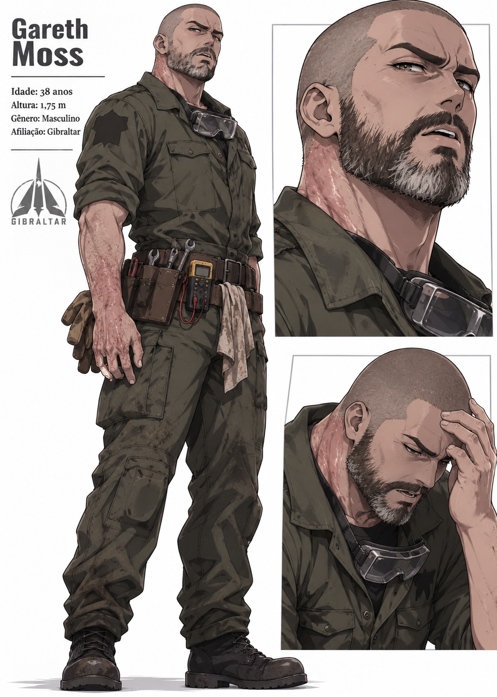

# FICHA DE PERSONAGEM: GARETH MOSS

*Chefe de máquinas e técnico de 'Mechs da ISS Gibraltar. Ex-AFFS. Fala com as bombas como quem fala com um cachorro velho, e com as pessoas o mínimo possível.*

*"Moss", para todos. "Técnico", para André. "Senhor Moss", só para Pip, quando quer alguma coisa.*

> Legenda das categorias: **[CÂNONE]** conferido no Sarna.net ou nos documentos do projeto (fontes no fim) · **[JOGADOR]** definido pelo jogador · **[CAP. 1]** e **[CAP. 2]** estabelecido na narração dos capítulos · **[imagem]** tirado da imagem de referência · **[INVENÇÃO]** criado nesta ficha, e por isso vetável · **[a definir]** fica para o jogador ou para a narrativa.
>
> A imagem mostra Moss sujo de graxa e abatido, como está no roleplay. A aparência abaixo descreve o homem como ele é no dia a dia. A ficha vai até a noite do pouso em Waycross, onde o Capítulo 2 está.

---

## 1. Identificação

| Campo | Dado |
|---|---|
| Nome | **Gareth Moss** [CAP. 1]. Nome do meio [INVENÇÃO]: Owen. |
| Como o chamam | "Moss", a tripulação. "Técnico", André [CAP. 1]. "Senhor Moss", Pip, quando quer alguma coisa [INVENÇÃO]. |
| Nascimento | 2987 ou 2988 [CAP. 1: 38 anos em março de 3026]. Dia e mês [INVENÇÃO]: 14 de fevereiro de 2988. |
| Idade | 38 anos [CAP. 1; imagem] |
| Origem | [INVENÇÃO] Kathil, na Marca Capelana, filho de um soldador dos estaleiros orbitais. Kathil é, depois de New Syrtis, o mundo mais importante da Marca, e os estaleiros dele foram aleijados pelos capelanos nas Guerras de Sucessão [CÂNONE]. |
| Altura e corpo | 1,75 m [imagem]; compacto, de ombros largos, antebraços grossos e mãos pesadas; uns 82 kg [INVENÇÃO] |
| Função | Chefe de máquinas e técnico de 'Mechs da Gibraltar [CAP. 1, lista da tripulação] |
| Serviço militar | Nove anos como técnico das AFFS, cuidando dos 'Mechs de um batalhão de linha na fronteira capelana [CAP. 1–2]. Qual batalhão: **[a definir]**. |
| Na Gibraltar desde | 3019 [INVENÇÃO], depois da morte de Edward Penhallow |
| No contrabando | Desde 3022. Sabia "como" [CAP. 1]. Ajudou a montar o reservatório quatro [CAP. 2]. |
| Família | [INVENÇÃO] Solteiro, sem filhos. A mãe morreu em 3010. O pai, soldador aposentado, vive em Kathil. Uma irmã mais nova, Megan, casada, com três filhos, que lhe escreve uma vez por ano. |
| Armado | Uma escopeta curta de bordo, ES-10 Bulkhead, entregue por André; deixada no tanque quando os Tubarões vieram buscá-lo [CAP. 2] |
| Onde está na noite do pouso | Na Rocha, com a tripulação da Gibraltar, no salão dos oficiais, depois de ter ligado o Centurion com Azami Matsuda pelo rádio e de ter sido tirado do tanque com Ros, Nell e Liam [CAP. 2] |

---

## 2. Aparência

### 2.1 Corpo e rosto
- **Porte:** baixo para a tripulação, mas largo. Tem o corpo de quem passou vinte anos levantando peça de 'Mech: ombros e antebraços grossos, pescoço curto, costas fortes [imagem].
- **Rosto:** quadrado, de maxilar pesado e nariz reto, com rugas fundas na testa e entre as sobrancelhas. É um rosto que parece sempre um pouco contrariado, mesmo quando está só concentrado [imagem].
- **Olhos:** verde-acinzentados, de pálpebras baixas, que olham as coisas um segundo a mais que o normal antes de decidir alguma coisa sobre elas [imagem; INVENÇÃO quanto ao hábito, a partir do CAP. 1: "olhou para mim como se estivesse medindo alguma coisa"].
- **Cabelo:** ralo, castanho, recuando nas têmporas. Raspa à máquina, bem curto, desde as AFFS; o que sobra é uma sombra no crânio [CAP. 1: "cabelo ralo"; imagem].
- **Barba:** cheia e curta, castanho-escura, grisalha no queixo. Apara uma vez por semana com a mesma máquina [imagem; INVENÇÃO quanto ao hábito].
- **Voz:** baixa e rouca, que quase não muda de tom. Diz uma frase quando os outros diriam três [CAP. 1].
- **Postura:** senta na ponta da mesa, de costas para a parede, sempre [CAP. 1]. De pé, com o peso nos calcanhares e as mãos soltas ao lado do corpo. Na sala de máquinas, anda como um homem anda na própria casa, encostando a mão nos canos para sentir a temperatura [CAP. 1].
- **Mãos:** grandes, de unhas curtas, sempre com uma sombra de graxa nas dobras. Dois dedos da mão esquerda (o anelar e o mínimo [INVENÇÃO quanto a quais]) já não dobram inteiros [CAP. 1].

### 2.2 Marcas
- **A queimadura** [CAP. 1; imagem]: começa no lado esquerdo do pescoço, logo abaixo da orelha, e desce, lisa e brilhante, de um rosado mais claro que a pele em volta, até sumir sob a gola. [INVENÇÃO] Por baixo da roupa, cobre a parte de cima do ombro esquerdo e um palmo do peito. Uma camisa de colarinho abotoada até o pescoço não a esconde inteira [CAP. 2].
- **Os antebraços** [imagem; INVENÇÃO quanto à origem]: salpicados de manchinhas mais claras, de respingos de solda e de fluido hidráulico quente, que todo técnico velho tem.
- **A mão esquerda** [CAP. 1]: os dois dedos rígidos ficam meio curvados, como se segurassem uma ferramenta invisível.

### 2.3 Roupa
- **De trabalho** [imagem]: macacão de duas peças, verde-oliva, de lona grossa, gasto nos joelhos; camisa de bolsos no peito, mangas dobradas acima do cotovelo; camiseta preta por baixo; calça cargo; botas de couro marrom, de bico duro, gastas e manchadas de óleo.
- **No pescoço** [imagem]: os óculos de proteção, pendurados pela tira, prontos para subir.
- **Na cintura** [imagem]: o cinto de ferramentas de couro, com as chaves combinadas, o alicate, o multímetro amarelo de pontas vermelhas e um trapo enfiado no cós.
- **Na mão** [imagem]: as luvas de raspa, quase sempre tiradas, porque ele diz que não sente a peça com elas [INVENÇÃO quanto à fala].
- **O remendo** [imagem; INVENÇÃO quanto ao sentido]: na manga esquerda, um remendo escuro em forma de estrela, costurado por cima do lugar onde ficava a insígnia do batalhão. Ele arrancou a insígnia no dia da baixa e nunca pôs outra coisa no lugar.
- **Para os Tubarões** [CAP. 2]: uma camisa de mangas compridas, abotoada até o pescoço, que não esconde a cicatriz.
- **Lanterna de capacete** para descer aos tanques [CAP. 1].

---

## 3. Cronologia

| Data | Acontecimento |
|---|---|
| 2988 | Nasce em Kathil [INVENÇÃO]. |
| ~2998–3006 | Aprende o ofício com o pai, nas carcaças das docas orbitais [INVENÇÃO]. |
| 3006 | Alista-se nas AFFS, aos dezoito anos, como aprendiz de técnico [INVENÇÃO quanto à data; CAP. 2: "Nove anos"]. |
| ~3007–3015 | Técnico de 'Mechs de um batalhão de linha na fronteira capelana. Troca atuador de Atlas, motor de Marauder, blindagem "de tudo quanto é coisa que anda" [CAP. 1]. |
| ~3011 | Numa incursão capelana a uma base de reparo, vê um MechWarrior esmagar um técnico das AFFS com o pé de um Vindicator "só porque ele estava no caminho" [CAP. 1; INVENÇÃO quanto à data]. |
| 3015 | O incêndio da baia de reparo: um Wolverine volta de uma incursão com a munição do ombro pegando fogo; Moss está embaixo dele, trocando um atuador. Seis homens morrem. Ele sai com a queimadura e os dois dedos [CAP. 1; INVENÇÃO quanto ao ano]. |
| 3015 | Baixa médica: a mão esquerda o desqualifica para técnico de primeira linha [INVENÇÃO]. |
| 3015–3018 | Três anos como técnico civil contratado num depósito de manutenção das AFFS na Marca Draconis [INVENÇÃO; ver o Registro]. |
| 3018–3019 | Fica sem contrato. Vai parar no porto de Elbar [INVENÇÃO]. |
| 3019 | Arthur o contrata na semana do enterro de Edward [INVENÇÃO]. |
| 3022 | Entra no contrabando. Monta os esconderijos das caixas [CAP. 1–2; INVENÇÃO quanto à data]. |
| 3025 | Pip Larkin embarca como aprendiz dele [INVENÇÃO quanto à data]. |
| ~Fim de 3025 | Monta, com Tom, o reservatório quatro: um tanque de água falso, com isolamento térmico de inspeção, feito para esconder um 'Mech desligado [CAP. 2]. |
| 25/03/3026 | Decolagem de Schedar. Primeiro dia: confere o motor e o giroscópio do Centurion [CAP. 1]. Leva Nell à sala de máquinas; mostra o grampo de Bridget; conta da cicatriz; diz a ela que o pai é um bom homem [CAP. 1]. |
| 26/03/3026 | No reservatório quatro, com Tom e Harry: "É uma peça da Liga com cara de Centurion." "Seu tio sabe onde. Eu sei como." [CAP. 1] |
| 27/03/3026 | A Halberd. Põe o medidor do quatro no verde. Abre a escotilha para os soldados, porque mandaram. Vê Harry morrer [CAP. 1]. |
| 28/03/3026 | Fala pela primeira vez depois do massacre. Admite que sabia; oferece-se para ligar o Centurion. Pede para conferir as correntes antes do salto. "Ela é como você." [CAP. 1] |
| 28–31/03/3026 | A travessia. Divide a cabine com Tom [CAP. 2]. |
| Dia do pouso | Abre o tanque falso com Tom. Ergue o berço. Guia a partida a frio do Centurion pelo rádio, com a piloto do Combine; fica na escada. Esconde-se no tanque com Ros, Nell e Liam; é levado para a Rocha [CAP. 2]. |

---

## 4. História

### 4.1 Kathil [INVENÇÃO sobre o CÂNONE]
Kathil é o segundo mundo da Marca Capelana. A Liga Estelar construiu ali, em 2602, um dos grandes estaleiros fora da Hegemonia; nas primeiras Guerras de Sucessão, as naves de guerra capelanas aleijaram os estaleiros de JumpShips [CÂNONE].

Gareth nasceu ali, filho de um soldador que trabalhava no que restava das docas: carcaças de séculos, reformadas para receber DropShips e consertar o que dava para consertar. A mãe era enfermeira de turno da noite. Gareth passou a infância embaixo das bancadas do pai, entregando chave, e aprendeu cedo que uma máquina avisa antes de quebrar, para quem sabe ouvir. Gente, não.

A mãe morreu em 3010, enquanto ele estava na fronteira. Ele soube por carta, como Arthur soube de Catherine, e é a única coisa que os dois têm em comum de que nenhum dos dois fala.

### 4.2 As AFFS (3006–3015)
Alistou-se aos dezoito para sair da sombra das docas e porque as AFFS pagavam a escola de técnico [INVENÇÃO]. Serviu nove anos [CAP. 2], cuidando dos 'Mechs de um batalhão de linha na fronteira capelana, durante a guerra [CAP. 1]. Trocou atuador de Atlas, motor de Marauder, blindagem de tudo o que anda [CAP. 1].

A fronteira capelana, para um técnico, eram as incursões: 'Mechs que saíam inteiros e voltavam aos pedaços, noites de trinta horas nas baias, e, de vez em quando, o inimigo dentro da base. Numa dessas, viu um MechWarrior capelano esmagar um técnico das AFFS com o pé de um Vindicator, só porque o homem estava no caminho. "Vi coisa pior." [CAP. 1] O Vindicator é o 'Mech de linha da Confederação Capelana, fabricado pela Ceres Metals desde 2826 [CÂNONE].

### 4.3 O Wolverine (3015)
Um Wolverine voltou de uma incursão com a munição do ombro pegando fogo, e ninguém percebeu a tempo. Moss estava embaixo dele, trocando um atuador [CAP. 1]. O Wolverine é um 'Mech médio de 55 toneladas, de uso comum nas AFFS; o modelo padrão leva um lançador de SRM-6 no torso esquerdo, ao lado do ombro [CÂNONE].

Seis homens não saíram da baia. Ele saiu com a queimadura e os dois dedos [CAP. 1]. O incêndio levou metade da equipe e a paciência que ele tinha com gente. Com máquinas, a paciência continuou intacta [CAP. 1].

[INVENÇÃO] O homem que estava no guindaste, o cabo Hal Brennan, tinha mulher e dois filhos em Kathil. Moss manda à viúva, desde então, uma parte do salário todo semestre, sem carta.

### 4.4 Três anos de contrato (3015–3018)
[INVENÇÃO; ver o Registro] Com a mão esquerda daquele jeito, as AFFS o consideraram inapto para técnico de primeira linha e lhe deram baixa médica. Ele assinou, no mesmo mês, um contrato de técnico civil num depósito de manutenção das AFFS na Marca Draconis, onde ninguém fazia exame de mão. Passou três anos ali, nas mesmas baias, de macacão sem insígnia. É por isso que, quando conta a vida, diz "doze anos dentro de baias de reparo das AFFS" a quem entende de máquina, e "nove anos nas AFFS" a quem pergunta por farda [CAP. 1–2].

Em 3018, o depósito cortou os contratados. Moss pegou o dinheiro, um cargueiro para Elbar e uma cerveja por noite no porto.

### 4.5 Arthur (3019)
[INVENÇÃO] Arthur o achou consertando um guindaste de cais em troca de uma garrafa, na semana em que enterrou Edward. A Gibraltar não tinha mais quem soubesse o motor dela como o irmão sabia. Arthur ofereceu um salário maior do que podia pagar e uma cabine. Moss fez uma única pergunta: "O que aconteceu com o último?" Arthur contou a versão que conta a todos: um contêiner mal travado. Moss aceitou.

Na Gibraltar, achou o que procurava sem saber: um motor velho e bom, uma sala de máquinas onde ninguém o incomodava e um capitão que falava por todo mundo, de modo que ele não precisava falar por ninguém [INVENÇÃO]. O grampo de cabelo com que Edward consertou o injetor na primeira viagem continua preso por arame numa placa da sala de máquinas. Moss nunca tirou dali [CAP. 1].

### 4.6 O "como" (3022–3026)
Quando Arthur começou a carregar armas, Moss foi o segundo a saber, depois de Tom [INVENÇÃO quanto à ordem]. Não aprovou nem desaprovou. Perguntou onde iam as caixas, olhou o porão e disse onde deviam ir. "Seu tio sabe onde. Eu sei como." [CAP. 1] Montou os fundos falsos, os painéis de válvulas falsas e a escotilha de manutenção escondida do porão [CAP. 1; INVENÇÃO quanto a ter sido ele].

No fim de 3025, montou com Tom o reservatório quatro: um tanque de água falso, com placas de cima iguais às dos tanques verdadeiros e isolamento térmico de inspeção, feito para enganar sensores de calor, para esconder um 'Mech desligado. "Funciona. Eu ajudei a montar. Funciona." [CAP. 2]

### 4.7 A peça da Liga (25–26/03/3026)
No primeiro dia da viagem, Moss desceu ao tanque e conferiu o motor e o giroscópio do Centurion [CAP. 1]. No segundo, ficou muito tempo de pé no berço, olhando o peito da máquina com a lanterna do capacete [CAP. 1]:

— Vocês não sabem o que é isso. Eu passei doze anos dentro de baias de reparo das AFFS. Troquei atuador de Atlas, motor de Marauder, blindagem de tudo quanto é coisa que anda. Nunca encostei numa coisa assim. Ninguém encostou. Isso aqui não é um Centurion com peças da Liga. É uma peça da Liga com cara de Centurion.

Conferiu as correntes elo por elo, com a mão espalmada no aço de cada um, "como quem mede a febre de um filho" [CAP. 1]. Mandou Harry calar a boca, e Harry calou [CAP. 1]. Disse que ninguém ia contar nada para Nell [CAP. 1].

Naquela manhã, Nell tinha pedido para ver a sala de máquinas, e ele não sabia dizer não para ela, embora não soubesse dizer sim de um jeito simpático [CAP. 1]. Mostrou o motor, o reator, a refrigeração e o grampo. Quando ela perguntou da cicatriz, ele contou, curto. E disse que o pai dela era um bom homem, "como quem pede que alguém se lembre de uma coisa antes que ela deixe de ser verdade" [CAP. 1].

### 4.8 A Halberd (27/03/3026)
Quando a Halberd apareceu, Arthur o chamou à ponte e lhe deu uma ordem: "O medidor do quatro no verde e a resistência no mínimo. Agora." [CAP. 1] Durante a vistoria, Moss viu Brannock achar o painel. Abriu a escotilha porque mandaram, digitou a senha e puxou a alavanca [CAP. 1]. Viu Harry morrer. Ajoelhou-se devagar com as mãos na nuca, olhando o corpo do rapaz com os olhos vazios [CAP. 1].

### 4.9 O primeiro a falar (28/03/3026)
Depois da noite da fumaça, ficou de olhos fechados, e foi o primeiro a dizer alguma coisa [CAP. 1]:

— Eu já vi homens matarem. Na guerra. Vi um MechWarrior capelano esmagar um técnico nosso com o pé de um Vindicator só porque ele estava no caminho. Vi coisa pior. Nunca vi um homem gostar daquilo daquele jeito. Calmo daquele jeito.

Quando o rapaz perguntou quem sabia, disse "Eu", logo depois de Tom [CAP. 1]. Quando perguntou da máquina, mediu o rapaz com os olhos antes de responder: "Que não devia existir… Mas, se você me perguntar se eu ligo aquilo, eu ligo." [CAP. 1]

Na Bellwether, pediu pela primeira vez para descer e conferir as correntes antes do salto, porque o salto sacode a carga. Desceu com o rapaz de escopeta atrás dele, passou a mão em cada elo e não disse nada. No poço do elevador, sem se virar: "Ela ia gostar de você. A máquina. Ela é como você. Ninguém sabe de onde veio." [CAP. 1]

### 4.10 A travessia
Dividiu a cabine com Tom [CAP. 2]. Quando o rapaz mostrou a lata do veneno, olhou para ela com a testa franzida, como quem não entende como aquilo foi parar ali [CAP. 2]. No refeitório, pôs a mão no ombro de Tom e a tirou em seguida, "como quem toca uma panela quente" [CAP. 2].

### 4.11 Waycross
**No porão** [CAP. 2], ao lado do painel do berço, com a camisa abotoada até o pescoço:
— Esse é o 'Mech? — É. — Parece um Centurion qualquer. — Não é um Centurion qualquer.
— Você é técnico? — Fui das AFFS. Nove anos. — E o que um técnico das AFFS está fazendo numa Mule de trigo? — Trigo.

Ergueu o berço com os macacos hidráulicos até a cabeça do Centurion ficar a meio metro das vigas. Pediu energia externa e alguém para entrar. Quando a piloto do Combine entrou na cabine, subiu atrás dela até o meio da escada, com um rádio [CAP. 2]:

— A partida a frio é pelo painel lateral esquerdo. Embaixo da tampa com a fita amarela. O computador vai pedir…
— Eu sei como se liga um 'Mech.
— Este não.

Ela pediu que ele dissesse. Ele disse; ela repetiu cada passo em voz alta. Quando a eletrônica da Liga acendeu, a piloto ficou quatro segundos em silêncio. "É. Eu sei." "Isto não é um Centurion." "É um Centurion. Só não é dos que você conhece." Ela disse que não precisava que ele ficasse durante a recalibragem do neurocapacete. "Eu fico." E ficou, no meio da escada, com o rádio na mão. O técnico das AFFS e a piloto do Combine [CAP. 2].

Às 11h38, o reator do Centurion pegou. "Destravando o berço." [CAP. 2]

**No refeitório**, quando o rapaz disse que ele ficava na nave com Ros, Nell e Liam e que os quatro se escondiam no tanque, fez que sim devagar [CAP. 2]. Às 13h25, desceu ao reservatório quatro, soltou os grampos da placa de isolamento de bombordo, entrou por último e fechou os grampos por dentro [CAP. 2]. Ros decola em sessenta segundos "se o Moss soltar as travas" [CAP. 2].

O Júnior soube que eles estavam lá e os mandou buscar "com educação": "A piloto, o técnico, o namoradinho e a loirinha." [CAP. 2]

---

## 5. Formação e capacitação

### 5.1 Formação [INVENÇÃO sobre o CAP. 1–2]
- Aprendizado de oficina com o pai, nas docas de Kathil: solda, hidráulica, motores de DropShip.
- Escola de técnicos das AFFS: curso básico de técnico de 'Mechs, com especialização em atuadores e sistemas de movimento.
- Nove anos de técnico de linha em batalhão de 'Mechs, com promoção a técnico-chefe de baia nos dois últimos anos.
- Três anos de técnico civil em depósito de manutenção.
- Sete anos de chefe de máquinas de DropShip civil.

### 5.2 O que ele sabe fazer
- **'Mechs** da era da Guerra de Sucessão: atuadores, motores de fusão, giroscópios, blindagem, armas, munição. Atlas e Marauder passaram pela mão dele [CAP. 1].
- **Partida a frio** de um 'Mech desligado há meses, inclusive de um com eletrônica que ele nunca tinha visto [CAP. 2].
- **Motor de DropShip**: reator, refrigeração, injetores, a sala de máquinas inteira da Gibraltar [CAP. 1].
- **Equipamento de porão**: berços de transporte, macacos hidráulicos, correntes de amarração, guindastes [CAP. 1–2].
- **Esconderijos**: tanques falsos, isolamento térmico, painéis de válvulas falsas [CAP. 1–2].
- **Diagnóstico de ouvido**: sabe pelo barulho o que uma bomba vai fazer antes de ela fazer [CAP. 1; INVENÇÃO quanto ao alcance].
- **Ensinar**, do jeito dele: Pip aprende olhando e levando bronca [INVENÇÃO].

### 5.3 O que ele não sabe fazer
- Tecnologia da Liga Estelar. Nunca tinha encostado. Sabe ligar e conferir; não sabe consertar nem calibrar a fundo [CAP. 1].
- Pilotar 'Mech. Sabe andar com um dentro da baia, e nada mais [INVENÇÃO].
- Conversar.

### 5.4 Avaliação por área
Escala do projeto: Verde, Regular, Veterano e Elite (`Economia_3026.md`). Guia de narração, não dado. [INVENÇÃO]

| Área | Nível | Observação |
|---|---|---|
| Técnico de 'Mechs (Esfera Interna) | **Elite** | Doze anos de baia |
| Sistemas de movimento e atuadores | **Elite** | A especialidade dele |
| Motor de DropShip | Veterano | Sete anos de Gibraltar |
| Equipamento de porão e berços | Veterano | |
| Esconderijos de contrabando | Veterano | Cinco anos sem achado, até Brannock [CAP. 1] |
| Tecnologia da Liga Estelar | Verde | O melhor a bordo mesmo assim |
| Escopeta e pistola | Regular | Treino básico das AFFS |
| Luta | Regular | Força de oficina |
| Pilotagem de 'Mech | Verde | |
| Trato com pessoas | Verde | Melhor com quem não quer conversa |

### 5.5 Salário
O ofício de técnico de 'Mech vale, no mercado mercenário de 3026, uma faixa abaixo da de MechWarrior; um técnico com a experiência dele seria Veterano na escala do projeto [`Economia_3026.md`; INVENÇÃO quanto à aplicação]. Na Gibraltar, ganha como chefe de máquinas de cargueiro, bem menos. O valor exato: **[a definir]**.

---

## 6. Histórico de serviço

| Período | Onde | Função | Como terminou |
|---|---|---|---|
| 3006–3015 | AFFS, batalhão de linha na fronteira capelana | Técnico de 'Mechs, depois técnico-chefe de baia [CAP. 1–2; INVENÇÃO quanto ao posto] | Baixa médica depois do incêndio [INVENÇÃO] |
| 3015–3018 | Depósito de manutenção das AFFS na Marca Draconis | Técnico civil contratado [INVENÇÃO] | Corte de contratados |
| 3019–hoje | ISS Gibraltar | Chefe de máquinas e técnico de 'Mechs [CAP. 1] | Em curso |

Posto na baixa [INVENÇÃO]: sargento técnico.

---

## 7. Histórico médico

- **A queimadura** [CAP. 1]: do lado esquerdo do pescoço até o ombro e o peito. Cicatriz antiga, de enxerto [INVENÇÃO]. Repuxa quando ele vira a cabeça para a direita depressa, e coça no frio [INVENÇÃO].
- **A mão esquerda** [CAP. 1]: dois dedos que não dobram inteiros, por tendões queimados. Pega bem com a direita; com a esquerda, segura e apoia [INVENÇÃO quanto ao detalhe].
- **O ouvido esquerdo** [INVENÇÃO]: perdeu parte da audição na explosão. Por isso inclina a cabeça para a direita quando escuta alguém, e por isso fala baixo.
- **As costas na parede** [CAP. 1]: senta sempre de costas para a parede. Desde o incêndio, não gosta de nada atrás dele.
- **Sono** [INVENÇÃO]: dorme pouco e acorda com qualquer mudança no ruído do motor. Sonha com o cheiro de propelente queimado.
- **Bebida** [INVENÇÃO]: uma cerveja por noite, sozinho, na sala de máquinas. Nunca duas.
- **Estado na noite do pouso:** ileso [CAP. 1–2].
- **Dados** [INVENÇÃO]: tipo sanguíneo O positivo; nenhuma alergia; nenhuma medicação.

---

## 8. Mente e personalidade

### 8.1 O núcleo
Moss confia em máquinas porque máquinas avisam. Gente não avisa. O Wolverine avisou, com fumaça, e ninguém olhou a tempo; desde então, ele olha [CAP. 1; INVENÇÃO quanto à leitura].

### 8.2 Calado
Fala com as máquinas e não com as pessoas [CAP. 1]. Levantar a xícara um palmo acima da mesa, nele, equivale a um discurso [CAP. 1]. Responde com uma palavra quando dá: "É." "Foi." "Trigo." [CAP. 1–2] Não é frieza. É economia: gastou a paciência com gente num incêndio e guarda o que sobrou.

### 8.3 O que ele sente e não diz
- Carinho por Nell, que não sabe expressar: não sabe dizer não para ela, nem sim de um jeito simpático [CAP. 1].
- Lealdade a Arthur, que ele diz em uma frase só, à filha dele: "Seu pai é um bom homem. Lembra disso." [CAP. 1]
- Respeito pela máquina do tanque, que ele toca "como quem toca a cabeça de alguém" [CAP. 1].
- Uma coisa parecida com respeito pelo rapaz, que ele reconhece na máquina: os dois não deviam existir [CAP. 1].

### 8.4 A culpa
Moss sabia "como" [CAP. 1]. Não pensa muito nos fuzis: pensa nas correntes, nos tanques, no isolamento. Quando o rapaz mostrou a pasta do Júnior a Arthur, ele não estava lá [CAP. 2]. Quando souber para onde as caixas foram, vai fazer a conta que um técnico faz: quem montou a arma também está na lista [INVENÇÃO].

### 8.5 Com o inimigo
É técnico das AFFS que viu capelanos matarem técnicos. Diante de uma piloto do Combine, que tem o mesmo tipo de sotaque das pessoas contra quem a Federação luta, ele disse "Este não" e "Eu fico" [CAP. 2]. Para ele, quem senta numa cabine que ele preparou é responsabilidade dele, de onde quer que venha [INVENÇÃO quanto à leitura].

### 8.6 O que ele quer [INVENÇÃO]
- Ver o Centurion inteiro, armado e calibrado, uma vez.
- Que Pip não termine como os seis da baia.
- Que Nell continue achando que o pai é um bom homem.
- Uma sala de máquinas, um motor e silêncio.

### 8.7 O que ele não faz
- Não mente sobre máquina. "Se você me perguntar se eu ligo aquilo, eu ligo." [CAP. 1]
- Não larga quem está numa cabine que ele preparou [CAP. 2].
- Não conta segredo de ninguém [CAP. 1; INVENÇÃO quanto à generalização].
- Não senta de costas para uma porta [CAP. 1].

### 8.8 Como reage

| Diante de | Ele |
|---|---|
| Uma máquina com problema | Paciência infinita, mão no aço, ouvido atento [CAP. 1] |
| Uma pergunta pessoal | Uma frase. Às vezes, a verdade inteira numa frase [CAP. 1] |
| Uma ordem de quem tem a arma | Obedece, sem pressa [CAP. 1] |
| Violência | Fecha os olhos; depois diz o que viu [CAP. 1] |
| Harry falando demais | "Cala a boca." [CAP. 1] |
| Alguém sofrendo | A mão no ombro, e logo tirada [CAP. 2] |
| Um técnico pirata que ri dele | Uma palavra: "Trigo." [CAP. 2] |

---

## 9. Voz e fala

### 9.1 Como ele fala
- Baixo, rouco, sem subir o tom.
- Frases curtas, sujeito, verbo e objeto. Pouco adjetivo.
- Palavrão raro, e seco [INVENÇÃO].
- Quando fala de máquina, fala mais, com termos exatos e sem pressa.
- Trata as máquinas no feminino: "ela" [CAP. 1].

### 9.2 Falas dos capítulos
— Foi.

— Pode perguntar. Baia de reparo, na fronteira capelana. Um Wolverine voltou de uma incursão com a munição do ombro pegando fogo e ninguém percebeu a tempo. Eu estava embaixo dele, trocando um atuador. Seis caras não saíram de lá. Eu saí com isso.

— Cala a boca.

— É uma peça da Liga com cara de Centurion.

— Nem o seu tio sabe. Seu tio sabe onde. Eu sei como. E vocês sabem que não é para saber.

— Ninguém vai contar nada para a Nell. Ninguém.

— Nunca vi um homem gostar daquilo daquele jeito. Calmo daquele jeito.

— Mas, se você me perguntar se eu ligo aquilo, eu ligo.

— Ela ia gostar de você. A máquina. Ela é como você. Ninguém sabe de onde veio.

— Fui das AFFS. Nove anos.

— Trigo.

— Este não.

— É um Centurion. Só não é dos que você conhece.

— Eu fico.

### 9.3 Exemplos de voz em situações novas [INVENÇÃO]
Para Pip, debaixo de um painel:

— Não força. Se precisa forçar, está errado. Solta, olha de novo.

Para André, sobre o Centurion:

— O motor está bom. O giroscópio está bom. O resto eu não sei, e quem disser que sabe está mentindo. Para mexer na eletrônica, precisa de alguém que já tenha visto uma dessas funcionando. Eu não conheço ninguém vivo que tenha visto.

Para Nell, se ela perguntar se ele sabia:

— Sabia. — Uma pausa. — Ele continua sendo um bom homem. As duas coisas são verdade.

### 9.4 Pensamentos [INVENÇÃO quanto ao conteúdo]
(Fumaça. Olha a fumaça.)

(Correntes boas. Pino três rangendo. Depois.)

(Este não, menina. Este ninguém conhece.)

---

## 10. Relações

### 10.1 Arthur
O capitão que o tirou do porto e falou por ele durante sete anos [INVENÇÃO]. Moss é leal a ele em silêncio e o defende em uma frase [CAP. 1]. Sabe o "onde" que Arthur sabe e o "como" que Arthur não sabe [CAP. 1]. Ficha própria: `Arthur_Penhallow.md`.

### 10.2 Nell
Não sabe dizer não para ela [CAP. 1]. Foi a ele que ela perguntou da cicatriz, e ele contou [CAP. 1]. A frase sobre o pai foi uma das três coisas que não se encaixavam na cabeça dela [CAP. 1]. Ficha própria: `Nell_Penhallow.md`.

### 10.3 Tom
Companheiro de porão e de segredo há cinco anos; desde a travessia, companheiro de cabine [CAP. 1–2]. Trocam olhares sem mexer o rosto [CAP. 1]. Moss é a única pessoa a bordo cuja mão Tom deixou no ombro, um segundo [CAP. 2].

### 10.4 Harry
Moss o mandava calar a boca, e ele calava [CAP. 1]. Viu-o morrer [CAP. 1].

### 10.5 Pip Larkin
O aprendiz, vinte anos, magro e sardento, que fala pouco perto de Moss e muito longe dele [CAP. 1]. Pip achou ter visto uma sombra cair do duto da sala de máquinas e não contou "porque Moss ia rir dele" [CAP. 1]. Moss nunca riu dele [INVENÇÃO]. Trabalha no guindaste em Waycross [CAP. 2].

### 10.6 Ros
Os dois ex-AFFS a bordo. Ela o via descer ao porão de madrugada [CAP. 2]. Ela decola em sessenta se ele soltar as travas [CAP. 2]. Ficha própria: `Ros_Hale.md`.

### 10.7 Crane
Os dois que sabiam, além dos Penhallow [CAP. 1]. [INVENÇÃO] Respeito de veteranos, nenhuma amizade.

### 10.8 André ("o rapaz")
Moss foi o primeiro a falar dele depois da fumaça, e o que disse não foi medo: foi uma constatação técnica [CAP. 1]. Mediu-o antes de responder [CAP. 1]. Comparou-o à máquina [CAP. 1]. Obedece a ele como obedeceria a qualquer um com a arma, e conversa com ele como conversaria com uma máquina que não entende, mas respeita.

### 10.9 Azami Matsuda
A piloto do Combine que ele guiou pela partida a frio. Ele ficou na escada [CAP. 2]. Ficha própria: `Azami_Matsuda.md`.

### 10.10 Haddix
O chefe de logística dos Tubarões, que riu dele por um técnico das AFFS numa Mule de trigo e não ouviu outra coisa além de "Trigo" [CAP. 2].

---

## 11. Recursos e posses

- O cinto de ferramentas, as luvas, os óculos, o multímetro [imagem].
- A escopeta Bulkhead, deixada no tanque [CAP. 2].
- [INVENÇÃO] Na cabine da Gibraltar: uma caixa de ferramentas própria, herdada do pai; uma foto da equipe da baia, tirada um mês antes do incêndio, com seis rostos riscados a lápis; as cartas da irmã.
- [INVENÇÃO] Economias modestas: vive na nave, gasta pouco, manda dinheiro à viúva de Brennan.

---

## 12. Estado na noite do pouso

- **Onde:** no salão dos oficiais da Rocha, com a tripulação, tratado "como rei" e vigiado [CAP. 2].
- **Corpo:** ileso, cansado.
- **Cabeça:** viu a eletrônica da Liga acender pela primeira vez; viu o Centurion sair andando da Gibraltar; ouviu a piloto do Combine dizer que aquilo não era um Centurion. Sabe que os Tubarões sabem que ele é ex-AFFS.
- **O que não sabe:** que a *Resolute*, da Federação, a que ele serviu nove anos, está em órbita e ataca antes das seis.

---

## 13. Segredos e quem sabe o quê

| Fato | Quem sabe |
|---|---|
| Sabia do contrabando | A tripulação, desde a noite da ponte [CAP. 1] |
| Montou os esconderijos e o reservatório quatro | Tom, Arthur, André [CAP. 2] |
| É ex-AFFS | A tripulação, Haddix [CAP. 1–2] |
| O que sabe do Centurion | André, Tom, Harry (morto) [CAP. 1] |
| O dinheiro à viúva de Brennan [INVENÇÃO] | Ninguém |

---

## 14. Vulnerabilidades

1. **O passado nas AFFS.** Para os Tubarões, é um ex-soldado da Federação. Para as AFFS, um desertor do lado errado.
2. **O conhecimento.** Quem quiser o Centurion vai querer o homem que sabe ligá-lo.
3. **O ouvido e as costas** [INVENÇÃO]: perde coisas pela esquerda; não suporta ninguém atrás.
4. **Fogo.** O cheiro de munição queimando o leva de volta à baia [INVENÇÃO].
5. **Nell e Pip.** Os dois por quem ele faria alguma coisa estúpida.

---

## 15. Orientação ao narrador

- **Pouca fala, muito gesto.** A mão no aço, a xícara levantada um palmo, a cabeça inclinada para ouvir.
- **Competência real.** Quando ele fala de máquina, a narração deve ser precisa.
- **Não fazer dele um homem frio.** É calado; cuida de todos à maneira dele.
- **O vínculo com a máquina.** O Centurion é a única coisa que o fez falar muito. Usar isso.
- **O vínculo com Azami.** Começou numa escada, com um rádio. Não acelerar.
- **O que fica com o jogador:** o batalhão, o mundo natal, o destino dele no ataque.

---

## 16. Ganchos

1. **O Centurion.** O comprador, o Júnior ou André vão querer quem sabe ligá-lo.
2. **As AFFS.** A *Resolute* pode trazer alguém do antigo batalhão.
3. **A viúva de Brennan** [INVENÇÃO].
4. **Pip.** O aprendiz que ainda não viu o que Moss viu.
5. **Azami.** O técnico e a piloto.
6. **A conta.** Quando souber o que os fuzis fizeram.

---

## 17. Registro

### CÂNONE verificado
| Fato | Fonte |
|---|---|
| Kathil: mundo da Marca Capelana, da Federação; um dos mais importantes da Marca depois de New Syrtis; estaleiros da Liga (2602), aleijados nas Guerras de Sucessão; sede da milícia de marca Kathil CMM desde 2754 | sarna.net/wiki/Loren's_Folly; sarna.net/wiki/Kathil_Capellan_March_Militia |
| Marca Capelana: feudo da Casa Hasek, capital New Syrtis | cfw.sarna.net/wiki/Capellan_March |
| Vindicator: 'Mech capelano de 45 t, da Ceres Metals (Capella), de 2826 | sarna.net/wiki/Ceres_Metals; texto do Sarna citado em career200.github.io; mwo.fandom.com/wiki/Vindicator |
| Wolverine: introduzido em 2575; WVR-6R de 55 t com AC/5, SRM-6 no torso esquerdo e laser médio na cabeça; usado pela Federação | texto do Sarna citado em career200.github.io; sarna.net/wiki/BattleTech_(Video_Game)/BattleMechs; camospecs (Armored Cavalry da Federação) |
| Centurion CN9-A: 50 t, Corean, 2801 | registro do Capítulo 1 |
| ES-10 Bulkhead | `Armas_e_Equipamento_de_Infantaria.md` (arsenal do projeto) |

### Divergências e leituras adotadas
- **Doze anos ou nove.** No Capítulo 1, Moss diz que passou "doze anos dentro de baias de reparo das AFFS"; no Capítulo 2, diz a Haddix: "Fui das AFFS. Nove anos." Leitura adotada: nove anos de farda e três de técnico civil contratado num depósito das AFFS. As duas frases são verdadeiras.
- **O cabelo.** O texto diz "cabelo ralo"; a imagem mostra a cabeça raspada. Leitura adotada: cabelo ralo, raspado à máquina.
- **Quando entrou na Gibraltar.** O texto não diz. Leitura adotada: 3019, depois da morte de Edward, que fazia as vezes de mecânico (o grampo do injetor).

### INVENÇÃO desta ficha (vetável)
O nome do meio e a data de nascimento; Kathil e a família; a escola de técnicos e o posto; a data do Vindicator e do incêndio; a baixa médica; o depósito e o corte de contratos; o encontro com Arthur e a pergunta; a autoria dos esconderijos; Brennan e a viúva; o ouvido; o remendo da manga; a caixa de ferramentas do pai e a foto riscada; os exemplos de fala; os pensamentos; os ganchos.

### Pendências
- O batalhão das AFFS e o mundo do incêndio.
- O salário na Gibraltar.
- O destino dele no ataque da *Resolute*.
