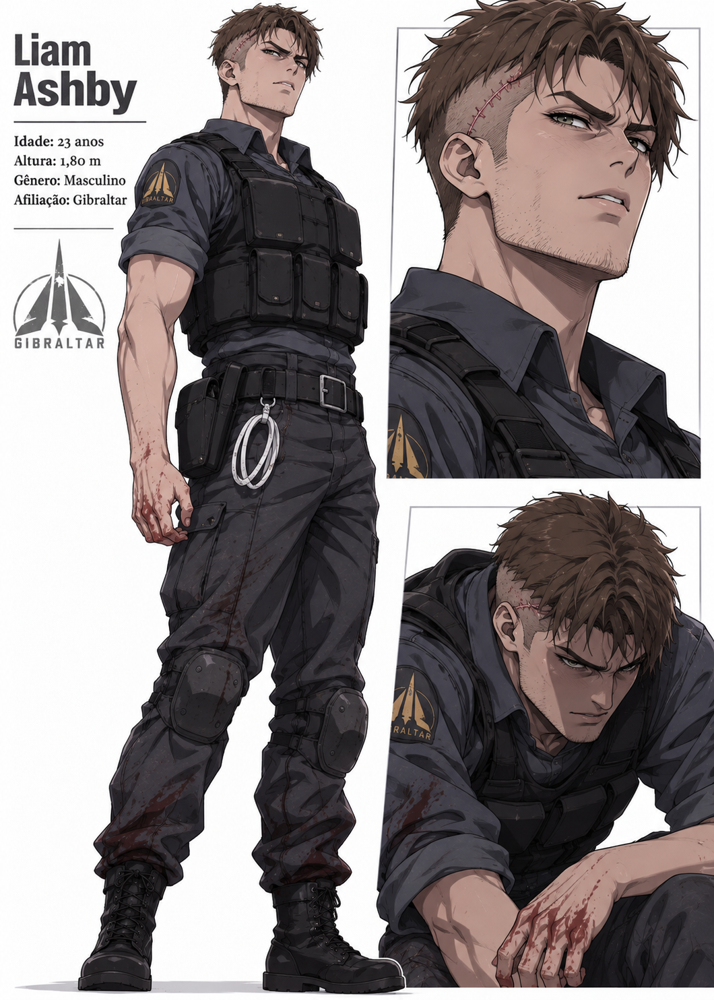

# FICHA DE PERSONAGEM: LIAM ASHBY

*Segurança da ISS Gibraltar. Ex-soldado da milícia de Elbar. Namorado de Nell. Dança mal e pede desculpa a cada pisão.*

*"Liam", para Nell e para a tripulação. "Ashby", para Arthur, quando o pega no flagra. "O namoradinho", para o Júnior.*

> Legenda das categorias: **[CÂNONE]** conferido no Sarna.net ou nos documentos do projeto (fontes no fim) · **[JOGADOR]** definido pelo jogador · **[CAP. 1]** e **[CAP. 2]** estabelecido na narração dos capítulos · **[imagem]** tirado da imagem de referência · **[INVENÇÃO]** criado nesta ficha, e por isso vetável · **[a definir]** fica para o jogador ou para a narrativa.
>
> A imagem mostra Liam com o corte costurado na cabeça e as mãos sujas de sangue, como ele está no roleplay. A aparência abaixo descreve o rapaz como ele é no dia a dia; o ferimento está listado à parte. A ficha vai até a noite do pouso em Waycross, onde o Capítulo 2 está.

---

## 1. Identificação

| Campo | Dado |
|---|---|
| Nome | **Liam Ashby** [CAP. 1]. Nome do meio [INVENÇÃO]: Patrick. |
| Como o chamam | "Liam", Nell e a tripulação. "Ashby", Arthur e Crane, e André na narração [CAP. 1]. "O namoradinho", o Júnior [CAP. 2]. |
| Nascimento | 3002 ou 3003 [CAP. 1: 23 anos em março de 3026]. Dia e mês [INVENÇÃO]: 2 de outubro de 3002. |
| Idade | 23 anos [CAP. 1; imagem] |
| Origem | [INVENÇÃO] Elbar, numa fazenda de trigo das planícies a oeste do porto, filho de cooperados da cooperativa de grão |
| Altura e corpo | 1,80 m [imagem]; atlético, de ombros largos e cintura fina, braços fortes de quem carregou saco na infância e fuzil na milícia; uns 78 kg [INVENÇÃO] |
| Serviço militar | Ex-soldado de milícia [CAP. 1]. [INVENÇÃO] Milícia planetária de Elbar, de 3020 a 3025, na estação de vigilância orbital do sistema; soldado de primeira classe. |
| Função | Segurança da Gibraltar, sob Victor Crane, desde agosto de 3025 [CAP. 1: entrou dois meses depois do baile; INVENÇÃO quanto ao mês] |
| No contrabando | **Não sabia** [CAP. 1: os que sabiam eram Tom, Harry, Moss e Crane]. Descobriu na Halberd, como Nell. |
| Família | [INVENÇÃO] Os pais, Hugh e Maggie Ashby, ainda na fazenda; três irmãos: Rory, o mais velho, que vai herdar a terra; Liam, o do meio; as gêmeas Ciara e Aoife, de catorze anos. |
| Relação | Namora Eleanor "Nell" Penhallow há nove meses. Ela decidiu na primeira noite que ia se casar com ele [CAP. 1]. |
| Armado | Uma submetralhadora SM-01 Squire e um rádio de mão da Milícia, entregues por André; deixados no tanque quando os Tubarões vieram buscá-lo [CAP. 2] |
| Onde está na noite do pouso | Na Rocha, com a tripulação, no salão dos oficiais. Foi ele quem respondeu "Entendido" pelo rádio quando André mandou os quatro saírem do tanque [CAP. 2]. |

---

## 2. Aparência

### 2.1 Corpo e rosto
- **Rosto:** bonito "de um jeito que ainda não sabia que era" [CAP. 1]. Maxilar marcado, queixo firme com uma covinha leve, nariz reto, maçãs altas [imagem].
- **Sorriso:** torto, sobe mais do lado direito [CAP. 1; INVENÇÃO quanto ao lado]. É a coisa que Nell viu primeiro no baile.
- **Olhos:** verde-acinzentados, de sobrancelhas grossas e retas, que se franzem fácil [imagem]. Quando está bravo, os olhos ficam pequenos e duros; quando está com Nell, ficam de menino.
- **Cabelo:** castanho, grosso e rebelde, cortado curto dos lados e mais comprido em cima, caindo em mechas desarrumadas sobre a testa. Molhado, depois do banho apressado antes do jantar [CAP. 1; imagem].
- **Barba:** uma sombra rala no queixo e no maxilar, que ele faz a cada dois dias porque não cresce o bastante para valer a pena [imagem; INVENÇÃO quanto ao hábito].
- **Pele:** clara, um pouco queimada de sol nos antebraços e no pescoço, de infância na lavoura [INVENÇÃO].
- **Orelhas:** ficam vermelhas quando ele fica com vergonha, até a raiz do cabelo [CAP. 1].
- **Voz:** de tenor, firme, que racha quando ele grita e treme quando fala com raiva, mas não para [CAP. 1–2].
- **Postura:** de soldado em parada quando Arthur olha [CAP. 1]; relaxada, mãos nos bolsos e peso numa perna, quando não olha. Fica perto de Nell sempre que há outros homens por perto, com a mão nas costas dela [CAP. 1].
- **Tique:** a mão direita fecha e abre ao lado do corpo quando ele está tenso [CAP. 2].

### 2.2 Roupa
- **De serviço** [imagem]: camisa de trabalho cinza-azulada, de colarinho e mangas dobradas acima do cotovelo, com o emblema da Gibraltar (uma agulha com asas, dourada, num círculo preto) na manga esquerda; colete tático preto, de bolsos de carregador; cinto de lona preto com fivela de aço; coldre na coxa direita; algemas presas no cinto por um mosquetão; calça cargo cinza-chumbo; joelheiras pretas; coturnos pretos de cano alto.
- **Fora de serviço** [INVENÇÃO]: camiseta, calça de lona e a jaqueta velha da milícia, sem as insígnias.
- **Para o jantar da primeira noite** [CAP. 1]: banho tomado às pressas, cabelo molhado.
- **Sempre com ele** [INVENÇÃO]: uma correntinha com a placa de identificação da milícia, por baixo da camisa; um maço de cartas de Nell na mochila.

### 2.3 Ferimento atual (não faz parte da aparência normal)
- **O corte** [CAP. 1; imagem]: 6 cm, oito pontos, da coronhada de um fuzil Highlander em 27/03/3026. Fica atrás da orelha esquerda e desce em direção à nuca. André raspou o cabelo em volta para costurar, e é por isso que, na imagem, o lado esquerdo da cabeça aparece raspado, com a cicatriz costurada.
- **A concussão e a febre**: em recuperação [CAP. 1–2].
- Vai ficar uma cicatriz [INVENÇÃO]. O cabelo cresce por cima em um ou dois meses.

---

## 3. Cronologia

| Data | Acontecimento |
|---|---|
| 3002 | Nasce numa fazenda de trigo de Elbar [INVENÇÃO]. |
| 3008–3020 | Infância e adolescência na fazenda: lavoura, colheita, sacos, trator, festas da cooperativa [INVENÇÃO]. |
| 3020 | Alista-se na milícia planetária de Elbar, aos dezoito anos, para sair da fazenda [INVENÇÃO]. |
| 3020–3025 | Cinco anos de milícia. Treinamento básico; depois, guarda da estação de vigilância orbital do sistema, com descidas de licença a Elbar [INVENÇÃO; CAP. 1: "numa licença dele em terra"]. |
| Junho de 3025 | Num baile da cooperativa de grão, numa licença em terra, conhece Nell. Dança mal, pisa no pé dela e pede desculpa a cada pisão. Ela decide que vai se casar com ele [CAP. 1; INVENÇÃO quanto ao mês]. |
| Agosto de 3025 | Termina o tempo de milícia e não renova. Entra para a segurança da Gibraltar, dois meses depois do baile. Sempre negou que tivesse sido por causa dela [CAP. 1]. |
| Agosto de 3025 a março de 3026 | Sete meses de rota Elbar–Schedar. Cartas com Nell, que termina a academia [INVENÇÃO]. |
| 25/03/3026 | Nell embarca em Schedar. O beijo no jantar; "Ashby."; "Senhor." [CAP. 1] |
| 26/03/3026 | O beijo no corredor do segundo convés; Arthur: "Você não tem uma ronda?" "Estou nela, senhor." "Na minha filha?" À noite, a rouparia do quarto convés [CAP. 1]. |
| 27/03/3026 | A Halberd. O cabo Voss põe a mão em Nell; Liam, algemado, derruba-o com o ombro, dá-lhe uma cabeçada e quebra o nariz dele. A coronha de um Highlander o atinge atrás da cabeça. Voss levanta o fuzil para matá-lo e é parado por um grito [CAP. 1]. |
| 28/03/3026 | Nove horas sangrando, febre. Tenta pegar a faca de André; André segura o pulso dele no ar. Nell implora. André o costura [CAP. 1]. |
| 28–31/03/3026 | Enfermaria, câmera e alarme na porta. Pergunta por Nell duas vezes [CAP. 2]. |
| Dia do pouso | Catorze minutos com Nell na enfermaria. Na rampa, com Crane, diante de Haddix. No refeitório, enfrenta André. Recebe a Squire e o rádio. Esconde-se no tanque; responde "Entendido" [CAP. 2]. |

---

## 4. História

### 4.1 A fazenda [INVENÇÃO]
Liam nasceu numa fazenda de trigo das planícies de Elbar, filho do meio de uma família de cooperados. A cooperativa de grão é o centro da vida ali: compra a semente, vende a colheita, empresta o trator e, duas vezes por ano, dá um baile no galpão grande, com banda de sanfona, bandeirinhas e cerveja de cevada.

O pai, Hugh, é um homem de poucas palavras e mão pesada, que nunca bateu nos filhos mas nunca precisou. A mãe, Maggie, é a voz da casa. Rory, o mais velho, vai herdar a terra; Liam sabia disso desde os dez anos e nunca se ressentiu, porque nunca quis ficar. As gêmeas, Ciara e Aoife, adoram o irmão do meio e escrevem cartas para ele cheias de desenhos.

Na fazenda, aprendeu a trabalhar de sol a sol, a carregar saco, a dirigir trator antes de alcançar os pedais direito e a brigar com os filhos dos vizinhos. Aprendeu também, com a mãe, a pedir desculpa.

O trigo que a Gibraltar carrega para Schedar é, em parte, o da cooperativa dele [INVENÇÃO].

### 4.2 A milícia (3020–3025) [INVENÇÃO]
Aos dezoito, alistou-se na milícia planetária de Elbar para sair da fazenda e ver alguma coisa além do horizonte de trigo. Fez o treinamento básico: fuzil, marcha, abordagem, primeiros socorros, ordem unida. Recebeu um AR-02 Highlander, o fuzil compacto que as unidades da Marca Draconis preferem [CÂNONE do projeto, `Armas_e_Equipamento_de_Infantaria.md`], e aprendeu a desmontá-lo de olhos fechados. Foi esse o fuzil cuja coronha o derrubou na ponte da Gibraltar.

Passou a maior parte dos cinco anos de guarda na estação de vigilância orbital do sistema: corredores de aço, rondas, exercícios de abordagem, tédio, cartas de casa. Nunca viu combate. Descia a Elbar de licença três ou quatro vezes por ano. Saiu soldado de primeira classe, com uma ficha limpa, uma advertência por briga num bar do porto e nenhuma vontade de renovar.

Liam sabe, por isso, exatamente como uma Leopard da Milícia faz uma vistoria. Sabia, quando a Halberd encostou, o que Brannock e os soldados iam fazer, e em que ordem [INVENÇÃO quanto ao conhecimento].

### 4.3 O baile (junho de 3025)
Conheceu Nell num baile da cooperativa de grão, numa licença em terra [CAP. 1]. Ela tinha ido com a tia Ruth [INVENÇÃO]. Ele a tirou para dançar, dançou mal, pisou no pé dela e pediu desculpa a cada pisão, e ela riu tanto que ele desistiu de acertar o passo e passou a pisar de propósito, para ouvi-la rir [CAP. 1; INVENÇÃO quanto ao final]. Ela decidiu, na mesma noite, que ia se casar com aquele rapaz de sorriso torto [CAP. 1].

### 4.4 A Gibraltar (agosto de 3025)
Dois meses depois, entrou para a segurança da Gibraltar [CAP. 1]. Ela sempre suspeitou que tinha sido por causa dela; ele sempre negou; os dois sabiam a verdade [CAP. 1].

[INVENÇÃO] A Gibraltar passou por Elbar em agosto de 3025, a última vez que Arthur viu a filha antes da viagem. Crane estava com uma vaga, porque um dos homens dele tinha ido para uma companhia mercenária. Liam se apresentou com os papéis da milícia. Arthur reconheceu o rapaz que tinha dançado com a filha dele, segundo as cartas de Ruth, e o contratou assim mesmo: "Prefiro ter você onde eu possa ver." Crane achou graça e não disse nada.

Durante sete meses, Liam fez a rota Elbar–Schedar com uma tripulação que guardava um segredo dele. Nunca soube das caixas: os que sabiam eram Tom, Harry, Moss e Crane [CAP. 1]. Escreveu para Nell de cada porto, e recebeu de volta cartas longas, cheias de cálculos de trajetória rabiscados nas margens [INVENÇÃO].

### 4.5 A viagem (25–26/03/3026)
No jantar da primeira noite, aproveitou o barulho do brinde, segurou o queixo de Nell com dois dedos e a beijou na boca, rápido, mas não tão rápido que Arthur não visse [CAP. 1]:
— Ashby.
— Senhor.
— Na minha mesa, não. Na minha mesa, a única coisa que encosta na boca da minha filha é o garfo da senhora Doyle.
Riu com os outros, de orelhas vermelhas, e serviu o purê para ela "com uma dignidade de soldado em parada" [CAP. 1].

No dia seguinte, puxou-a para trás da coluna do elevador de bombordo e a beijou de verdade. Combinaram a rouparia do quarto convés, depois das onze. "Seu pai dorme às dez como um velho." "Meu pai não dorme nunca." "Então ele vai estar ocupado fumando escondido de você." [CAP. 1] O capitão dobrou o corredor: "Você não tem uma ronda?" "Estou nela, senhor." "Na minha filha?" Dois tapinhas na bochecha. "Bom rapaz. Mãos onde eu possa ver." [CAP. 1]

Os dois se encontraram na rouparia naquela noite [CAP. 1].

André, que observava a tripulação dos dutos, o descreveu assim: "Ashby a olhava como quem guarda uma posição. Ficava perto dela quando havia outros homens por perto, encostava a mão nas costas dela sem motivo e se irritava quando Harry a fazia rir. Não era maldade. Era medo de perder o que acabou de ganhar." [CAP. 1]

### 4.6 Voss (27/03/3026)
Na ponte, depois da vistoria, algemado, entre dois soldados, viu o cabo Voss pôr a mão em Nell [CAP. 1]. Jogou-se para a frente com um rugido "que ninguém na ponte esperava ouvir daquele rapaz de sorriso torto", acertou o cabo com o ombro bem no meio do peito, derrubou-o por cima do console de comunicações, levantou-se primeiro, sem as mãos, só com os joelhos e o ódio, e deu-lhe uma cabeçada no rosto. O nariz do cabo estalou como um galho seco [CAP. 1].

— Tira a mão dela, filho da puta! Tira a mão dela!

A coronha de um Highlander o atingiu por trás. Ele caiu de cara no piso de grade, sem pôr as mãos na frente, porque não tinha as mãos [CAP. 1]. Voss se levantou com o nariz quebrado e levantou o fuzil para ele, no chão, até alguém gritar o nome do cabo [CAP. 1].

Nell pôs a cabeça dele no colo. As mãos dela ficaram vermelhas na hora [CAP. 1].

### 4.7 A faca (28/03/3026)
Ficou quase nove horas sangrando pelo couro cabeludo, com febre, a nuca empapada de sangue seco e fresco ao mesmo tempo [CAP. 1]. Enquanto André estava no porão, conseguiu passar as mãos algemadas por baixo das pernas, para a frente do corpo [CAP. 1].

Quando André se agachou diante dos dois, Liam o olhava com os olhos turvos de febre, e André viu nele "a decisão de fazer uma última coisa". A faca de combate estava na coxa direita de André, a vinte centímetros da mão dele. A mão se moveu, mais rápida do que a febre deixaria esperar. André segurou o pulso dele no meio do caminho, sem olhar, a cinco centímetros do cabo da faca [CAP. 1].

Nell implorou: "Ajuda ele. Ele não vai fazer mais nada. Eu juro. Eu juro pela minha vida." André soltou o pulso, pôs Liam no ombro como um saco de grão, levou-o para o outro lado da ponte e o costurou com o kit da Halberd: oito pontos, antisséptico, bandagem, antibiótico [CAP. 1]. No salto, foi amarrado numa maca, com os olhos abertos, procurando Nell [CAP. 1].

### 4.8 A enfermaria (28–31/03/3026)
Passou a travessia na enfermaria, com uma câmera e um alarme na porta [CAP. 2]. A febre caiu de 38,4 para 37,9 em uma noite; o corte ficou limpo, sem secreção; ele comeu a porção inteira de mingau e pediu mais; dormiu cinco horas e meia; a dor de cabeça diminuiu. Perguntou por Nell duas vezes [CAP. 2].

### 4.9 Catorze minutos (dia do pouso)
André deu a Nell quinze minutos com ele antes do pouso, porque ela navegava melhor sabendo como ele estava [CAP. 2]. O microfone da enfermaria gravou tudo [CAP. 2]:

— Nell. Vem cá. Deixa eu te ver.

Ela recuou do toque dele. "Desculpa, eu não… não é você." A voz dele mudou: "Tudo bem. Eu não toco."

— Ele fez alguma coisa com você? No turno. Você voltou daquele jeito, o macacão fechado até aqui, e não falou com ninguém.

Ela contou que não, que não dormia havia quatro dias, que tinha perdido a música da mãe. Ele não disse nada. Depois:

— Posso?
— Pode.

O abraço. Depois:

— Quando a gente pousar, eu vou achar um jeito. Tem gente lá embaixo. Muita gente. Ele não pode vigiar todo mundo.

Ela não deixou: ele ouve tudo, ele não mente. "E você acredita nele?" Ela disse que tinha abraçado André. Ele perguntou por quê. Ela não soube dizer: "Ele não é gente, Liam. Não é que ele seja mau. Mau é gente. Ele é outra coisa." Liam não respondeu. A porta se abriu e se fechou [CAP. 2].

### 4.10 A rampa e o refeitório
No planejamento do pouso, quando André mandou "Liam fica com o Crane", abriu a boca para dizer que queria ficar com Nell. André repetiu a ordem no mesmo tom, e ele fechou a boca. Nell pôs a mão na perna dele por baixo da mesa [CAP. 2].

Na rampa, ficou um passo atrás de Crane, com a mão direita fechando e abrindo ao lado do corpo. Haddix apontou para ele: "E esse aí?" "Assistente", disse Crane. "Tem cara de quem levou uma coronhada." "Caiu da escada." "Todo mundo cai da escada numa nave de contrabandista." [CAP. 2]

No refeitório, depois que Vane exigiu a tripulação inteira, quando André distribuiu quem ia e quem ficava, Liam tirou o braço de Nell e deu um passo à frente [CAP. 2]:

— Não. Quem você pensa que é? Você entrou escondido nesta nave. Você é um clandestino. Um clandestino. Você se escondeu num tanque de água, comeu a nossa comida, roubou as nossas roupas, matou quarenta pessoas e agora fica aí em pé decidindo quem vai e quem fica. Quem vive e quem morre. Você não é o capitão. Você não é nada aqui.

A voz tremia, mas não parava. Okafor, Pike e Bell concordaram; Sam perguntou por que era André quem decidia [CAP. 2]. André deu três opções: matar todos, sumir e deixá-los se virarem, ou que calassem a boca e confiassem nele. Falou da fraqueza deles: "A filha gosta do Liam. O Liam gosta dela." Liam ficou branco. Quando ninguém falou, olhou para Crane [CAP. 2].

### 4.11 O tanque
Recebeu uma Squire e um rádio de mão da Milícia numa frequência de manutenção, com uma regra: se André chamasse, dois cliques, sem voz [CAP. 2].

— E se você não chamar?
— Então ninguém está vindo.

Segurou o rádio com força [CAP. 2]. Às 13h25, entrou primeiro no reservatório quatro [CAP. 2].

Horas depois, o rádio chamou: "Liam." Dois cliques. "Eles já sabem que vocês estão aí. Estão indo buscar vocês. Não resistam. Saiam do tanque, subam até a rampa e esperem com as mãos à vista. Não levem as armas. Vão tratar vocês bem." Uma pausa longa. A voz dele, baixa e rouca: "Entendido." [CAP. 2]

---

## 5. Formação e capacitação

### 5.1 Formação [INVENÇÃO sobre o CAP. 1]
- Escola rural da cooperativa até os dezesseis anos.
- Treinamento básico da milícia planetária de Elbar: fuzil, pistola, submetralhadora, abordagem em corredor, revista, algemas, primeiros socorros, ordem unida.
- Cinco anos de guarda em estação orbital: rondas, controle de acesso, exercícios de abordagem em gravidade zero.
- Sete meses de segurança de cargueiro com Crane, que lhe ensinou mais em sete meses do que a milícia em cinco anos.

### 5.2 O que ele sabe fazer
- **Atirar** com fuzil, pistola e submetralhadora, como soldado de milícia: bem no estande, sem nunca ter atirado em ninguém [INVENÇÃO].
- **Brigar**: força de fazenda e briga de bar. A cabeçada em Voss foi briga de bar, algemado [CAP. 1].
- **Procedimento de vistoria e abordagem**, de dentro: sabe o que a Milícia faz [INVENÇÃO].
- **Primeiros socorros** básicos [INVENÇÃO].
- **Trabalho braçal**: carregar, amarrar carga, dirigir veículo de pátio [INVENÇÃO].
- **Rádio de campanha**: procedimento, código de cliques [CAP. 2].
- **Dançar**: não sabe [CAP. 1].

### 5.3 Avaliação por área
Escala do projeto: Verde, Regular, Veterano e Elite (`Economia_3026.md`). Guia de narração, não dado. [INVENÇÃO]

| Área | Nível | Observação |
|---|---|---|
| Fuzil e submetralhadora | Regular | Bom no estande; nunca em combate |
| Pistola | Regular | |
| Luta corpo a corpo | Regular | Coragem acima da técnica |
| Procedimento de segurança | Regular | |
| Combate real | Verde | Nunca atirou em ninguém |
| Coragem | **Elite** | Algemado, contra um soldado armado [CAP. 1] |
| Juízo | Verde | A faca, o refeitório [CAP. 1–2] |
| Trabalho de fazenda | Veterano | |

---

## 6. Histórico de serviço

| Período | Onde | Função | Como terminou |
|---|---|---|---|
| 3020–3025 | Milícia planetária de Elbar, estação de vigilância orbital [INVENÇÃO] | Soldado, depois soldado de primeira classe [INVENÇÃO] | Fim do tempo de serviço; não renovou [INVENÇÃO] |
| Agosto de 3025–hoje | ISS Gibraltar | Segurança, sob Crane [CAP. 1] | Em curso |

Ficha da milícia [INVENÇÃO]: limpa, com uma advertência por briga num bar do porto de Elbar.

---

## 7. Histórico médico

- **O corte** [CAP. 1]: 6 cm, oito pontos, atrás da orelha esquerda, descendo para a nuca. Limpo e firme em 30/03 [CAP. 2].
- **A concussão** [CAP. 1]: tontura e dor de cabeça diminuindo [CAP. 2]. [INVENÇÃO] Pode ter dor de cabeça com esforço e luz forte por mais uma ou duas semanas.
- **A febre** [CAP. 1–2]: 38,4 em 29/03 à noite, 37,9 em 30/03 às seis da manhã. Sob antibiótico do kit da Halberd.
- **O cansaço**: perdeu sangue por nove horas [CAP. 1]. [INVENÇÃO] Ainda fraco para esforço longo.
- **Antes da viagem** [INVENÇÃO]: saudável; um dedo da mão esquerda torto, quebrado numa briga aos quinze anos; uma cicatriz pequena no joelho, de arame farpado.
- **Dados** [INVENÇÃO]: tipo sanguíneo A positivo; nenhuma alergia.

---

## 8. Mente e personalidade

### 8.1 O núcleo
Liam é um rapaz bom, que ama de um jeito que não cabe em si e não sabe o que fazer com o medo de perder. Nada no mundo dele, a fazenda, a milícia, a rota de trigo, o preparou para o que aconteceu na ponte.

### 8.2 Ciúme e proteção
Guarda Nell "como quem guarda uma posição" [CAP. 1]. Fica perto dela quando há outros homens; irrita-se quando Harry a faz rir [CAP. 1]. Não é maldade: é o medo de soldado novo que segura o fuzil com força demais [CAP. 1]. Agora o ciúme tem um alvo novo, que ele não consegue nem nomear direito: Nell abraçou o homem que matou quarenta pessoas [CAP. 2].

### 8.3 Coragem sem juízo
Algemado, atacou um soldado armado por ter posto a mão nela [CAP. 1]. Com febre, tentou pegar a faca do homem mais perigoso que já viu [CAP. 1]. Diante dele, no refeitório, disse em voz alta o que ninguém dizia [CAP. 2]. Cada vez, alguém pagou ou quase pagou: ele mesmo, e Nell, que teve de implorar.

### 8.4 Delicadeza
Quando Nell recuou do toque dele, disse "Tudo bem. Eu não toco." E pediu: "Posso?" [CAP. 2] O rapaz que dá cabeçada em cabo também sabe esperar.

### 8.5 Humilhação
Não conseguiu protegê-la. Quem a protegeu, de certo modo, foi o monstro. Ficou com o Crane quando queria ficar com ela [CAP. 2]. Mentiram por ele na rampa ("Caiu da escada") [CAP. 2]. Ouviu, na frente de todos, que a ligação dele com Nell é uma fraqueza [CAP. 2]. Tudo isso fica nele.

### 8.6 Obediência, por fim
Disse "Entendido" [CAP. 2]. Não porque concordou: porque Nell lhe pediu que não fizesse nada, e porque ele entendeu, enfim, que fazer alguma coisa podia matá-la.

### 8.7 O que ele quer
- Casar com Nell [CAP. 1: ela decidiu; INVENÇÃO quanto a ele também querer].
- Achar "um jeito" [CAP. 2].
- Ser o homem que a protege, e não o que precisa ser costurado.
- [INVENÇÃO] Uma casa com quintal em Elbar, longe do porto e longe das naves.

### 8.8 O que ele não faz [INVENÇÃO]
- Não fica parado quando alguém toca em Nell.
- Não toca nela sem ela querer.
- Não mente para ela.

### 8.9 Como reage

| Diante de | Ele |
|---|---|
| Alguém tocando em Nell | Ataca, sem pensar [CAP. 1] |
| Arthur o pegando no flagra | Fica vermelho até a raiz do cabelo; "Senhor." [CAP. 1] |
| Uma ordem de André | Abre a boca, fecha a boca [CAP. 2] |
| Nell com medo dele | Recua, espera, pergunta [CAP. 2] |
| Injustiça | Fala, com a voz tremendo, e não para [CAP. 2] |
| Uma piada | Ri junto, de orelhas vermelhas [CAP. 1] |

---

## 9. Voz e fala

### 9.1 Como ele fala
- Direto, informal, de rapaz de fazenda que passou pela milícia.
- Palavrão o tempo todo, segundo Nell [CAP. 2].
- "Senhor", para Arthur e para Crane [CAP. 1].
- Com Nell, baixo, de testa encostada na dela [CAP. 1].
- Quando está com raiva, repete a palavra que mais dói: "Um clandestino. Um clandestino." [CAP. 2]

### 9.2 Falas dos capítulos
— Senhor.

— Hoje à noite. Depois das onze. A rouparia do quarto convés.

— Seu pai dorme às dez como um velho.

— Então ele vai estar ocupado fumando escondido de você.

— Estou nela, senhor.

— Tira a mão dela, filho da puta! Tira a mão dela!

— Nell. Vem cá. Deixa eu te ver.

— Tudo bem. Eu não toco.

— Posso?

— Quando a gente pousar, eu vou achar um jeito.

— E você acredita nele?

— Por que você abraçou ele, Nell?

— Não. Quem você pensa que é?

— E se você não chamar?

— Entendido.

### 9.3 Exemplos de voz em situações novas [INVENÇÃO]
Para Crane, de madrugada:

— Eu não sirvo para nada aqui, chefe. Eu só levo coronhada.
— Você levou a coronhada certa.

Para Nell, numa noite de calma:

— Quando isso acabar, eu vou aprender a dançar. Juro. Vou pisar no pé da tia Ruth até acertar.

Para André, se ficarem sozinhos:

— Eu não gosto de você. Não vou gostar nunca. Mas, se você tirar ela daqui viva, eu fico te devendo. E eu pago o que devo.

### 9.4 Pensamentos [INVENÇÃO quanto ao conteúdo]
(Dois cliques. Sem voz. Segura o rádio.)

(Ela abraçou ele.)

(Achar um jeito. Tem de ter um jeito.)

---

## 10. Relações

### 10.1 Nell
A namorada, há nove meses [CAP. 1]. Ela decidiu no baile que ia se casar com ele [CAP. 1]. Os dois se escondem nos cantos da nave, longe dos olhos do capitão [CAP. 1]. Ela segurou a cabeça dele no colo por nove horas e implorou pela vida dele duas vezes [CAP. 1–2]. Recuou do toque dele e depois deixou que ele a abraçasse [CAP. 2]. Contou que abraçou André [CAP. 2]. Ficha própria: `Nell_Penhallow.md`.

### 10.2 Arthur
O pai dela, que o vigia com piadas que são ordens [CAP. 1]. "Bom rapaz. Mãos onde eu possa ver." [CAP. 1] Arthur rugiu por ele e pela filha quando Voss levantou o fuzil [CAP. 1]. Liam não sabia do contrabando e se sente traído [INVENÇÃO quanto ao sentimento]. Ficha própria: `Arthur_Penhallow.md`.

### 10.3 Crane
O chefe [CAP. 1]. Mentiu por ele na rampa [CAP. 2]. Segurou Nell quando André carregou Liam [CAP. 1]. Liam olhou para ele quando ninguém respondeu a André [CAP. 2]. [INVENÇÃO] Crane gosta dele, e acha que ele vai morrer cedo se não aprender a contar até três.

### 10.4 Harry
O primo de Nell que a fazia rir, e de quem Liam tinha ciúme [CAP. 1]. Morreu na vistoria [CAP. 1]. André anda com a blusa e o nome dele [CAP. 2]. [INVENÇÃO] Liam se arrepende de cada vez que fechou a cara para ele.

### 10.5 Os colegas de segurança
Okafor, grande e calmo; Bell e Pike, irmãos de criação que discutem por tudo [CAP. 1]. Concordaram com ele no refeitório [CAP. 2].

### 10.6 André
O homem que o costurou, que segurou o pulso dele a cinco centímetros da faca, que o chamou de fraqueza e que ela abraçou [CAP. 1–2]. Liam o chamou de clandestino na cara dele [CAP. 2]. Odeia-o e depende dele, e sabe disso.

### 10.7 Voss
O cabo de dentes amarelos que pôs a mão em Nell e cujo nariz Liam quebrou [CAP. 1–2]. Morto na noite da fumaça [CAP. 1].

---

## 11. Recursos e posses

- A Squire e o rádio, deixados no tanque [CAP. 2].
- O equipamento de segurança da Gibraltar: colete, cinto, coldre, algemas [imagem].
- [INVENÇÃO] A plaqueta da milícia; as cartas de Nell; a jaqueta velha da milícia; algum dinheiro guardado para "uma coisa", que é uma aliança.
- Salário de segurança de cargueiro: **[a definir]**.

---

## 12. Estado na noite do pouso

- **Onde:** no salão dos oficiais da Rocha, com a tripulação, tratado "como rei" e vigiado [CAP. 2].
- **Corpo:** pontos firmes, febre baixa, cansado, dor de cabeça.
- **Cabeça:** obedeceu. Sabe que Nell abraçou André. Sabe que ninguém viria se André não chamasse. Ouviu o Júnior chamá-lo de "namoradinho" e Nell de "loirinha", pela voz dos homens que foram buscá-los [INVENÇÃO quanto a ter ouvido].
- **O que não sabe:** que o Júnior disse a Arthur que talvez vire genro dele [CAP. 2]; que a *Resolute* ataca antes das seis.

---

## 13. Segredos e quem sabe o quê

| Fato | Quem sabe |
|---|---|
| Que Nell abraçou André | Liam, André (pela gravação) [CAP. 2] |
| O que ele planejava ("um jeito") | Nell, André (pela gravação) [CAP. 2] |
| Que tentou pegar a faca | Todos [CAP. 1] |
| A aliança [INVENÇÃO] | Ninguém |

---

## 14. Vulnerabilidades

1. **Nell.** Qualquer ameaça a ela o faz agir antes de pensar. O Júnior já mostrou interesse nela [CAP. 2].
2. **O ferimento.** Concussão e febre recentes.
3. **O orgulho ferido.** Quer provar alguma coisa, e isso é perigoso num lugar como a Rocha.
4. **A inexperiência.** Nunca esteve num combate de verdade.
5. **O ciúme** de André, que pode virar uma estupidez.

---

## 15. Orientação ao narrador

- **Bom rapaz, de verdade.** Ciumento, explosivo, mas delicado com ela quando importa ("Posso?").
- **Coragem demais, juízo de menos.** Cada impulso dele tem consequência.
- **O conflito com André** não se resolve com um discurso. Liam vai continuar odiando e obedecendo.
- **A relação com Nell** está em reconstrução: ela recuou do toque dele. Respeitar o ritmo dela.
- **Contraste com André:** Liam sente tudo, e mostra tudo.
- **O que fica com o jogador:** o destino dele, o que ele faz quando o Júnior chegar perto de Nell.

---

## 16. Ganchos

1. **O Júnior e a "loirinha".** O dia em que Liam souber.
2. **"Um jeito."** O plano que ele ainda não abandonou.
3. **A milícia.** Na Rocha, ele é um ex-soldado da Federação entre piratas.
4. **A aliança** [INVENÇÃO].
5. **Elbar e a família.** Os pais dele vendem trigo para a nave de um contrabandista.
6. **O abraço.** A conversa que ele e Nell ainda não tiveram.

---

## 17. Registro

### CÂNONE verificado
| Fato | Fonte |
|---|---|
| Elbar: mundo da Federação a cerca de 15,9 anos-luz de Schedar, na região da Marca Draconis | `Mapa_Regiao_Schedar.md` |
| AR-02 Highlander: fuzil *bullpup* preferido pelas unidades da Marca Draconis | `Armas_e_Equipamento_de_Infantaria.md` (arsenal do projeto) |
| SM-01 Squire: submetralhadora da Federação, de guardas de base e polícia militar | `Armas_e_Equipamento_de_Infantaria.md` (arsenal do projeto) |

### Divergências e leituras adotadas
- **Onde é o corte.** O texto diz "na nuca"; a imagem mostra a cicatriz costurada no lado esquerdo da cabeça, acima da orelha. Leitura adotada: o corte fica atrás da orelha esquerda e desce para a nuca, e André raspou o cabelo em volta para costurar.
- **O lado raspado.** A imagem mostra o lado esquerdo raspado. Leitura adotada: é consequência da sutura, não do corte de cabelo normal.

### INVENÇÃO desta ficha (vetável)
O nome do meio e a data de nascimento; a fazenda e a família; a milícia de Elbar, a estação orbital, o posto e a advertência; o mês do baile e o de entrada na nave; Ruth no baile; a contratação por Arthur e a vaga de Crane; as cartas; o conhecimento de vistoria; o dedo torto e o joelho; o tipo sanguíneo; a aliança; os exemplos de fala; os pensamentos; os ganchos.

### Pendências
- O salário.
- O destino dele no ataque da *Resolute*.
