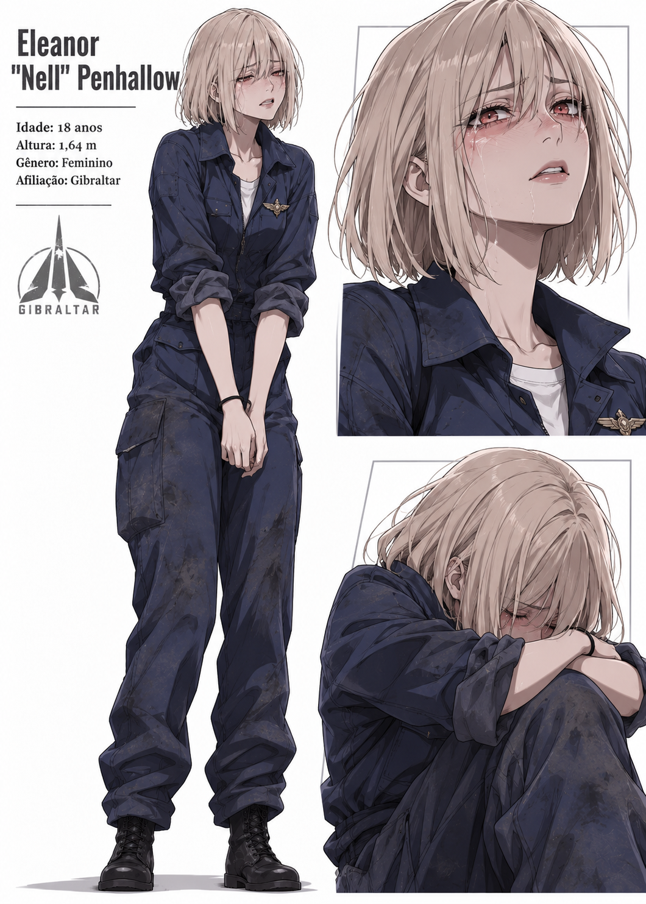

# FICHA DE PERSONAGEM: ELEANOR "NELL" PENHALLOW

*Navegadora da ISS Gibraltar, recém-formada, quinta da turma. Filha de Arthur. Esperou dezoito anos para voar com o pai e descobriu, no terceiro dia, quem ele era.*

*"Nell", para todos. "Eleanor", para André e na lista da tripulação. "Querida", para o pai e para Ros. "A loira", para André na ponte. "A loirinha", para o Júnior.*

> Legenda das categorias: **[CÂNONE]** conferido no Sarna.net ou nos documentos do projeto (fontes no fim) · **[JOGADOR]** definido pelo jogador · **[CAP. 1]** e **[CAP. 2]** estabelecido na narração dos capítulos · **[imagem]** tirado da imagem de referência · **[INVENÇÃO]** criado nesta ficha, e por isso vetável · **[a definir]** fica para o jogador ou para a narrativa.
>
> A imagem mostra Nell chorando, de olhos vermelhos, como ela está no roleplay. A aparência abaixo descreve a moça como ela é no dia a dia; o estado atual está listado à parte. A ficha vai até a noite do pouso em Waycross, onde o Capítulo 2 está.

---

## 1. Identificação

| Campo | Dado |
|---|---|
| Nome | **Eleanor Penhallow**, "Nell" [CAP. 1]. Nome do meio [INVENÇÃO]: Catherine, o da mãe. |
| Como a chamam | "Nell", todos. "Eleanor", André e a lista da tripulação [CAP. 1–2]. "Querida", Arthur e Ros [CAP. 1]. "A loira", André, para os outros [CAP. 2]. "A loirinha", o Júnior [CAP. 2]. |
| Nascimento | 3007, em Elbar [deduzido do CAP. 1: nove anos quando a mãe morreu, em 3017; dezoito em março de 3026]. Dia e mês [INVENÇÃO]: 3 de maio de 3007. |
| Idade | 18 anos [CAP. 1; imagem] |
| Altura e corpo | 1,64 m [imagem]; magra, de ombros estreitos e braços finos; uns 54 kg [INVENÇÃO] |
| Origem | Filha de Arthur e Catherine Penhallow, de Elbar. Criada pela tia Ruth depois dos nove anos [CAP. 1]. |
| Formação | Academia de navegação mercante: entrou aos quinze, com a terceira melhor nota do ano no exame; formou-se aos dezoito, em quinto lugar da turma [CAP. 1]. Onde fica a academia: **[a definir]**; ver o Registro. |
| Função | Navegadora da Gibraltar. Primeira viagem [CAP. 1]. |
| No contrabando | **Não sabia** [CAP. 1]. Tom jurou ao tio que ela nunca saberia [CAP. 1]. Descobriu na ponte, em 27/03/3026 [CAP. 1]. |
| Família | O pai, Arthur [CAP. 1]. A mãe, Catherine, morta em 3017 [CAP. 1]. A tia Ruth, em Elbar [CAP. 1]. Os primos Tom e Harry; Harry morto em 27/03/3026 [CAP. 1]. O tio Edward, morto em 3019 [CAP. 1]. |
| Relação | Namora Liam Ashby há nove meses; decidiu no primeiro dia que ia se casar com ele [CAP. 1]. |
| Armada | Não. Recusou a arma que André ofereceu [CAP. 2]. |
| Onde está na noite do pouso | Na Rocha, com a tripulação, no salão dos oficiais, depois de ter sido tirada do tanque. O Júnior disse ao pai dela que está "louco para conhecer" a "loirinha" [CAP. 2]. |

---

## 2. Aparência

### 2.1 Corpo e rosto
- **Cabelo:** loiro-claro, quase platinado, liso e fino, cortado curto na altura do queixo, com uma franja comprida varrida para o lado. Vive despenteado pelo fone de navegação [CAP. 1; imagem]. Na inversão sem peso, espalhou-se em volta da cabeça dela "como uma coroa" [CAP. 1].
- **Olhos:** azuis, os olhos de Catherine, que o pai nunca conseguiu encarar por muito tempo sem sentir alguma coisa ceder por dentro [CAP. 1]. Grandes, de cílios claros [imagem].
- **Rosto:** oval e delicado, de queixo pequeno, nariz fino e boca cheia [imagem]. Fica corado com facilidade, de riso, de vergonha, de corrida [CAP. 1].
- **Pele:** clara, de quem cresceu numa casa de pedra em clima frio [INVENÇÃO sobre a imagem].
- **Voz:** clara e rápida quando está feliz; fina quando está com medo [CAP. 1–2]. Cantarola sem perceber, baixo e desafinado, a canção de ninar sem letra da mãe [CAP. 1].
- **Postura:** desce escada de dois em dois degraus [CAP. 1]. Senta na cadeira de navegação como quem senta num trono [CAP. 1]. Abraça o pai por trás, com o rosto nas costas dele, como fazia quando era pequena [CAP. 1].
- **Mãos:** finas e rápidas, que contam na tela com o dedo enquanto os lábios se mexem [CAP. 1].
- **Riso:** fácil, alto, de criança. Ri dentro de um beijo [CAP. 1].

### 2.2 Roupa
- **O macacão de oficial da Gibraltar** [CAP. 1; imagem]: azul-marinho, de lona leve, de mangas compridas que ela dobra até o cotovelo, com bolsos cargo nas pernas e camiseta branca por baixo.
- **A insígnia de navegadora** [CAP. 1–2; imagem]: dourada, com asas abertas, costurada no peito por ela mesma na véspera da viagem, nervosa demais para acertar a linha, e por isso torta. Desde a noite da ponte, presa com um alfinete, porque a linha cedeu [CAP. 2; INVENÇÃO quanto ao motivo].
- **No pulso** [imagem]: um elástico de cabelo preto, que ela nunca usa no cabelo curto e não tira [INVENÇÃO quanto ao hábito].
- **Botas:** pretas, de amarrar [imagem].
- **Fora de serviço** [INVENÇÃO]: suéter de lã tricotado pela tia Ruth, grande demais, de mangas que cobrem as mãos.

### 2.3 Estado atual (não faz parte da aparência normal)
- **Olhos vermelhos e inchados** de chorar; olheiras fundas [CAP. 2; imagem].
- **Quatro dias sem dormir** [CAP. 2].
- **O mesmo macacão** desde a noite da ponte [CAP. 2].
- **A mão** queimada de leve pelo chá na primeira madrugada, já curada [CAP. 1].
- **O corpo encolhido**: braços na frente do corpo, mãos juntas, ombros para dentro [imagem]. Recua quando alguém a toca de surpresa, até Liam [CAP. 2].

---

## 3. Cronologia

| Data | Acontecimento |
|---|---|
| Maio de 3007 | Nasce em Elbar, filha de Arthur e Catherine [INVENÇÃO quanto ao mês]. |
| 3007–3016 | Infância com a mãe, que canta para ela uma canção de ninar sem letra. O pai em viagem quase sempre [CAP. 1–2]. |
| 3016 | O pai compra a Gibraltar com as terras da família da mãe [CAP. 1]. |
| Começo de 3017 | A mãe morre na febre que leva meia cidade. Nell tem nove anos. A carta chega ao pai onze dias depois do enterro [CAP. 1]. |
| 3017–3022 | Criada pela tia Ruth numa casa de pedra com cheiro de lã molhada e de pão. Dorme com o rádio ligado na frequência do porto. Decora as classes de DropShip antes da tabuada [CAP. 1–2]. |
| 3019 | O tio Edward morre. Os primos vão para a nave [CAP. 1]. |
| 3020 | [INVENÇÃO] Desenha, num papel de pão, a agulha com asas que vira o emblema dos macacões da tripulação. |
| 3021 | Aos catorze, decide que vai ser navegadora [CAP. 1]. |
| 3022 | Aos quinze, passa no exame da academia de navegação mercante com a terceira melhor nota do ano [CAP. 1]. |
| 3022–3025 | Academia. Enfim, amigas: Imogen, uma ruiva que fuma escondida, e uma menina de Kathil que ronca [CAP. 2]. |
| Junho de 3025 | No baile da cooperativa de grão, conhece Liam. Decide que vai se casar com ele [CAP. 1; INVENÇÃO quanto ao mês]. |
| Agosto de 3025 | Última vez que vê o pai antes da viagem. Liam entra para a segurança da Gibraltar [CAP. 1; INVENÇÃO quanto ao mês, deduzido dos "sete meses"]. |
| Dezembro de 3025 | Forma-se em quinto lugar. Chora na cerimônia porque o pai não está. Ele manda uma mensagem de HPG que custa mais do que pode pagar, dizendo que tem orgulho dela e que o lugar de navegadora a espera [CAP. 1; INVENÇÃO quanto ao mês]. |
| 25/03/3026 | Embarca em Schedar. Primeiro jantar: "Em quinto, pai." [CAP. 1] |
| 26/03/3026 | Tira o cigarro do pai. Pergunta dos pontos fora do zênite. Visita a sala de máquinas com Moss. Inversão sem peso: "Você parece a sua mãe." À noite, a rouparia com Liam [CAP. 1]. |
| 27/03/3026, 1h50 | Primeiro turno sozinha na ponte. Vê uma sombra atrás dela no reflexo da tela. "Foi o velho Ed, então." [CAP. 1] |
| 27/03/3026 | É ela quem vê a Halberd sair da sombra da vela da Bellwether. A vistoria. Harry morto. "Pai, fala para ele que é mentira." Voss. Liam no colo dela [CAP. 1]. |
| 28/03/3026 | A fumaça. Pergunta o nome de André. Implora por Liam. Não olha para o pai. No salto, olha um segundo [CAP. 1]. |
| 28–29/03/3026 | Cena do veneno: a pistola na têmpora dela. "A coisa mais patética que eu já vi." [CAP. 2] |
| 29/03/3026 | O turno com André na ponte. A proposta, a recusa, o abraço [CAP. 2]. |
| Dia do pouso | Catorze minutos com Liam. Navegação no console reserva. "Por que ela está presa?" Recusa a arma. O tanque. A Rocha [CAP. 2]. |

---

## 4. História

### 4.1 Catherine
Nell quase não se lembra do rosto da mãe. Lembra a voz, cantando uma canção de ninar sem letra, a mesma que ela cantarola sem perceber [CAP. 2]. A mãe morreu na febre de 3017, quando Nell tinha nove anos. O pai estava a três saltos, com o porão cheio de trigo, e soube pela carta que chegou onze dias depois do enterro [CAP. 1]. Ele nunca falou daquilo com ela [CAP. 2].

[INVENÇÃO] Ela se lembra de outra coisa, que nunca contou a ninguém: na última semana, a mãe tossia no quarto e pedia que a deixassem cantar para a filha pela porta.

### 4.2 A casa de pedra
Foi criada pela tia Ruth, irmã do pai, numa casa de pedra com cheiro de lã molhada e de pão [CAP. 1]. Dormia com o rádio ligado na frequência do porto, para ouvir as DropShips pedirem pouso, e decorou as classes antes de saber a tabuada: Mule, Union, Leopard, Seeker [CAP. 1–2]. Quando o pai chegava, duas vezes por ano, com presentes demais e tempo de menos, ela se sentava no colo dele, mesmo grande demais para isso, e pedia que ele contasse cada salto, cada ponto de salto, cada estrela, e ele contava com a voz de cascalho até ela dormir [CAP. 1].

Na escola, era a menina que sabia o nome das estrelas e não tinha amigas [CAP. 2].

[INVENÇÃO] Ruth a criou com disciplina e afeto contido: hora para dormir, hora para estudar, tricô no inverno, missa aos domingos. Foi Ruth quem lhe ensinou a costurar, mal, e quem a levou ao baile da cooperativa.

### 4.3 A academia
Aos catorze, decidiu que ia ser navegadora. Aos quinze, passou no exame da academia de navegação mercante com a terceira melhor nota daquele ano [CAP. 1]. Na academia, enfim, teve amigas: uma ruiva chamada Imogen, que fumava escondida, e uma menina de Kathil que roncava [CAP. 2]. Nome da menina de Kathil [INVENÇÃO]: Hester.

Aprendeu ali o que os manuais dizem: que pontos de salto fora do zênite e do nadir são perigosos, que o salto fica menos preciso [CAP. 1]. Aprendeu também a conferir tudo, e nunca desaprendeu: confere a trajetória três, quatro, cinco vezes [CAP. 1].

Formou-se em quinto lugar da turma e chorou na cerimônia porque o pai não estava. Ele estava a dois saltos de distância, com a Gibraltar cheia de minério, e mandou uma mensagem de HPG que custou mais do que podia pagar [CAP. 1].

### 4.4 O baile
Conheceu Liam num baile da cooperativa de grão, numa licença dele em terra [CAP. 1]. Ele dançava mal, pisava no pé dela e pedia desculpa a cada pisão. Ela decidiu, na mesma noite, que ia se casar com aquele rapaz de sorriso torto [CAP. 1]. Dois meses depois, ele entrou para a segurança da Gibraltar e jurou que não tinha sido por causa dela; os dois sabiam a verdade [CAP. 1].

### 4.5 A viagem prometida
O pai tentou adiar a primeira viagem dela, com uma desculpa sobre a época ruim. Ela respondeu que tinha esperado sete meses para vê-lo e dezoito anos para voar com ele [CAP. 1]. Embarcou em Schedar em 25/03/3026 [CAP. 1].

No primeiro jantar, desceu a escada da ponte de dois em dois degraus, rindo de alguma coisa que Ros tinha dito [CAP. 1]:
— A trajetória está perfeita, pai. Perfeita. A Ros disse que eu devia parar de conferir e eu conferi mais três vezes.
— Quatro — corrigiu Ros.
— Quatro. Desculpa.

O pai brindou à navegadora "formada em primeiro lugar da turma". "Em quinto, pai." "Em primeiro do meu coração, o que vale mais que qualquer diploma." [CAP. 1] Liam a beijou na mesa, e o pai lembrou a todos que, na mesa dele, só o garfo da senhora Doyle encostava na boca da filha. Ela deu um tapa no braço dele, rindo e morrendo de vergonha [CAP. 1]. Depois do jantar, abraçou-o por trás no corredor da ponte [CAP. 1].

Na manhã seguinte, tirou o cigarro de entre os dedos dele "como quem tira uma colher da boca de uma criança" e o apagou no cinzeiro de latão. Ele disse a Ros que a filha lhe tinha tirado o último prazer da vida. Ela lhe deu um beijo na bochecha, que cheirava a tabaco e a espuma de barbear [CAP. 1]. Num canto de uma tela, escreveu "pai = melhor capitão do universo", com um coração [CAP. 1].

Perguntou por que o ponto de encontro com a Bellwether ficava fora do nadir, se a academia dizia que era perigoso. Ele deu uma resposta engraçada, e ela pensou que o pai era mais esperto do que a academia, como sempre [CAP. 1].

Visitou a sala de máquinas com Moss, que lhe mostrou o grampo do tio Edward e lhe contou da cicatriz. Na saída, ele disse que o pai dela era um bom homem [CAP. 1]. Na inversão, flutuou pela primeira vez fora de um simulador, rindo como criança, e o pai a segurou pelo tornozelo e ficou sério: "Você parece a sua mãe." [CAP. 1]

À noite, enquanto escovava os dentes, pensou em três coisas que não se encaixavam (a tosse do pai, que estava pior; Tom, que passava tempo demais no porão inferior; a frase de Moss) e as deixou de lado. Depois pensou em Liam e esqueceu as três [CAP. 1]. Encontrou-o na rouparia do quarto convés [CAP. 1].

### 4.6 O fantasma (27/03/3026, 1h50)
Subiu para o primeiro turno sozinha da vida, de banho tomado, cabelo úmido e uma caneca de chá nas mãos, sorrindo para a cadeira vazia de Ros como quem sorri para um trono [CAP. 1]. Cantarolava a canção da mãe e conferia a trajetória pela quinta vez quando viu, no reflexo da tela escura, uma sombra de pé atrás dela. Girou a cadeira, queimou a mão com o chá. Não havia ninguém [CAP. 1].

Chamou o pai. Ele subiu de robe e chinelos, puxou as câmeras: nada. "Eu vi, pai." "Eu sei que viu. Foi o velho Ed, então. Veio conferir se a navegadora nova presta." [CAP. 1] No dia seguinte, a nave inteira tinha uma história de fantasma. Só Nell viu que o pai não acendeu o cigarro o dia inteiro e olhava o próprio reflexo nas telas escuras [CAP. 1].

### 4.7 A Halberd (27/03/3026)
Foi ela quem viu primeiro: "Contato. Saindo de trás da vela da Bellwether, do lado planetário. Estava na sombra da vela." [CAP. 1] Nunca tinha visto o rosto do pai mudar daquele jeito [CAP. 1]. Durante a vistoria, ficou na ponte com Ros e três soldados. Ouviu pelo intercomunicador os tiros que mataram Harry. Ros pôs a mão sobre a dela: "Fica quieta, querida." [CAP. 1]

Quando trouxeram o pai para a ponte, perguntou: "Pai, fala para ele que é mentira." O pai não sustentou o olhar dela por mais de um segundo, e foi o silêncio que contou tudo [CAP. 1]. As três coisas que não se encaixavam se encaixaram de uma vez, com um barulho surdo dentro da cabeça dela [CAP. 1].

O cabo Voss pôs a mão nela. Liam o derrubou e levou a coronhada [CAP. 1]. Ela se jogou no chão e pôs a cabeça dele no colo, e as mãos dela ficaram vermelhas na hora [CAP. 1].

### 4.8 A noite da fumaça
Na fumaça, ouviu os soldados morrerem: o som molhado, o grito, o estalo do pescoço, a voz calma no meio de tudo dizendo "isso, isso" [CAP. 2]. Viu a soldado do crucifixo, morena, magra, muito nova, a única que se levantou, abrir o uniforme com as mãos tremendo, mexer os lábios no pai-nosso, e cair devagar, a um terço do peso, sem cabeça [CAP. 2].

Quando a fumaça foi embora, viu o homem pela segunda vez, parado exatamente onde ela tinha visto a sombra na noite anterior [CAP. 1]. Chorava com o rosto no pescoço de Liam [CAP. 1]. O pai disse "Eu fiz por vocês"; ela não olhou para ele [CAP. 1].

Depois, com a cabeça de Liam no colo e as mãos vermelhas do sangue dele, quebrou a única regra que o homem tinha posto [CAP. 1]:
— Qual é o seu nome?

Ele olhou em volta e respondeu: "Silverseal. André Silverseal." Era a primeira vez que dizia aquele nome em voz alta [CAP. 1]. Ela ficou olhando para ele de boca entreaberta, como quem guarda alguma coisa [CAP. 1]. Quando Liam, com febre, tentou pegar a faca, ela implorou: "Ajuda ele. Ele não vai fazer mais nada. Eu juro. Eu juro pela minha vida." [CAP. 1] No salto, olhou para o pai por um segundo [CAP. 1].

### 4.9 "A coisa mais patética" (28–29/03/3026)
Quando André descobriu que alguém tinha envenenado o chá dele, arrancou-a da fila, longe de Liam, e encostou o cano da M-11 na têmpora dela, por baixo do cabelo, para saber quem tinha sido. Ela não gritou: ficou rígida, de olhos muito abertos, olhando para o pai. Tom disse que tinha sido ele, e não soube dizer onde ficava o armário. No três, Bridget confessou [CAP. 2]. Depois, ele disse à ponte inteira que não sentia nada, e que a loira implorar ou perguntar o nome dele não fazia diferença [CAP. 2]. Ela chorava com o rosto no paletó do pai, que dessa vez ela deixou que a abraçasse. Ele a olhou [CAP. 2]:

— E você é a coisa mais patética que eu já vi na vida. Uma coisa tão fraca não merecia respirar.

Ela parou de chorar "como se alguém tivesse cortado o choro com uma tesoura" [CAP. 2].

### 4.10 O turno (29/03/3026)
No turno dela, André limpou a ponte durante duas horas, de joelhos, fresta por fresta. Ela olhava as mãos dele e não conseguia juntar as duas coisas na cabeça [CAP. 2]. Não disse nada por quase duas horas. Depois [CAP. 2]:

— O Liam. Como ele está?

Ele respondeu como quem lê de uma tela: temperatura, pontos, mingau, sono. "Perguntou por você duas vezes." Nenhum relatório técnico teria aquela linha [CAP. 2].

— Você nunca fala palavrão.
— Eu só falo palavrão quando estou com raiva, com dor ou sentindo prazer.
— E nunca está?
— Eu nunca estou com raiva. Nunca estou com dor. E nunca sinto prazer em nada.

Chorou pelos soldados. Perguntou o que o pai tinha feito, porque ninguém lhe explicava. Ele explicou como num relatório: o primeiro contrato, o controlador de Schedar, o desvio, o tenente que lia os dados brutos. "O seu pai não puxou nenhum gatilho. Mas todos os gatilhos começaram nele." [CAP. 2] Ela chorou alto, vinte minutos, pelos soldados, pelo pai, pela insígnia torta, por Harry, pela soldado do crucifixo [CAP. 2].

Depois falou da vida inteira, porque ele era a única pessoa a bordo que não estava sofrendo: a tia Ruth, o rádio do porto, a mãe, a academia, o baile [CAP. 2]. E viu, de repente, que não havia ninguém atrás dos olhos dele, e entendeu que, quando ele não precisasse mais deles, ia fazer a conta, e a conta ia dar zero [CAP. 2].

Teve nojo de pensar no que pensou, e o medo foi maior que o nojo. Ofereceu-se a ele, inteira, para sempre, em troca da vida de todos [CAP. 2]. Ele se agachou na frente dela e disse: "Meu objetivo atual é apenas sumir." Ela entendeu que ele não a queria, assim como não queria nada [CAP. 2]. E o abraçou, sem decidir, como se agarrava ao pai quando acordava de um pesadelo, porque era a única coisa sólida perto dela [CAP. 2]. Ele ficou rígido como uma viga, sem respirar; depois soltou os braços dela com cuidado e fechou o macacão dela até o pescoço com dois dedos, sem tocar na pele. "O seu turno acabou." Na porta da cabine: "Eu não sei se vai acabar tudo bem. Mas, dependendo do seu pai, todos saem vivos de lá." [CAP. 2]

### 4.11 O pouso
Navegou pior nas duas horas em que não sabia de Liam e melhor nas seis em que sabia. Por isso, André lhe deu quinze minutos com ele antes do pouso [CAP. 2]. Na enfermaria, recuou do toque de Liam ("não é você, eu juro"), contou que não dormia havia quatro dias, que via a moça do crucifixo cair devagar toda vez que fechava os olhos, que tinha perdido a música da mãe. Deixou que ele a abraçasse. Proibiu-o de "achar um jeito". Contou que tinha abraçado André. "Ele não é gente, Liam. Não é que ele seja mau. Mau é gente. Ele é outra coisa." [CAP. 2]

Navegou o pouso no console reserva [CAP. 2]. No planejamento, pôs a mão na perna de Liam por baixo da mesa [CAP. 2]. Viu pela câmera a piloto do Combine, de roxo, entre dois fuzis, e perguntou baixinho: "Por que ela está presa?" Ninguém respondeu [CAP. 2].

No refeitório, olhou para o chão enquanto André falava da fraqueza deles ("A filha gosta do Liam") [CAP. 2]. Não quis arma, e ele não insistiu [CAP. 2]. Na borda do tanque, parou e olhou para André: para a blusa de Harry, para as armas, para o rosto. Não disse nada [CAP. 2]. Os homens do Júnior foram buscar "a loirinha" com educação [CAP. 2].

---

## 5. Formação e capacitação

### 5.1 O que ela sabe fazer
- **Navegar**: trajetórias de queima, vetores, consumo, janelas de inversão, velocidade relativa de encontro, desvios de corredor de pouso [CAP. 1–2].
- **Conferir**: três, quatro, cinco vezes [CAP. 1].
- **DropShips**: sabe as classes de cor desde criança [CAP. 1].
- **Estrelas**: sabe o nome delas desde a escola [CAP. 2].
- **Ver**: viu a sombra no reflexo, viu a Halberd na sombra da vela, viu as três coisas que não se encaixavam [CAP. 1].
- **Rádio de porto**: ouve desde pequena [CAP. 1].
- **Costurar**: mal [CAP. 1].
- **Armas**: nenhuma. Recusou [CAP. 2].

### 5.2 Formação [INVENÇÃO sobre o CAP. 1]
- Três anos e meio de academia de navegação mercante: astronomia, cálculo de trajetória, procedimento de salto, comunicações, regulamento de tráfego, simulador de ponte.
- Estágio de simulador; nenhuma hora real de ponte antes da Gibraltar.

### 5.3 Avaliação por área
Escala do projeto: Verde, Regular, Veterana e Elite (`Economia_3026.md`). Guia de narração, não dado. [INVENÇÃO]

| Área | Nível | Observação |
|---|---|---|
| Navegação (teoria) | Veterana | Quinta da turma [CAP. 1] |
| Navegação (prática) | Verde | Primeira viagem |
| Observação | Veterana | O reflexo, a vela, as três coisas [CAP. 1] |
| Cálculo de cabeça | Veterana | |
| Comunicações | Regular | |
| Combate | Nenhum | |
| Primeiros socorros | Verde | Segurou a cabeça de Liam nove horas sem saber o que fazer [CAP. 1] |

---

## 6. Histórico

| Período | Onde | O quê |
|---|---|---|
| 3013–3021 | Escola de Elbar [INVENÇÃO] | A menina que sabia o nome das estrelas [CAP. 2] |
| 3022–3025 | Academia de navegação mercante | Terceira nota de entrada, quinta da turma [CAP. 1] |
| 25/03/3026–hoje | ISS Gibraltar | Navegadora [CAP. 1] |

---

## 7. Histórico médico

- **Sono:** quatro dias sem dormir, até o pouso [CAP. 2].
- **Flashbacks:** fecha os olhos e vem o barulho da escopeta, e a moça do crucifixo caindo devagar [CAP. 2].
- **A música perdida:** tenta lembrar a canção da mãe e vem o barulho da escopeta no lugar [CAP. 2].
- **Toque:** recua quando alguém a toca de surpresa, até Liam [CAP. 2].
- **Alimentação** [INVENÇÃO]: come pouco desde a noite da ponte.
- **A mão:** queimadura leve de chá, de 27/03, curada [CAP. 1].
- **Antes da viagem** [INVENÇÃO]: saudável; míope leve, corrigida na academia; nenhuma alergia.
- **Dados** [INVENÇÃO]: tipo sanguíneo O negativo.

---

## 8. Mente e personalidade

### 8.1 O núcleo
Nell é uma moça alegre, de riso fácil, que cresceu esperando o pai e conferindo tudo. Em três dias, perdeu a ideia que tinha do pai, o primo que a fazia rir, a música da mãe e o sono, e descobriu que a única coisa sólida perto dela era o homem que tinha feito tudo aquilo.

### 8.2 Antes
Alegre, afobada, carinhosa, um pouco aluna aplicada demais [CAP. 1]. Ama o pai sem reservas e o acha "o melhor capitão do universo" [CAP. 1]. Briga com ele por cigarro e por trajetória e depois confere escondido se ele tinha razão [CAP. 1]. Decide as coisas de uma vez, como casar com Liam [CAP. 1].

### 8.3 Agora
Quebrada, mas não parada. Ainda vê: perguntou por que a piloto do Combine estava presa quando ninguém mais reparou [CAP. 2]. Ainda pergunta: o nome dele, o que o pai fez [CAP. 1–2]. Ainda protege: implorou por Liam, ofereceu-se pela tripulação, proibiu Liam de fazer bobagem [CAP. 1–2].

### 8.4 O pai
Não consegue olhar para ele. Olhou um segundo no salto [CAP. 1]. Deixou que ele a abraçasse com a pistola ainda perto [CAP. 2]. Sabe agora, pela boca de André, o que ele fez e por quê [CAP. 2]. Ainda não sabe o que sente. O amor não acabou; a confiança, sim.

### 8.5 André
Ele não é gente: é outra coisa [CAP. 2]. Ela o achou bonito, e se sentiu mal por isso, "bonito do jeito que uma estátua é bonita… como olhar para uma coisa que imita um rosto" [CAP. 2]. Ele a humilhou ("patética") e, no dia seguinte, recusou o que ela ofereceu e fechou o macacão dela com cuidado [CAP. 2]. Ela acredita que ele não mente [CAP. 2]. E isso, diz ela, é o pior de tudo.

### 8.6 Liam
Ama-o. Recuou do toque dele e não sabe por quê [CAP. 2]. Contou-lhe do abraço, porque não mente para ele [CAP. 2]. Tem medo de que ele faça alguma coisa e morra [CAP. 2].

### 8.7 Coragem
Não tem arma, nem força, nem treino [CAP. 2]. Tem a coragem de perguntar e de oferecer. Quebrou a regra de André diante de todos, com o namorado sangrando no colo [CAP. 1].

### 8.8 O que ela quer
- Dormir.
- Lembrar a música.
- Que todo mundo saia vivo [CAP. 2].
- Casar com Liam [CAP. 1].
- [INVENÇÃO] Navegar. Ainda quer. É a única coisa que não quebrou.

### 8.9 O que ela não faz
- Não pega em arma [CAP. 2].
- Não mente para Liam [CAP. 2].
- [INVENÇÃO] Não deixa de conferir a trajetória, nem agora.

### 8.10 Como reage

| Diante de | Ela |
|---|---|
| Uma trajetória | Confere de novo [CAP. 1] |
| O pai mentindo | Não olha para ele [CAP. 1] |
| Liam em perigo | Implora, jura pela própria vida [CAP. 1] |
| Uma injustiça que ninguém vê | Pergunta baixinho [CAP. 2] |
| Humilhação | O choro corta de uma vez [CAP. 2] |
| Silêncio | Fala, porque o silêncio é pior [CAP. 2] |
| Um toque de surpresa | Recua [CAP. 2] |

---

## 9. Voz e fala

### 9.1 Como ela fala
- Rápido, aos borbotões, quando está nervosa ou feliz [CAP. 1–2].
- "Pai" o tempo todo, antes [CAP. 1]. Agora, quase nunca.
- Pede desculpa por coisas pequenas [CAP. 1].
- Não fala palavrão [INVENÇÃO, a partir do CAP. 2: ela repara que todos falam, menos André; não se inclui].
- Quando está quebrada, frases curtas, roucas, de quem não fala há muito tempo [CAP. 2].

### 9.2 Falas dos capítulos
— A trajetória está perfeita, pai. Perfeita.

— Quatro. Desculpa.

— Em quinto, pai.

— Meu pai não dorme nunca.

— O que foi, pai?

— Olá? Tem alguém aí?

— Eu vi, pai.

— Contato. Saindo de trás da vela da Bellwether, do lado planetário. Estava na sombra da vela.

— Pai, fala para ele que é mentira.

— Qual é o seu nome?

— Por favor. Ajuda ele. Ele não vai fazer mais nada. Eu juro. Eu juro pela minha vida.

— O Liam. Como ele está?

— Você nunca fala palavrão.

— E nunca está?

— Eu tenho uma proposta.

— Eu perdi a música, Liam. Eu não acho mais.

— Ele não é gente, Liam. Não é que ele seja mau. Mau é gente. Ele é outra coisa.

— Por que ela está presa?

### 9.3 Exemplos de voz em situações novas [INVENÇÃO]
Para Ros, de madrugada:

— Você conferia quantas vezes, no começo? — Uma pausa. — Mentira. Ninguém confere só uma.

Para o pai, quando conseguir:

— Eu não sei se eu te perdoo. Eu sei que eu ainda te amo. Eu não sabia que as duas coisas podiam ser verdade ao mesmo tempo.

Para André:

— Eu não tenho medo de você. — A voz treme. — Tenho, sim. Mas eu vou perguntar mesmo assim.

### 9.4 Pensamentos [INVENÇÃO quanto ao conteúdo]
(Vetor estável. Consumo dentro. Confere de novo.)

(Ela caiu devagar.)

(Cantarola. Qualquer coisa. Cantarola.)

---

## 10. Relações

### 10.1 Arthur
O pai, que ela esperou a vida inteira e que mentiu para ela a vida inteira [CAP. 1–2]. Ficha própria: `Arthur_Penhallow.md`.

### 10.2 Liam
O namorado, que ela decidiu que vai ser o marido [CAP. 1]. Ficha própria: `Liam_Ashby.md`.

### 10.3 Ros
A piloto que riu com ela na ponte, segurou a mão dela quando Harry morreu e tentou ensiná-la a parar de conferir [CAP. 1]. Ficha própria: `Ros_Hale.md`.

### 10.4 Moss
O técnico que não sabe dizer não para ela, que lhe contou da cicatriz e lhe disse para lembrar que o pai é um bom homem [CAP. 1]. Ficha própria: `Gareth_Moss.md`.

### 10.5 Tom e Harry
Tom, o primo mais velho, sério, que carrega alguma coisa nas costas o tempo todo [CAP. 1]. Diante da pistola, disse "Fui eu. Solta ela.", sem ter sido ele [CAP. 2]. Harry, o primo que a fazia rir, e por isso irritava Liam [CAP. 1]. Morto [CAP. 1].

### 10.6 Ruth
A tia que a criou [CAP. 1].

### 10.7 André
Ver 8.5. Ele a chama de Eleanor [CAP. 2].

### 10.8 Azami Matsuda
A piloto de roxo, presa, pela qual só Nell perguntou [CAP. 2]. Ficha própria: `Azami_Matsuda.md`.

### 10.9 O Júnior
Quer conhecer a "loirinha", "cabelo curtinho", "uma graça", e disse ao pai dela que talvez vire genro dele [CAP. 2]. Nell ainda não sabe.

---

## 11. Recursos e posses

- O macacão, a insígnia presa com alfinete, as botas, o elástico de cabelo [imagem; CAP. 2].
- O diploma da academia e a mensagem de HPG do pai, guardados na cabine [INVENÇÃO].
- As cartas de Liam [INVENÇÃO].
- O suéter da tia Ruth [INVENÇÃO].
- Salário de navegadora: o primeiro ainda não foi pago [INVENÇÃO].

---

## 12. Estado na noite do pouso

- **Onde:** no salão dos oficiais da Rocha, com a tripulação, tratada "como rei" e vigiada [CAP. 2].
- **Corpo:** exausta, sem dormir há quatro ou cinco dias.
- **Cabeça:** sabe o que o pai fez. Sabe que abraçou André e contou a Liam. Sabe que André disse que todos saem vivos, dependendo do pai. Perguntou pela piloto presa.
- **O que não sabe:** que o Júnior quer conhecê-la; que o pai disse não ao Júnior por ela ("Eu prometi para a minha filha que esta era a última"); que a *Resolute* ataca antes das seis.

---

## 13. Segredos e quem sabe o quê

| Fato | Quem sabe |
|---|---|
| A proposta que fez a André | André [CAP. 2] |
| O abraço | André, Liam [CAP. 2] |
| Que perdeu a música da mãe | Liam, André (pela gravação) [CAP. 2] |
| Que o pai recusou o Júnior por causa dela | Arthur, André, o Júnior [CAP. 2] |
| A tosse da mãe pela porta [INVENÇÃO] | Ninguém |

---

## 14. Vulnerabilidades

1. **O Júnior.** O interesse dele é a ameaça mais próxima.
2. **O cansaço.** Quatro dias sem dormir.
3. **A ponte.** Qualquer arma na cabeça de Nell move o pai, Liam e Tom ao mesmo tempo, e André disse isso em voz alta [CAP. 2].
4. **A fragilidade física.** Nenhum treino, nenhuma arma.
5. **A confiança em André.** Ela acredita que ele não mente.

---

## 15. Orientação ao narrador

- **Duas Nells.** A de antes (riso, escada de dois em dois degraus) e a de agora. A de antes ainda aparece em lampejos.
- **Não reduzir Nell a vítima.** Ela vê o que os outros não veem e pergunta o que os outros não perguntam.
- **A música.** O dia em que ela voltar a lembrar é um marco.
- **A navegação** é o fio de sanidade dela.
- **O pai, Liam e André**: três relações em aberto, nenhuma para resolver depressa.
- **O que fica com o jogador:** o destino dela, o encontro com o Júnior, o que ela faz com André.

---

## 16. Ganchos

1. **O Júnior e a "loirinha".**
2. **A canção da mãe.**
3. **A primeira palavra ao pai** depois da noite da ponte.
4. **Azami.** A pergunta que ninguém respondeu.
5. **A academia.** Imogen e a menina de Kathil, que um dia vão saber o que aconteceu na primeira viagem dela.
6. **O nome.** Foi para ela que André disse pela primeira vez o nome que vai carregar pelo resto da vida [CAP. 1].

---

## 17. Registro

### CÂNONE verificado
| Fato | Fonte |
|---|---|
| Elbar: mundo da Federação a cerca de 15,9 anos-luz de Schedar, na região da Marca Draconis | `Mapa_Regiao_Schedar.md` |
| Kathil: mundo da Marca Capelana, da Federação | sarna.net/wiki/Loren's_Folly; sarna.net/wiki/Kathil_Capellan_March_Militia |
| Mule, Union, Leopard e Seeker: classes de DropShip | registro do Capítulo 1; `Viagem_e_Logistica_Espacial_3026.md` |
| HPG: comunicação interestelar cara | `Viagem_e_Logistica_Espacial_3026.md` |

### Divergências e leituras adotadas
- **Os olhos.** O texto diz azuis, os de Catherine; a imagem os mostra vermelhos, de chorar. Vale o azul.
- **A insígnia.** No Capítulo 1, costurada torta; no Capítulo 2, presa com alfinete. Leitura adotada: a linha cedeu na noite da ponte e ela a prendeu com um alfinete.
- **Datas da formatura e do baile.** O texto diz que ela tinha dezoito anos ao se formar, que esperou sete meses para ver o pai e que conheceu Liam nove meses antes da viagem. Leitura adotada: baile em junho de 3025, última visita do pai em agosto, formatura em dezembro. Com o aniversário em maio, ela já tinha dezoito no baile.
- **Onde fica a academia.** O texto não diz. Pode ser em Elbar, como internato, ou em outro mundo da Marca. Fica a definir.

### INVENÇÃO desta ficha (vetável)
O nome do meio e a data de nascimento; a tosse da mãe pela porta; Ruth no detalhe; o desenho do emblema; o nome Hester; os meses do baile, da visita e da formatura; a linha da insígnia; o elástico e o suéter; a miopia; o tipo sanguíneo; os exemplos de fala; os pensamentos; os ganchos.

### Pendências
- Onde fica a academia.
- O destino dela no ataque da *Resolute*.
