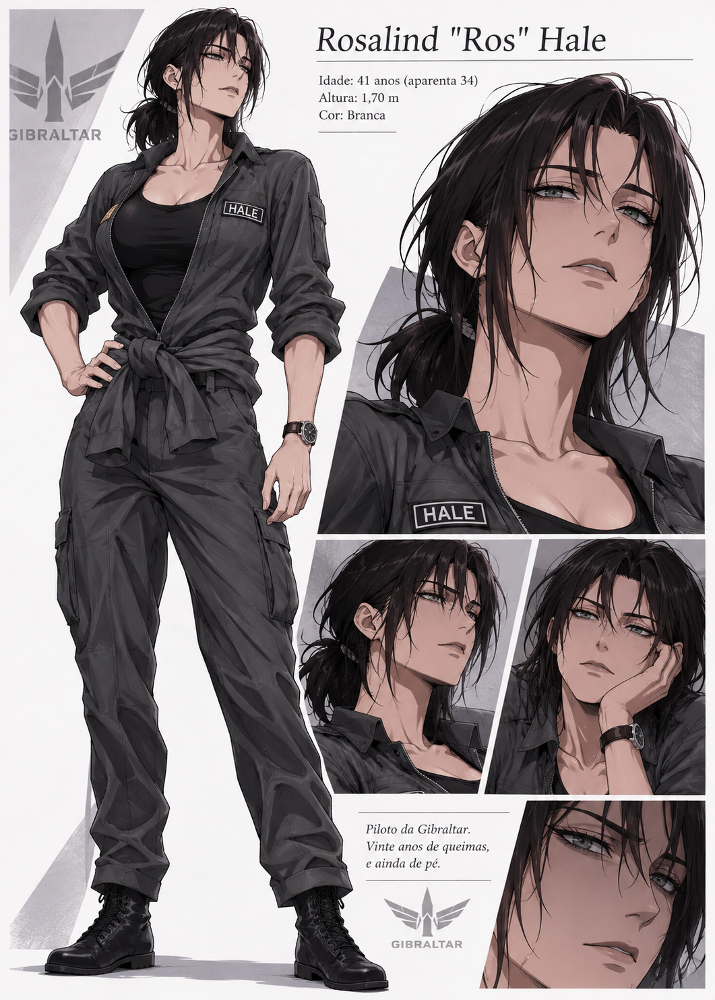

# FICHA DE PERSONAGEM: ROSALIND "ROS" HALE

*Piloto da ISS Gibraltar. Ex-capitã de Union de assalto das AFFS, condecorada. Vinte anos de queimas, e ainda de pé.*

*"Ros", para todos. "Hale", na fita do peito. "A piloto", para o Júnior. "Querida", para ninguém, a não ser Nell.*

> Legenda das categorias: **[CÂNONE]** conferido no Sarna.net ou nos documentos do projeto (fontes no fim) · **[JOGADOR]** definido pelo jogador · **[CAP. 1]** e **[CAP. 2]** estabelecido na narração dos capítulos · **[imagem]** tirado da imagem de referência · **[INVENÇÃO]** criado nesta ficha, e por isso vetável · **[a definir]** fica para o jogador ou para a narrativa.
>
> A ficha vai até a noite do pouso em Waycross, onde o Capítulo 2 está.

---

## 1. Identificação

| Campo | Dado |
|---|---|
| Nome | **Rosalind Hale**, "Ros" [CAP. 1; imagem]. Hale é o sobrenome de solteira, que ela retomou depois do terceiro casamento [INVENÇÃO]. |
| Nascimento | 2984 ou 2985, num mundo de mineração da Marca Capelana [CAP. 2]. Qual mundo: **[a definir]**. Dia e mês [INVENÇÃO]: 3 de agosto de 2984. |
| Idade | 41 anos; aparenta uns 34 [JOGADOR; imagem] |
| Altura e corpo | 1,70 m [imagem]; esguia, firme, "um corpo que aguentou bem três maridos e vinte anos de queimas de alta gravidade" [CAP. 2] |
| Origem | Filha de um capataz de mina que bebia e de uma mãe que rezava [CAP. 2] |
| Serviço militar | AFFS a partir dos dezessete anos. Reprovada no exame de piloto de caça por um décimo de visão; posta em DropShips. Oito anos pilotando uma Union de assalto. Capitã da nave e condecorada por um pouso sob fogo numa lua da fronteira capelana. Deu baixa na semana seguinte [CAP. 2]. |
| Função | Piloto da Gibraltar (copiloto no rol, porque o comandante é Arthur) há dez anos [CAP. 1–2] |
| Família | Três ex-maridos. Um filho de dezenove anos que mora com o pai em New Syrtis e não responde às cartas dela desde os quinze [CAP. 2]. |
| Situação legal | Tripulante de um cargueiro contrabandista. Sabia que Arthur fazia alguma coisa e não perguntou [CAP. 2]. |
| Armada | Uma escopeta curta de bordo, ES-10 Bulkhead, entregue por André; deixada no tanque quando os Tubarões vieram buscá-la [CAP. 2] |
| Onde está na noite do pouso | Na Rocha, levada da Gibraltar pelos homens do Júnior com Nell, Liam e Moss, "com educação", para o salão dos oficiais [CAP. 2] |

---

## 2. Aparência

### 2.1 Corpo e rosto
- **Rosto:** anguloso, de maçãs altas e queixo firme, com rugas de riso nos cantos dos olhos [CAP. 2; imagem]. Bonita, "muito mais do que as mulheres da idade dela costumavam ser nos mundos de onde ela vinha", e sabe disso [CAP. 2].
- **Olhos:** cinza-esverdeados, de pálpebras um pouco caídas, que dão ao olhar um ar de quem acha graça de alguma coisa e não vai dizer o quê [CAP. 2; imagem].
- **Pele:** muito branca, que vinte anos de luz de cockpit não conseguiram queimar [CAP. 2]. No rosto, um leve tom dourado dos refletores [INVENÇÃO sobre o CAP. 2, que fala também de "rosto bronzeado"].
- **Cabelo:** preto, liso e comprido, abaixo dos ombros [JOGADOR; CAP. 2; imagem]. Preso num rabo de cavalo baixo ou num coque baixo para pilotar, com mechas soltando-se em volta do rosto [CAP. 2; imagem]. Uma franja longa, partida de lado, que ela empurra para trás com os dedos.
- **Boca:** lábios cheios, que sobem num canto quando ela acha graça [CAP. 2].
- **Mãos:** de piloto, firmes, de dedos longos. Ela repara nas mãos dos outros [CAP. 2].
- **Voz:** grave e lenta, que sabe baixar meio tom quando quer [CAP. 2].
- **Postura:** relaxada, de quem está em casa. Na cadeira do piloto, meio deitada de lado, com a caneca na mão e os olhos nos instrumentos [CAP. 1]. De pé, mão na cintura, peso numa perna só [imagem]. Encostada na porta, de braços cruzados [CAP. 2].
- **No comando:** o rosto para, como o de quem está inteiramente em outro lugar [CAP. 2].

### 2.2 Roupa
- **Macacão** [imagem]: cinza-chumbo, de tecido de oficina, com a fita "HALE" bordada no peito. Usa aberto até a cintura, com as mangas da parte de cima amarradas em volta do quadril, por cima de uma regata preta. Mangas dobradas, quando veste a parte de cima. Bolsos cargo nas pernas.
- **Botas:** pretas, de cano médio, de amarrar [imagem].
- **Relógio:** de pulseira de couro marrom, no pulso esquerdo [imagem]. [INVENÇÃO] É um relógio de piloto das AFFS, de mostrador simples, o único objeto da farda que ela guardou.
- **A caneca:** de esmalte azul lascado, que voou com ela por três naves. Ela não tomava chá na xícara de ninguém [CAP. 1]. Atirou-a contra a antepara no turno com André, e a caneca se espatifou [CAP. 2].
- **Uma corrente fina no pescoço** [imagem; INVENÇÃO quanto ao pingente]: com uma medalhinha de santo que a mãe lhe deu quando ela entrou nas AFFS. Ela não reza. Não tira.

### 2.3 Marcas
Nenhuma cicatriz visível. O que vinte anos de queimas deixaram está nas costas e nos joelhos [INVENÇÃO, ver o histórico médico].

---

## 3. Cronologia

| Data | Acontecimento |
|---|---|
| 2984 | Nasce num mundo de mineração da Marca Capelana [CAP. 2]. |
| 3001 (17 anos) | Entra nas AFFS para sair de casa [CAP. 2]. |
| ~3002 | Reprova no exame de visão para piloto de caça por um décimo; vai para a escola de DropShips [CAP. 2; INVENÇÃO quanto à data]. |
| ~3002–3010 | Oito anos pilotando uma Union de assalto, levando 'Mechs e soldados para mundos onde muitos morriam [CAP. 2]. |
| ~3003 | Primeiro casamento, com um MechWarrior das AFFS, que a trai [CAP. 2; INVENÇÃO quanto à data]. |
| ~3005 | O primeiro marido morre num duelo bêbado por uma mulher que nem era a dela [CAP. 2]. |
| ~3006 | Segundo casamento, com um contador de New Syrtis [CAP. 2; INVENÇÃO quanto à data]. |
| 3007 | Nasce o filho [CAP. 2: tem dezenove anos em 3026]. |
| ~3010 (25 ou 26 anos) | O pouso na lua da fronteira capelana, com o porão quatro atingido. A medalha. A medalha na privada. A baixa [CAP. 2; INVENÇÃO quanto à data]. Desde os vinte e cinco anos, não dorme oito horas seguidas [CAP. 2]. |
| ~3011 | Deixa o contador, porque a gentileza dele a entediava até as lágrimas. O filho fica com o pai [CAP. 2; INVENÇÃO quanto à data]. |
| ~3011–3016 | Pilotagem civil de frete, sem rumo [INVENÇÃO]. |
| ~3013–3015 | Terceiro casamento, com um comerciante de peças, que some com as economias dela numa noite de chuva [CAP. 2; INVENÇÃO quanto à data]. |
| 3016 | Entra na Gibraltar. Arthur é o único capitão que não pergunta por que uma piloto de assalto condecorada quer pilotar trigo [CAP. 2]. |
| 3022 | O filho, com quinze anos, para de responder às cartas [CAP. 2]. Começa o contrabando de Arthur, que ela percebe e prefere não ver [CAP. 2]. |
| 25–28/03/3026 | A viagem, a Halberd, a noite da ponte. Às 4h16 do dia 28, é a única que vê, no radar, o clarão da Halberd explodindo [CAP. 1]. |
| 29/03/3026 | O turno com André: ensina-o a pilotar uma Mule em três horas, conta a vida, atira a caneca [CAP. 2]. |
| Dia do pouso | Pilota o pouso em Waycross. Fica na Gibraltar, escondida no reservatório quatro, pronta para decolar em sessenta segundos; os Tubarões a encontram e a levam [CAP. 2]. |

---

## 4. História

### 4.1 A mina
Nasceu num mundo de mineração da Marca Capelana, filha de um capataz que bebia e de uma mãe que rezava [CAP. 2]. A Marca Capelana é a província da Federação na fronteira com a Confederação Capelana, governada pela Casa Hasek a partir de New Syrtis [CÂNONE].

[INVENÇÃO] A casa ficava numa vila de barracos de chapa ao pé de uma mina a céu aberto. O pai voltava do turno com pó de minério nos pulmões e uísque de batata no sangue; a mãe rezava o terço na cozinha e mandava a filha rezar junto. Ros ia para o alto do morro ver as DropShips de minério decolarem, e descobriu cedo que a única saída daquele mundo passava por uma cabine.

### 4.2 As AFFS
Entrou nas AFFS aos dezessete, para sair de lá [CAP. 2]. Queria ser piloto de caça. O exame de visão a reprovou por um décimo, e a puseram em DropShips [CAP. 2].

Pilotou uma Union de assalto durante oito anos, levando 'Mechs e soldados para mundos onde muitos deles morriam. Aprendeu a pousar debaixo de fogo, com os alarmes gritando, o casco tremendo e a voz do comandante da companhia no ouvido perguntando se ia demorar [CAP. 2]. A Union é a DropShip padrão das companhias de 'Mechs: leva doze 'Mechs e dois caças [CÂNONE]. Chegou a capitã da nave [CAP. 2, segundo o Júnior].

### 4.3 O porão quatro
Num desses pousos, numa lua da fronteira capelana cujo nome ela não diz, um míssil atravessou o porão quatro da Union com a companhia ainda presa nos berços. Ela pousou assim mesmo, porque era o trabalho dela pousar, e ouviu pelo intercomunicador o que estava acontecendo no porão enquanto pousava [CAP. 2].

Ganhou uma medalha por aquele pouso. Jogou a medalha numa privada de porto na semana seguinte e pediu baixa [CAP. 2]. Desde os vinte e cinco anos, não dorme oito horas seguidas [CAP. 2].

### 4.4 Três maridos e um filho
- **O primeiro**, um MechWarrior das AFFS, bonito e barulhento, que a traiu com metade da academia e morreu dois anos depois, num duelo bêbado por uma mulher que nem era a dela [CAP. 2].
- **O segundo**, um contador de New Syrtis, gentil e calmo, que ela deixou porque a gentileza dele a entediava até as lágrimas, e com quem teve um filho [CAP. 2]. É "um homem bom e chato" [CAP. 2]. Nome [INVENÇÃO]: Edwin Marsh.
- **O terceiro**, um comerciante de peças que a roubou e sumiu com as economias dela numa noite de chuva [CAP. 2].

**O filho** [CAP. 2]: tem dezenove anos e mora com o pai em New Syrtis. Não responde às cartas dela desde os quinze. Ela manda uma por mês, mesmo assim. Nome [INVENÇÃO]: Daniel Marsh. [INVENÇÃO] Ela o deixou com o pai aos quatro anos, quando foi embora, e não sabe dizer a si mesma se foi o certo; acha que sim, e nunca se perdoou.

### 4.5 A Gibraltar
Entrou na Gibraltar dez anos antes porque Arthur Penhallow foi o único capitão que não perguntou por que uma piloto de assalto condecorada queria pilotar um cargueiro de trigo numa rota que nenhum piloto decente aceitaria. E porque a rota era chata. Ela queria uma coisa chata, depois de tudo: trigo, água e minério, sempre o mesmo céu e a mesma poeira, sem nada que gritasse [CAP. 2].

Pilotou a nave por dez anos [CAP. 1]. Arthur nunca deixou ninguém limpar a ponte direito, porque "sujeira de nave é história" [CAP. 2]. Ela ri das promessas dele: "Você tem uns trinta outros prazeres, Arthur. Todos piores que o cigarro." [CAP. 1]

### 4.6 O que ela sabia
Sabia. Cinco anos. Via os desvios de rota nos números que pilotava; via Tom e Moss descendo ao porão de madrugada; via o envelope que ia para Schedar todo mês. Não perguntou, porque queria a rota chata, e porque, se soubesse, teria de fazer alguma coisa, e ela não queria fazer mais nada na vida [CAP. 2]. "Então eu fechei os olhos, e o Harry morreu." [CAP. 2]

### 4.7 A Halberd e a noite da ponte
Durante a inspeção, ficou na cadeira do piloto, muito quieta, com as mãos nos joelhos. Quando os tiros que mataram Harry vieram pelo intercomunicador, pôs a mão sobre a de Nell e apertou: "Fica quieta, querida. Fica quieta e não se mexe." [CAP. 1]

Na fumaça, ouviu a ponte morrer como ouvira o porão quatro da Union vinte anos antes [CAP. 2]. Depois, quando o rapaz saiu, foi a primeira a acusar Arthur em voz alta: "Assim como não sabia das armas? Do 'Mech? Do reservatório quatro? … Dez anos, Arthur… Armas de guerra? Um 'Mech? Com a sua filha a bordo?… O Harry morreu, Arthur." [CAP. 1]

Às 4h16, sentada no chão diante do console, foi a única que viu o clarão da Halberd no radar de longo alcance. Olhou para o rapaz. Não disse nada. Ele também não [CAP. 1]. Respondeu às perguntas dele certo, sem olhar para ele: três dias de queima até Waycross, num ponto que Odell conhece [CAP. 1].

### 4.8 O turno (29/03/3026)
Passou a noite trancada planejando um sorriso e uma estratégia: continuar necessária e, se desse, passar de necessária a outra coisa [CAP. 2]. Tinha visto antes de todos que o rapaz era jovem demais, mais do que o rosto dizia, "talvez vinte, talvez menos" [CAP. 2].

Na ponte limpa, sentou na cadeira que era dela havia dez anos. Puxou conversa pelo que era seguro, elogiou o trabalho dele, ofereceu uma omelete que ele nunca ia esquecer. "Você tem mãos de piloto. Já pilotou?" "Não uma DropShip." "Quer aprender?" "Quero." [CAP. 2] Entendeu na hora, com uma pontada fria, que cada coisa que ensinasse era uma razão a menos para mantê-la viva. Ensinou assim mesmo, por orgulho de piloto, porque recusar era pior, e porque, pela primeira vez, ele tinha olhado para ela como se ela tivesse alguma coisa que ele queria [CAP. 2]. Em duas horas, ele sabia mais sobre pilotar uma Mule do que ela sabia depois de um ano de academia [CAP. 2]. Ela contou que a atracação de Arthur na Bellwether, com a pistola na nuca, foi a coisa mais bonita que já viu um piloto fazer [CAP. 2].

Depois, ele ficou imóvel por quatro horas. Ela tentou tudo: piadas de piloto, comida, mundos bonitos (as auroras de Mallory's World, os desfiladeiros de New Rhodes, as praias de New Syrtis), um toque no braço, o elogio da beleza dele [CAP. 2]. Nada. Então contou: a mina, as AFFS, o porão quatro, a medalha, os maridos, o filho, a Gibraltar [CAP. 2]. E arrebentou: "Você fica aí parado como uma porra de uma estátua!" Atirou a caneca de esmalte azul contra a antepara, a dois metros da cabeça dele [CAP. 2]. Tremeu. Disse a verdade: que sabia, que fechou os olhos, que ouvia de novo o porão quatro, e que estava ali, aos quarenta e um anos, "tentando seduzir um menino que matou quarenta pessoas", ela que tem um filho da idade dele [CAP. 2].

"Era a minha caneca preferida." Riu. "De todos os homens que eu conheci na minha vida inteira, você é o único que me ouviu até o fim." "Você não tinha terminado." "Agora terminei, garoto." [CAP. 2] Ele varreu os cacos. Ela não soube o que sentir.

Arthur a viu voltar daquele turno rindo e chorando ao mesmo tempo, coisa que nunca tinha visto em dez anos [CAP. 2].

### 4.9 O pouso em Waycross
Pilotou a descida como André nunca tinha visto ninguém pilotar uma máquina: sem brigar com a nave, corrigindo antes que a Mule puxasse para bombordo, numa coluna de ar que só ela via, desligando os alarmes âmbar sem olhar, "como quem enxota moscas" [CAP. 2]. Perguntou a ele o que viria depois. Ele disse que o depois dele era dele e o deles não era da conta dele. "É a primeira coisa sobre o futuro que alguém me diz nesta nave sem mentir… É um alívio." [CAP. 2] Disse o que faria com a vida: ir a New Syrtis, bater na porta do ex-marido e pedir para ver o filho; voltar no dia seguinte, se a porta fechasse. "Então vá." "Você fala como se fosse simples." "Não falei que é simples. Falei que você deve ir." "E você? Não tem uma porta em que bater?" Ele não respondeu [CAP. 2].

"Toque. Motor cortado. Reator em espera." [CAP. 2]

No porão, viu a piloto do Combine pela câmera: "Ela é do Combine. Olha a postura. Olha a voz. Academia do Dragão. Eu matei gente que falava desse jeito." "Ela também." [CAP. 2] Olhando a disciplina dos carregadores dos Tubarões: "Eu achei que pirata era bagunça." [CAP. 2]

No refeitório, quando André perguntou se ela decolava em noventa segundos, cruzou os braços: "Em sessenta. Se alguém soltar as travas da plataforma por fora." [CAP. 2] Às 13h25, desceu ao reservatório quatro com Nell, Liam e Moss e se escondeu atrás da placa de isolamento [CAP. 2]. O Júnior soube que eles estavam lá pelo manifesto e pelo reator em espera quente, e os mandou buscar com educação: "A piloto, o técnico, o namoradinho e a loirinha." [CAP. 2] O Júnior sabe quem ela é: "aquela que era capitã de Union de assalto nas AFFS e ganhou medalha" [CAP. 2].

---

## 5. Formação e capacitação

### 5.1 O que ela sabe fazer
- **Pilotar DropShips** como poucos na Esfera Interna: pouso sob fogo, pouso de precisão, entrada atmosférica, aproximação, atracação em colar, inversão [CAP. 2].
- **Conhecer a Gibraltar** como o próprio corpo: a Mule responde devagar e depois de repente, e puxa para a esquerda com peso no porão de bombordo [CAP. 2].
- **Decolar em sessenta segundos** com o reator em espera quente e as travas soltas [CAP. 2].
- **Ensinar.** Em três horas, fez de André um piloto de Mule [CAP. 2].
- **Ler homens** e usar o que tem "como usava os comandos de uma nave: pouco, na hora certa, sem nunca deixar perceber que estava pilotando" [CAP. 2].
- **Cozinhar** uma omelete inesquecível, segundo ela [CAP. 2].
- **Atirar** com o que as AFFS ensinam a qualquer tripulante: pistola e escopeta [INVENÇÃO].

### 5.2 Formação [INVENÇÃO sobre o CAP. 2]
- Escola de pilotos das AFFS, curso de DropShip, depois de reprovada no de caça.
- Oito anos de voo de combate em Union de assalto, com pousos sob fogo.
- Instrutora informal de copilotos novos nos últimos dois anos de serviço.

### 5.3 Avaliação por área
Escala do projeto: Verde, Regular, Veterana e Elite (`Economia_3026.md`). Guia de narração, não dado. [INVENÇÃO]

| Área | Nível | Observação |
|---|---|---|
| Pilotagem de DropShip | **Elite** | |
| Pouso sob fogo | **Elite** | Condecorada [CAP. 2] |
| Ensino de pilotagem | Veterana | |
| Leitura de pessoas | Veterana | Viu antes de todos que André era jovem demais [CAP. 2] |
| Sedução como ferramenta | Veterana | Não funcionou com André [CAP. 2] |
| Navegação | Veterana | Ensinou Nell a parar de conferir [CAP. 1] |
| Pistola e escopeta | Regular | |
| Combate de 'Mech | Nenhum | Só os leva |
| Caças aeroespaciais | Verde | Nunca pôde |

---

## 6. Histórico de serviço

| Período | Onde | Função | Como terminou |
|---|---|---|---|
| 3001–3010 | AFFS | Piloto de DropShip; oito anos em Union de assalto; capitã da nave [CAP. 2] | Medalha jogada fora; baixa a pedido [CAP. 2] |
| 3010–3016 | Frete civil | Piloto de aluguel [INVENÇÃO] | A Gibraltar |
| 3016–hoje | ISS Gibraltar | Piloto (copiloto no rol) [CAP. 1–2] | Em curso |

A unidade das AFFS e o nome da Union: **[a definir]**.

---

## 7. Histórico médico

- **Sono.** Não dorme oito horas seguidas desde os vinte e cinco anos [CAP. 2].
- **O porão quatro.** Ouvir gente morrer pelo intercomunicador é o pior gatilho dela. A noite da ponte o reativou: "Vinte anos depois, a mesma porra de coisa." [CAP. 2]
- **Visão.** Um décimo abaixo do exigido para piloto de caça, a vida inteira [CAP. 2]. Usa óculos para ler as letras pequenas da carta, e não deixa ninguém ver [INVENÇÃO].
- **Coluna e joelhos** [INVENÇÃO]: vinte anos de alta gravidade nas costas. Dor lombar quando chove; um joelho que estala.
- **Bebida** [INVENÇÃO]: bebe socialmente, com moderação; nunca antes de voar.
- **Estado na noite do pouso:** ilesa [CAP. 1–2], cansada, com o tremor do turno de 29/03 já passado.
- **Dados** [INVENÇÃO]: tipo sanguíneo A negativo; nenhuma alergia; nenhuma medicação.

---

## 8. Mente e personalidade

### 8.1 O núcleo
Ros pilota a própria vida como pilota uma nave: pouco, na hora certa, sem deixar perceber que está pilotando [CAP. 2]. Por baixo do controle, há uma mulher cansada que fugiu para uma rota chata porque não aguentava mais ouvir gente morrer, e que acabou ouvindo de novo.

### 8.2 Ironia
Responde a tudo com uma frase seca e um canto da boca subindo [CAP. 1–2]. "Quatro", quando Nell diz que conferiu três vezes [CAP. 1]. A ironia é a cadeira de piloto dela: lugar onde se sente segura.

### 8.3 A culpa
Fechou os olhos por cinco anos para ter paz e pagou com o Harry, com o menino da Milícia e com a moça do crucifixo [CAP. 2]. Não se perdoa e não se esconde mais: foi a primeira a acusar Arthur [CAP. 1].

### 8.4 Sedução como ferramenta
Sabe o efeito que tem num homem e o usa com parcimônia [CAP. 2]. Com André, usou e falhou, e a falha a fez se ver de fora: "Olha só a que eu cheguei." [CAP. 2] Não tem vergonha do corpo; tem vergonha de precisar usá-lo.

### 8.5 A mãe ausente
O filho é a ferida maior. Uma carta por mês, sem resposta, há quatro anos [CAP. 2]. O sonho dela não tem nada de grandioso: bater numa porta em New Syrtis [CAP. 2].

### 8.6 Com Nell
Protetora, quase materna: "Fica quieta, querida." [CAP. 1] Ri com ela na ponte [CAP. 1]. Nell desceu a escada rindo de alguma coisa que Ros disse [CAP. 1].

### 8.7 Com André
Viu o menino antes de ver o monstro [CAP. 2]. Ele foi o único homem que a ouviu até o fim, e ela não sabe o que fazer com isso [CAP. 2]. Ele lhe disse "então vá". Ela não sabe se vai.

### 8.8 O que ela quer
- Ver o filho [CAP. 2].
- Uma rota chata, sem nada que grite [CAP. 2].
- Dormir oito horas.
- Uma caneca nova [INVENÇÃO].

### 8.9 O que ela não faz [INVENÇÃO]
- Não larga os comandos no meio de um pouso, aconteça o que acontecer no porão.
- Não mente para quem não mente para ela.
- Não pede desculpas pela vida que levou.

### 8.10 Como reage

| Diante de | Ela |
|---|---|
| Perigo em voo | Fica calma, enxota os alarmes, pilota [CAP. 2] |
| Gente morrendo longe, ouvida pelo rádio | Desmorona por dentro [CAP. 2] |
| Uma mentira | Ironia, e depois a acusação [CAP. 1] |
| A verdade, mesmo dura | Alívio [CAP. 2] |
| Um menino perigoso | Primeiro tenta pilotá-lo; depois fala com ele como mãe [CAP. 2] |
| Nell com medo | Mão sobre a mão dela [CAP. 1] |

---

## 9. Voz e fala

### 9.1 Como ela fala
- Grave e lenta. Baixa meio tom quando quer [CAP. 2].
- Frases curtas e secas no trabalho; longas, de contadora de histórias, quando decide contar.
- Chama André de "garoto" [CAP. 2]. Chama Nell de "querida" [CAP. 1].
- Palavrão quando a cadeira de piloto não está debaixo dela [CAP. 2].

### 9.2 Falas dos capítulos
— Quatro.

— Você tem uns trinta outros prazeres, Arthur. Todos piores que o cigarro.

— Fica quieta, querida. Fica quieta e não se mexe.

— Dez anos, Arthur. Dez anos eu pilotei esta nave.

— Você tem mãos de piloto. Sabia?

— Quer aprender?

— Era a minha caneca preferida.

— Agora terminei, garoto.

— Sabe que isso é quase reconfortante?

— Em sessenta. Se alguém soltar as travas da plataforma por fora.

— Ela é do Combine. Olha a postura. Olha a voz. Academia do Dragão. Eu matei gente que falava desse jeito.

— Toque. Motor cortado. Reator em espera.

### 9.3 Exemplos de voz em situações novas [INVENÇÃO]
Para um piloto das AFFS:

— Union de assalto, oito anos. Não, eu não sinto falta. Sim, eu ainda pouso melhor que você.

Para Nell, numa madrugada de turno:

— Para de conferir, querida. A nave não muda de ideia se você olhar mais uma vez. Eu juro, eu já tentei.

Sobre o filho:

— Uma carta por mês. Se ele um dia abrir a gaveta, vai achar quarenta e oito. Isso é o que eu tenho para mostrar.

### 9.4 Pensamentos [INVENÇÃO quanto ao conteúdo]
(Continua necessária. Depois, outra coisa.)

(Puxa para bombordo. Corrige antes.)

(O porão quatro de novo. Não. Pilota.)

---

## 10. Relações

### 10.1 Arthur
Dez anos de cadeira lado a lado. Ele foi o único capitão que não perguntou nada [CAP. 2]. Ela sabia e não perguntou de volta [CAP. 2]. Agora o acusa, e ainda acha a atracação dele na Bellwether a coisa mais bonita que já viu [CAP. 1–2]. Ficha própria: `Arthur_Penhallow.md`.

### 10.2 Nell
Ensinou-a a parar de conferir a trajetória, sem sucesso [CAP. 1]. Segurou a mão dela quando Harry morreu [CAP. 1]. Divide o console com ela desde que o de Nell foi destruído [CAP. 1–2]. Ficha própria: `Nell_Penhallow.md`.

### 10.3 Moss
Os dois ex-AFFS da nave. Ela o via descer ao porão de madrugada [CAP. 2]. No refeitório, ela decola em sessenta "se o Moss soltar as travas" [CAP. 2]. Ficha própria: `Gareth_Moss.md`. [INVENÇÃO] Respeitam-se em silêncio; nunca falaram da guerra um com o outro.

### 10.4 Liam
O menino de Nell. Ela acha graça do ciúme dele [INVENÇÃO]. Ficha própria: `Liam_Ashby.md`.

### 10.5 André ("o garoto")
Tentou pilotá-lo, falhou, desabou na frente dele, foi ouvida até o fim [CAP. 2]. Ensinou-o a pilotar uma Mule [CAP. 2]. Ele lhe disse para ir a New Syrtis [CAP. 2]. É a pessoa a bordo que mais o entende como um menino e menos o teme como um monstro, e mesmo assim sabe que ele é as duas coisas.

### 10.6 Os outros
- **Bridget**: dez anos de cozinha e de rixa sobre quem sabe mexer numa panela [CAP. 2].
- **Tom, Crane e os demais**: colegas de dez anos.
- **O Júnior**: sabe da medalha dela e a mandou buscar [CAP. 2].
- **O filho e os ex-maridos**: ver 4.4.

---

## 11. Recursos e posses

- O macacão, o relógio, as botas, a corrente com a medalhinha [imagem; INVENÇÃO quanto à medalhinha].
- A escopeta Bulkhead deixada no tanque [CAP. 2].
- Na cabine da Gibraltar [INVENÇÃO]: as cartas ao filho que voltaram sem ser abertas, e as que ela não chegou a mandar; uma foto do filho aos quatro anos.
- Salário da Gibraltar. Economias: as que o terceiro marido deixou, isto é, poucas [CAP. 2].

---

## 12. Estado na noite do pouso

- **Onde:** na Rocha, no salão dos oficiais, com a tripulação da Gibraltar, tratada "como rei" e vigiada [CAP. 2].
- **Corpo:** ilesa, cansada.
- **Cabeça:** sabe que os Tubarões sabem quem ela é; sabe que a nave estava pronta para fugir e que a fuga foi descoberta; disse ao garoto o que faria com a vida.
- **O que não sabe:** que a *Resolute* está em órbita, que o ataque vem antes das seis e que, entre as AFFS, ainda pode haver quem se lembre do pouso da lua capelana.

---

## 13. Segredos e quem sabe o quê

| Fato | Quem sabe |
|---|---|
| Sabia do contrabando e não perguntou | André; agora, ela disse em voz alta [CAP. 2] |
| O porão quatro da Union | André; nem Arthur sabe metade [CAP. 2] |
| A medalha na privada | André |
| O filho que não responde | André |
| A tentativa de seduzir André | André |
| A medalha e o posto nas AFFS | O Júnior [CAP. 2] |

---

## 14. Vulnerabilidades

1. **O porão quatro.** Gente morrendo pelo rádio a desmonta.
2. **O filho.** Uma notícia dele a faria largar tudo.
3. **A culpa** pelos cinco anos de olhos fechados.
4. **O cansaço.** Quarenta e um anos, insônia, vinte anos de queima.
5. **A fama.** Uma piloto de assalto condecorada é útil demais para piratas e reconhecível demais para as AFFS.

---

## 15. Orientação ao narrador

- **Nos comandos**, Ros é perfeita, e a narração deve mostrar isso com precisão técnica: correções antes do desvio, alarmes enxotados, números ditos com calma.
- **Fora dos comandos**, é uma mulher cansada e engraçada, que usa a ironia como cinto de segurança.
- **Não reduzir Ros à sedutora.** A sedução foi uma ferramenta de sobrevivência que falhou e a fez enxergar a si mesma. Ela é antes de tudo piloto e mãe.
- **O filho é o fio dela.** New Syrtis é o destino que ela disse em voz alta.
- **Com André**, uma relação de quase mãe e de igual na cabine. Ela o chama de "garoto".
- **O cabelo é preto.** As primeiras passagens dos capítulos o chamam de grisalho; vale o preto (ver o Registro).
- **O que fica com o jogador:** o mundo natal, a unidade das AFFS, o destino dela no ataque.

---

## 16. Ganchos

1. **New Syrtis.** A porta do ex-marido, o filho de dezenove anos.
2. **As AFFS.** Quem estava no porão quatro, quem lhe deu a medalha, quem se lembra dela.
3. **A Gibraltar sem Ros.** Ela é a única que decola em sessenta segundos.
4. **André piloto.** Ela o ensinou; um dia ele vai pilotar sem ela.
5. **A lua capelana** cujo nome ela não diz.
6. **A caneca.** Alguém vai lhe dar uma nova, e isso vai significar alguma coisa.

---

## 17. Registro

### CÂNONE verificado
| Fato | Fonte |
|---|---|
| New Syrtis: capital da Marca Capelana; da Federação em 3025 | sarna.net/wiki/Copplin (página de New Syrtis) |
| A Marca Capelana é tradicionalmente o feudo da Casa Hasek, cujo líder é Duque de New Syrtis; Michael Hasek-Davion é duque de 3013 a 3029 | cfw.sarna.net/wiki/Capellan_March; cfw.sarna.net/wiki/Prince_of_the_Capellan_March |
| Union: DropShip de 3.600 t, padrão das companhias de 'Mechs, leva 12 'Mechs e 2 caças | `Viagem_e_Logistica_Espacial_3026.md` |
| Mule: nave civil esferoide de cerca de 8.500 t de carga | registro do Capítulo 1 |
| Mallory's World, fortaleza da Marca Draconis | `Estado_do_Universo_Marco_3026.md` |
| ES-10 Bulkhead | `Armas_e_Equipamento_de_Infantaria.md` (arsenal do projeto) |

### Divergências e leituras adotadas
- **Cabelo.** O Capítulo 1 e o começo do Capítulo 2 descrevem Ros com "cabelo grisalho preso num coque". O jogador definiu cabelo todo preto, a imagem confirma, e o próprio Capítulo 2, no pouso, já diz "cabelo preto preso num coque baixo". Vale o preto.
- **Pele.** O Capítulo 2 diz "rosto bronzeado de quem passou a vida debaixo de luz de cockpit" e, depois, "pele muito branca, que vinte anos de luz de cockpit não tinham conseguido queimar". Leitura adotada: pele branca, com um leve tom dourado no rosto.
- **Copiloto ou piloto.** O rol a chama de copiloto, porque o comandante é Arthur; na prática, é a piloto da nave, e a imagem a chama assim.

### INVENÇÃO desta ficha (vetável)
O sobrenome de solteira; a data de nascimento; a vila da mina; as datas dos casamentos e da baixa; os nomes do segundo marido e do filho; o filho deixado aos quatro anos; a pilotagem civil entre 3010 e 3016; o relógio e a medalhinha; os óculos de leitura; a coluna e o joelho; o tipo sanguíneo; as cartas devolvidas; os exemplos de fala; os pensamentos; os ganchos.

### Pendências
- O mundo natal na Marca Capelana.
- A unidade das AFFS e o nome da Union.
- A lua do pouso.
- O destino dela no ataque da *Resolute*.
